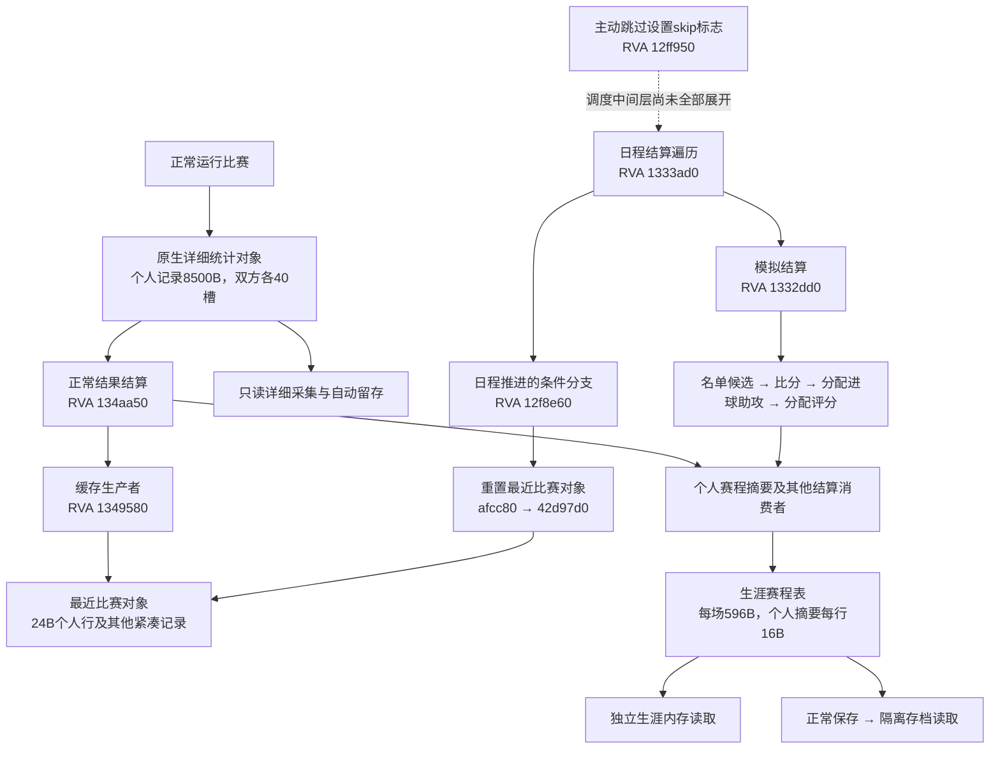

# D1：PES2021 数据流架构与采集边界

2026-10-23 D2：已完成指定构建、专用测试生涯的[映射与受控导入](./completed/D_D2_映射与受控导入.md)。真实原生样本向独立 actual 仓库导入6条观察（25项能力、2条个人比赛、3条生涯事件），复读6条均为 DUPLICATE；142项适配器与13项A导入/仓库测试通过。采用明确审阅的本地绑定和事件身份，D2.1/D2.2 在此范围验收；[快速跳过完整动作统计](./D2_PES2021_快速跳过动作统计复核_2026-10-23.md)仍未取得。

以下保留之前轮次的接口与历史结论。

2026-10-22 收尾：[D1 独立采集验收](./completed/D_D1_独立采集验证.md)已完成 D1.1/D1.2，范围为指定构建与专用测试生涯，使用明确审阅的本地绑定和事件清单。25项能力、五场原生结算、重复读取及拒绝检查通过，完整适配器121项测试通过。D2 映射/导入尚未实现；累计范围、任意回滚和其他未认证字段继续保持未知。

更新：2026-10-22。适用范围：本机 PES2021 1.7.1 / SmokePatch V4 / BAL 研究构建。本文是后续逆向与采集的入口；逐轮原始实验见 [运行证据](./D1_PES2021_自动留存与赛前身份线索_2026-10-08.md)。

## 1. 目前可以作出的决定

正常比赛和快速跳过使用不同的统计生产路径。**当前已定位的模拟分支直接生成比分及个人摘要；正常比赛的射门、传球、距离等来自比赛运行对象。** 后续不再靠反复推进比赛、打开页面寻找快速跳过的完整动作表。

这次从静态生产代码提取评分规则，复核此前四场、双方共 **88 条**真实原生个人记录，全部吻合。无需新增比赛，也没有读取截图数值。这个结果比“轮询没有看到对象”更能说明当前分支在做什么。

仍不能宣称整个 EXE 已逆向完成，或所有模式都不存在其他数据源。下面区分直接代码证据、历史真实字节验证和尚未闭合的调用链，D2 保持关闭。

## 2. 两条路径与公共生涯数据

图中箭头描述数据依赖或已核查的调用关系，不表示全部异步调度已复原。`12f8e60` 实际调用 `1333ad0`，返回后在条件分支调用重置函数；图中将遍历和后续重置分开显示。正常比赛的详细对象和生涯上下文也有不同的管理根，不能相互替代：

| 对象 | 入口/布局 | 能提供什么 | 已证实的边界 |
| --- | --- | --- | --- |
| 详细比赛对象 | 模块 `+0x36f3dc8` 的既有受检指针链 | 34类个人计数、连续值、分钟/评分候选 | 正常比赛真实可读，离开结果流程后释放；不能等事后从旧地址恢复 |
| 生涯上下文 | `u64(u64(base+0x3705e10)+0x48)` | 赛程、摘要、最近缓存及其他生涯结构 | 独立于详细管理根；地址不代表生涯/事件身份 |
| 原生赛程表 | context `+0xe9ff08`，步长 `0x254` | 日期、双方球队、完成位及16B个人摘要 | 在已测试的直接索引布局下可读；完成写入有阶段性 |
| 最近个人缓存 | context `+0x181c570` 起的1940B | 自带场次头，双方40槽×24B | 不是完整个人动作表；指定模拟样本为空，不代表没有出场 |
| 隔离存档 | 已有解密/parser接口 | 持久身份候选、赛程摘要、累计双桶与缓存 | 序列化偏移不能整体平移到内存对象 |

## 3. 模拟生产代码：从猜测转为可检查的算法

以下名称是本项目按代码行为给出的说明，RVA 是复查入口，不是官方符号。当前 EXE SHA256：`9e3e3fe103df35f9832c1ab99704293bd7afeb6ab6e44fb7c8f9319b6a530145`。

| RVA | 已核查的行为 | 不能从它推导的内容 |
| --- | --- | --- |
| `12ff950` | `CmnUpdateSkipMatch` 的方法将 context `+0x17893fc` 设为1，再交给任务调度 | 尚未逐层认证到结算函数的全部调度中间层 |
| `1333ad0` | 遍历当日日程，检查完成位、模式/skip条件；分流常规模拟 `1332dd0` 与另一个特殊结果分支 `1331d60` | 不能将后者不经验证命名为正常比赛引擎 |
| `1332010` | 为双方整理名单、构建12B临时候选向量，写入个人引用与90分钟候选 | 临时12B行不是8500B详细统计记录 |
| `1331a30` | 结合球队状态/其他因素确定主队胜、客队胜或平局候选 | 并非逐脚传球/射门模拟 |
| `1332b60` | 调用有界随机数函数，直接写赛程 `+0x1c/+0x1f` 比分 | 比分生成不等于取得了射门过程 |
| `1332f90` | 从候选球员属性构建权重，按球队得分次数分配个人进球/助攻 | 不能把所读取的能力字段编号当作单场统计编号 |
| `1333420` | 按权重选择个人，增加赛程个人行 `+8` 进球或 `+9` 助攻字节 | 不会因此产生可恢复的传球/射门次数 |
| `1333730` | 排序后，对前11人按结果查基础表，按进球/助攻加分，写个人行 `+12` 的评分位 | 模拟评分不能冒充以完整比赛动作计数为来源的评价 |
| `15149e0 → 15872f0` | 随机数入口是尾跳；目标实现更新随机状态并对给定上界取余，另有随机源回退分支 | 未将任何随机种子或采集时间用作比赛身份 |

`1332dd0` 明确串接这些步骤，再写赛程 bit30；双方分别调用进球/助攻分配和评分分配。特殊加时/点球相关辅助分支另有写入，本文没有把常规90分钟解释推广为所有比赛时长。实际中途换人、零分钟和角色适用性仍需专项认证。

### 3.1 评分规则与88条原始记录一致

`1333730` 使用下面三张 DWORD 表的低字节，单位为十分值。索引来自候选向量的排序名次，**不是未经核对的球衣号码、固定场上位置或赛后界面行号**：

| 比赛结果 | 表RVA | 前11个基础值 |
| --- | --- | --- |
| 胜 | `28e61f8` | 62, 62, 61, 61, 60, 60, 60, 58, 58, 55, 55 |
| 负 | `28e6228` | 60, 60, 58, 58, 55, 55, 55, 53, 53, 50, 50 |
| 平 | `28e6258` | 60, 60, 58, 58, 56, 56, 56, 54, 54, 52, 52 |

实际写入算法为：基础值；有进球则 `+3`，否则有助攻则 `+2`；最大100，再写入打包评分位。这是**是否有进球/助攻**的分支，不是每个进球都加3，进球与助攻也不同时叠加。转换为显示候选值即加0.3或0.2。

对 round8 已取得的 sequence `2522/2534/2546/2558`，逐侧取11条个人原始记录，按上述分支扣除加分后，**8组基础评分多重集合全部与对应表一致**；共88行。每侧个人进球合计也都等于相应球队比分，全部分钟候选为90。比较没有还原每名球员的排序名次，因而这是整体公式交叉验证，不声称已预测每名球员的完整生成过程。

这解释了为何快速跳过有评分、进球、助攻，却没有既有详细读取器所需的动作记录。当前证据支持把这些字段标为**模拟摘要来源**；以后做D2时必须保留来源差异，不应将两类评分当作同质测量。

## 4. 正常比赛的数据从哪里进入生涯

正常结果结算 `134aa50` 调用 `1349580`：后者从真实详细对象取得个人 ID、分钟、评分、扑救等并写入24B缓存。round8已有61条逐行核对及整个缓存与保存字节一致的真实证据，不需要再次比赛来证明这条边。

`134aa50` 随后通过原生计数 getter 读取个人进球/助攻和评分等，交给个人结算消费者；其分钟处理还存在“起始字节非255且差值为0时，将结算使用值置为1”的分支。这个消费者规则值得专项核对，但不能直接认证所有零分钟的足球参与语义，现有 parser 不据此改写原始值。

另定位到 `132b550` 正常结果消费者：它读取大量个人原生计数和连续值，并构造派生量/排序数据。该函数证明正常路径存在更丰富的消费者，但没有据此认证某个结构保存了所有历史个人明细，也没有从快速跳过摘要虚构这些数据。

## 5. 为什么最近缓存会消失

`12f8e60` 在完成当日日程结算后，于 `context+0x178950d` 条件分支将 `context+0x181c570` 传入 `afcc80`。不能将这个调用不加条件地描述为每次读取必然清空。

`afcc80` 是尾跳入口，实际重置体在 **`.impdata` 节的 `42d97d0`**。本轮追到346B函数体，所有直接分支目标都落在已解码指令边界，函数内无调用；可明确看到双方各40次、每次24B的清零/空引用写入，而非只看见一个疑似reset名称。还重置相邻的198×40B区及其他尾字段，最大写入末端为相对 `+0x26bc`。

因此 **1940B个人缓存只是更大最近比赛对象的一部分**。正常缓存写入函数 `1349580` 也会将详细对象中的另一组最多198条记录复制到 context `+0x181cd04`，步长40B，包含两个人员引用和其他字段。这是事件/结果紧凑记录的后续线索；字段种类、时间及语义未认证，不能把198条记录当作全场每脚传球或已解码事件流。

结合此前正常比赛后有缓存、模拟推进后空表的真实样本，已经找到相符的明确重置路径。剩余问题是条件及具体执行时机认证，不必继续重复证明“缓存又空了”。本机部分代码经尾跳进入其他可执行节，不能只扫描 `.trace` 就宣称调用图已闭合，也不能把任意128B反汇编片段当作完整函数。

## 6. 后续工作顺序和停止条件

1. **固定已有采集分工。** 完整明细通过正常比赛详细采集/留存取得；快速跳过通过生涯接口取得摘要。旧场完整明细未留存时保持缺失，不通过评分或累计反推。
2. **暂停普通Quick Skip完整动作表的重复搜索。** 当前生产代码与88行真实数据已支持摘要生成路径。只有出现具体的新生产函数、存储结构或调用边，才恢复这个方向；不因“理论上游戏应该有”继续扩大扫描。
3. **剩余动态实验必须先写清问题与断点。** 例如在 `1332dd0 / 1333730 / 1349580 / 42d97d0` 捕获入口参数与目标缓冲区，确认模拟、正常写缓存和重置条件。每次实验只回答一个调用/归属问题；不再以多场菜单推进代替函数观察。当前未安装/运行调试器、未写断点、未注入或改游戏代码。
4. **未认证字段与后续扩展。** 实际换人/零分钟、累计双桶的范围与重置、持久生涯分支/比赛身份和结算检测。累计44B表仍不能从已知缓存偏移整体平移得出；本轮没有认证其新内存位置。198×40B区是具体候选，可优先研究它是否补充换人/事件证据。

如果目标是在不进入比赛的前提下取得完整射门、传球和距离，下一项应是单独验证**让正常比赛引擎自动运行/模拟**的可行性；这与Quick Skip是不同功能，目前没有实现或承诺其可行。不能靠读取接口恢复当前摘要算法没有提供的过程数据。

## 7. 证据与本轮边界

原始研究根：`game_adapters/raw/real_test/pes2021-bal-20261002-d1/underlying/round9-architecture-20261022/`，继续受Git忽略。

- `architecture-index-v2.json`：46个按chained unwind归并的函数，12条经过指令边界验证的指定直接交叉引用、全体调用/跳转及写操作、固定表和能力getter分支。它是局部索引，不是全程序闭图。
- `index_code.py`、各主题反汇编JSON：批量定位调用者与写入位置，不再依赖反复逐屏采集。`1331640` 的线性解码有51B尾部未分类，明确保留而非假装全部解码；其他未展开/间接入口同样保留边界。
- `cache-reset-cfg-audit.json / audit_reset.py`：实际reset函数体、跳板、346B摘要与内部控制流核查；静态映像的全局初始值不冒充真实运行时全局值。
- `real-simulation-formula-crosscheck.json`：四场既有原生记录、8组/88行评分表比较和个人进球合计。

本轮PES进程已不在运行，旧PID只读打开返回WinError87，按名称查询也未找到进程。没有重新启动游戏、推进比赛、操作界面或制造新的live验收；工作为本机EXE静态追踪与既有真实字节复核。适配器生产代码未改，最近完整回归仍是round8的107项通过；不能把本轮静态核查算作新增运行测试。D1整体与D2门槛不变。
