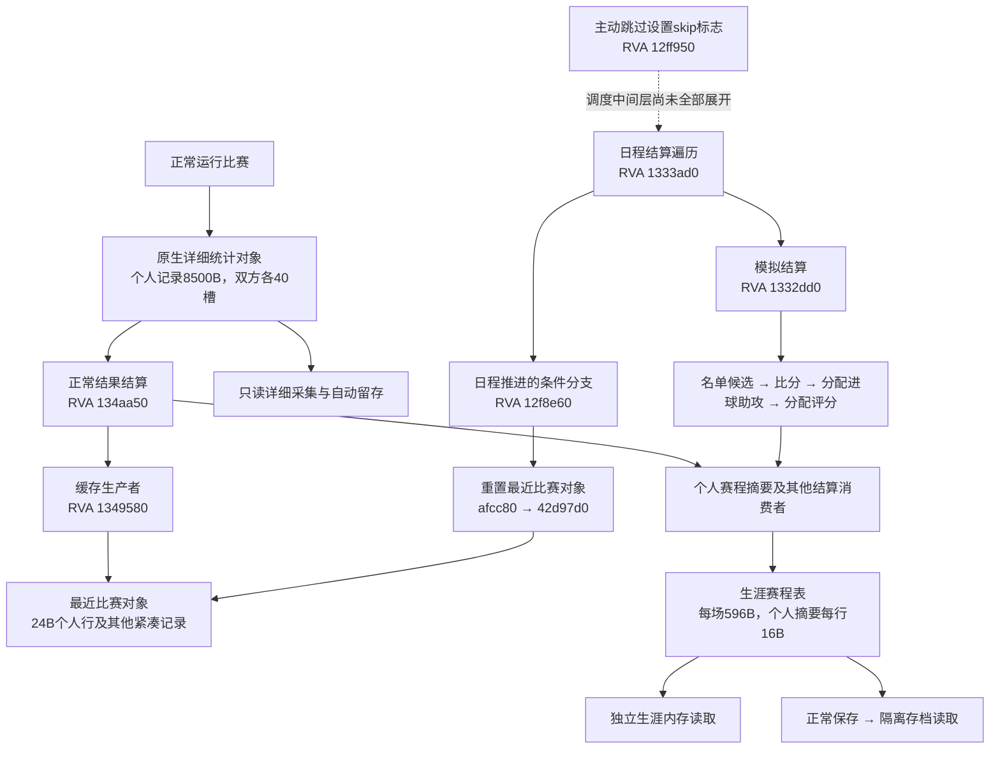

# D：游戏接入、原生采集与受控导入

整理日期：2026-10-23。

<a id="d-current"></a>

操作游戏的现行方法独立整理为[Codex玩PES](../guides/Codex玩PES.md)，包含窗口选择、独立输入、场景键位和存档保护；下文保留数据接口与历史实验分工。


## 当前实现与阅读范围

截至2026-10-23，D0调查、D1独立采集验证和D2受控导入已完成本机指定测试范围的验收：PES2021 1.07.01 / Data Pack 7.00 / SmokePatch V4 / BAL专用测试生涯。已交付“原生读取 → 明确审阅身份与事件 → 字段映射与预览 → A受控导入”；尚未交付任意存档自动识别、跨版本适配、Web采集入口或无人值守连续比赛。

本节按当前源码说明可用接口；后面的逐轮记录保留当时结论、数量和实验条件。历史中的“D1未完成”“D2关闭”“字段待验证”不替代本节的当前状态。原始存档、采集JSON和独立actual验收数据保留在本机忽略目录，不能仅凭克隆仓库复现真实运行验收。

阶段验收记录为142项适配器测试、13项A导入/仓库测试通过；这些测试验证解析与导入行为，不证明所有未知字段语义或任意版本兼容。D2真实验收向独立 `local_data/game_imports/pes2021-d2-acceptance-20261023` 导入一份能力快照、两条个人比赛、三条生涯事件，共6条观察；再次导入均为DUPLICATE。应用当前数据根没有因此自动切换。

## 接口分工与数据来源

| 入口 | 当前职责 | 不由该入口证明的内容 |
| --- | --- | --- |
| [pes2021_interface.py](../../game_adapters/pes2021_interface.py) | `capture / inspect / stats / compare / prepare-reuse`；稳定复制磁盘槽位，解密校验，分别预览快照、赛程、累计候选和缓存 | 未保存的实时状态、自动比赛事件身份、正式应用导入 |
| [pes2021_runtime_stats.py](../../game_adapters/pes2021_runtime_stats.py) | 只读正常比赛详细对象；34类原生计数、分钟/评分候选、盘带距离、平均速度及派生比例；完整保留双方80槽×8500B原字节 | 每条人员记录实际参赛、比赛结束、持久生涯或赛事身份 |
| [pes2021_runtime_career.py](../../game_adapters/pes2021_runtime_career.py) | 从独立生涯根读取指定596B赛程和1940B最近比赛缓存，可在保存前取得已结算摘要 | 快速跳过完整动作统计、自动寻找目标赛程、自动认证分支 |
| [pes2021_runtime_watch.py](../../game_adapters/pes2021_runtime_watch.py) | 有限轮询详细对象，周期留存，并在对象消失、切换或停止时保留最后有效数据 | 无遗漏连续采样、自动完成检测、对象片段等于比赛、自动导入 |
| [pes2021_native_package.py](../../game_adapters/pes2021_native_package.py) | 对已有受审阅的原生包重新核对原件、哈希、目标引用、时间窗、前后结算及详细表/缓存关联 | 自动生成审阅台账或原生持久GUID；任意实时JSON可直接导入 |
| [pes2021_import.py](../../game_adapters/pes2021_import.py) | `bind → preview → commit`，持久绑定、显式映射及逐项调用A的 `ObservationImporter` | 跨进程锁、整批原子事务、游戏写回或自动模型分析 |
| [keyboard_probe.py](../../game_adapters/keyboard_probe.py) | 默认诊断；显式执行时向已核对的当前游戏窗口发送一个有时长上限的按键 | AI代踢、完整菜单驱动、输入插入就证明游戏接受该操作 |

运行时读取器限定64位Windows、准确EXE路径和加载代码指纹：详细统计核对七段，生涯读取另核对三段。不匹配拒绝猜读。根/阵容稳定性和重复读取检查降低误绑定风险，但不提供原子帧；采样间隔中出现又消失的对象可能漏掉。

`runtime_watch` 默认运行300秒、1秒轮询、30秒检查点；CLI时长范围1–1800秒、间隔0.5–30秒。单份检查点上限2MiB，默认总预算32MiB/64份，预留末份和清单空间；三次连续读取错误停止。`offline_replay` 只验证留存逻辑，不计作真实运行验收。原始reader保留 `d2_ready=false` 等保守标志，表示它自身不授权导入；独立D2服务再核对受审阅包，不能据此误读为D2尚未实现。

## 已映射字段及缺失语义

当前映射版本为 `pes2021-canonical-v1`，逐字段规则见 [映射实现](../../game_adapters/pes2021_import.py) 的 `ATTRIBUTES` 和 `map_package`，规范允许值见 [A schema](../../player_data/schema.py)。

| 来源 | 导入A的内容 | 保留边界 |
| --- | --- | --- |
| 已审阅原生快照 | 姓名与25项能力；进攻意识对应 `offense.attacking_awareness`，跳跃对应 `physical.jumping`，其余按映射表分别归类 | PES显示分数原值；仅接受A的0–100范围，不截断或缩放；不证明现实能力或跨游戏等价 |
| 正常完赛、关联已核对的目标明细 | 个人进球、助攻、有效评分；`shots / shots_on_target / passes / pass_accuracy` | 传球成功率为成功数/尝试数×100；无分母或计数不一致时省略；notes注明 `normal_engine` |
| 已入选主动跳过且存在有效个人摘要 | 个人进球、助攻、有效评分 | notes注明 `summary_simulation`；不与正常动作引擎评分混成同质测量 |
| 已审阅未入选，或替补跳过后个人行缺失 | `career_event`，分别保存未入选或实际参与未知的语义 | 不追加个人比赛，不填零分钟、零进球或零射门来代替缺失 |

**快速跳过按已明确的游戏机制只更新个人进球、助攻和评分，不生成完整动作统计。** 正常比赛引擎的详细表是另一条数据源；不再将Quick Skip未生成的射门、传球等视为等待读出的隐藏数据，不估算或复制其他场次补齐。

累计双桶尚不命名为赛季/生涯；分钟候选、角色/实际换人、总评、未核实赛事/对手文本和其他特征不进入本映射。原生Dribble不直接改名为足球过人，盘带距离不冒充全场跑动距离，平均速度也未导入规范比赛指标。原字节、原生命名及来源引用保留，未知、缺行、无分母、明确零值分别处理。这里的unknown是字段语义，不是A导入结果的第六种状态。

已验收原生包使用游戏内日期，精度为日；现实采集时间独立保留时区。A的通用观察契约支持未知生效时间及RECORDED_ONLY，但这不表示当前D1真实包已经支持无日期比赛；`read_package` 目前核对原生日期锚点并输出 `day`，不能用今天替代未知游戏日期。

## 身份、预览与提交

生涯、分支、球员和事件采用**明确审阅后分配的本地身份**，不是自动识别的原生GUID。同姓名、原生球员ID、文件哈希或日期/双方/sequence均不足以独立证明同一生涯或事件；赛程锚点用于关联和冲突检测，不充当持久赛事ID。

D1包需要原件和审阅证据，检查同进程PID/创建时间、构建、目标ID/队伍/packed引用、未结算到已结算的转换及时间窗；正常详细表须与该场缓存投影吻合。同场多次终场采集合并为一个事件。新运行采集JSON还须准备并核对包、绑定审阅和事件审阅，才能交给D2；没有一条命令自动完成这些审阅。

D2首次绑定只接受EMPTY actual context，保存于 `collectors/pes2021_native/bindings.json`，不接管不明旧历史、不隐式加载demo。绑定不能静默替换；新路线使用独立context，可记录父绑定，但不复制或合并历史。文件摘要用于完整性检查，来源与身份可信度仍依赖明确本地审阅，不是第三方真实性认证。

| 情况 | 当前处理 |
| --- | --- |
| 同来源事件未改变，重新读取 | 保持原身份，A返回DUPLICATE |
| 同事件内容或原件引用改变 | 拒绝自动更新；明确更正须提供 `supersedes / reason`，不追加第二场 |
| 未见过的记录早于已导入高水位 | `rollback_review_required`，等待历史或新分支审阅 |
| 同一赛程锚点另换事件ID | `route_review_required`，不能靠改名绕过防重 |
| 原件校验、版本、绑定或目标引用不通过 | 校验拒绝；CLI返回REJECTED |
| 有效新计划与旧预览token不同 | 提交返回CONFLICT，本批尚不写入观察 |
| 某项已写入后后续项失败 | 返回逐项结果和未尝试项目；重新预览并按原身份重试 |

预览不创建球员聚合或收据。提交先重新读取并验证原件，token绑定具体观察、目标绑定和预期状态版本；逐项消费A返回的版本，不在冲突后强行刷新覆盖。APPLIED、DUPLICATE、RECORDED_ONLY、CONFLICT、REJECTED按A结果保留；RECORDED_ONLY保存观察并改变版本，但不表示当前事实投影更新。I/O错误可返回ERROR和未尝试项目；收据写盘异常也可能使CLI拒绝，因此A观察日志是恢复依据，不以缺收据断定此前零写入。

单写入进程是调用约束，CLI写操作要求 `--sole-writer` 显式声明；它不是进程间锁。没有跨整批事务，部分成功不会自动全部回滚。实现不注册模型导入工具，不改执行图；导入后也不会自动分析或切换当前工作台context。

## 操作入口

从仓库根目录执行，使用本机Python环境。以下原生包路径是本机已验收样本；克隆仓库没有原件时会拒绝，不能改成fixture冒充实际采集。

```powershell
.\venv\Scripts\python.exe -m game_adapters.pes2021_native_package game_adapters/raw/real_test/pes2021-bal-20261002-d1 --summary
.\venv\Scripts\python.exe -m game_adapters.pes2021_import preview game_adapters/raw/real_test/pes2021-bal-20261002-d1 --actual-root local_data/game_imports/pes2021-d2-acceptance-20261023
```

新actual根需先明确目标生涯、分支、球员和依据，执行 `bind`；示例标识仅用于专用测试根，不应套用到其他生涯：

```powershell
.\venv\Scripts\python.exe -m game_adapters.pes2021_import bind game_adapters/raw/real_test/pes2021-bal-20261002-d1 --actual-root local_data/game_imports/pes2021-d2-new-test --sole-writer --career pes2021-test-20261002 --branch round8-controlled --player test-player-001 --basis "明确核对的专用测试生涯和D1事件清单"
.\venv\Scripts\python.exe -m game_adapters.pes2021_import preview game_adapters/raw/real_test/pes2021-bal-20261002-d1 --actual-root local_data/game_imports/pes2021-d2-new-test
.\venv\Scripts\python.exe -m game_adapters.pes2021_import commit game_adapters/raw/real_test/pes2021-bal-20261002-d1 --actual-root local_data/game_imports/pes2021-d2-new-test --sole-writer --preview-token "替换为刚取得的preview_token"
```

实时研究入口的 `--pid` 必须使用当前进程，`--fixture-sequence` 使用已核对的本地表序号；`--native-player-id / --expected-team-index / --expected-packed-index` 也须对应目标。默认EXE为用户桌面 `pes/PES2021.exe`，其他安装位置须显式传 `--exe`。输出必须选隔离根 `game_adapters/raw/real_test/` 内的新目录或新JSON；采集输出的父目录通常须已存在，旧证据不覆盖。完整CLI参数可用各模块 `--help` 查看。

磁盘测试槽可以轮换，但每次先运行 `prepare-reuse` 并立即复核归档/原件哈希，再通过游戏正常保存菜单覆盖明确槽位；票据不执行覆盖，也不自动认证生涯。槽位1为用户切尔西档，禁止轮换；工具拒绝为它生成复用票据。同原生ID不是跨生涯保护的替代条件。

```powershell
.\venv\Scripts\python.exe -m game_adapters.pes2021_interface prepare-reuse --slot 2 --expected-native-player-id 2147483834 --output game_adapters/raw/real_test/new-test-reuse-archive
.\venv\Scripts\python.exe -m unittest discover -s game_adapters -p 'test_*.py' -v
.\venv\Scripts\python.exe -m unittest evaluation.test_player_imports evaluation.test_player_repository -v
```

## 正常比赛自动运行扩展

2026-10-23实测证明：不发送球场动作，正常比赛能推进至终场，后台自动留存59条有效ID人员明细，并核对本场赛程和缓存；有记录不等于每人实际出场。这与此前61条正常场样本是不同比赛，数量不能混用。该次watcher记录1次读错，不能声称全程零错误。

**BAL目标球员完整AI接管、自动处理全部菜单、连续无人值守多场尚未实现。** 本机观察中控制方未成功移到中立侧，光标切换为不可选的固定状态；无输入测试有球员站位不动的偏差，不作为正常AI表现样本。中场仍由助手确认菜单。下一步是具体控制权与阶段驱动验证，不能把时钟会推进等同AI代踢，也不把此扩展继续列为D1/D2基础验收前置。


## 原始记录索引

| 原位置 | 合并章节 |
| --- | --- |
| `docs/D0.2_PES2021_采集方式与首个试验_2026-10-02.md` | [阅读原文](#history-d-01) |
| `docs/D0_游戏接入可行性_2026-10-02.md` | [阅读原文](#history-d-02) |
| `docs/D1_PES2021_单场详细统计底层采集调研_2026-10-06.md` | [阅读原文](#history-d-03) |
| `docs/D1_PES2021_只读脚本接口与字段边界_2026-10-05.md` | [阅读原文](#history-d-04) |
| `docs/D1_PES2021_数据流架构与采集边界.md` | [阅读原文](#history-d-05) |
| `docs/D1_PES2021_测试生涯采集操作单_2026-10-02.md` | [阅读原文](#history-d-06) |
| `docs/D1_PES2021_自动化输入可行性_2026-10-02.md` | [阅读原文](#history-d-07) |
| `docs/D1_PES2021_自动留存与赛前身份线索_2026-10-08.md` | [阅读原文](#history-d-08) |
| `docs/D1_PES2021_运行时个人详细统计采集_2026-10-07.md` | [阅读原文](#history-d-09) |
| `docs/D2_PES2021_快速跳过动作统计复核_2026-10-23.md` | [阅读原文](#history-d-10) |
| `docs/D2_PES2021_正常比赛自动运行验证_2026-10-23.md` | [阅读原文](#history-d-11) |
| `docs/completed/D_D0_游戏接入调查.md` | [阅读原文](#history-d-12) |
| `docs/completed/D_D1_独立采集验证.md` | [阅读原文](#history-d-13) |
| `docs/completed/D_D2_映射与受控导入.md` | [阅读原文](#history-d-14) |
| `docs/devolopment_logs/2026-10-02_D1.1_真实页面包与离线读取.md` | [阅读原文](#history-d-15) |
| `docs/devolopment_logs/2026-10-02_D1_样本准备与输入排查.md` | [阅读原文](#history-d-16) |
| `docs/devolopment_logs/2026-10-03_D1_PES2021_底层存档读取.md` | [阅读原文](#history-d-17) |
| `docs/devolopment_logs/2026-10-05_D1_原生赛程与自动结算验证.md` | [阅读原文](#history-d-18) |
| `docs/devolopment_logs/2026-10-05_D1_首发主动跳过与统计分层验证.md` | [阅读原文](#history-d-19) |
| `docs/devolopment_logs/2026-10-06_D1_测试槽轮换与重载分支验证.md` | [阅读原文](#history-d-20) |
| `docs/devolopment_logs/archive/2026-10-roadmap/2026-10-02_D0.1_调查与验收.md` | [阅读原文](#history-d-21) |
| `docs/devolopment_logs/archive/2026-10-roadmap/2026-10-02_D0.2_调查与验收.md` | [阅读原文](#history-d-22) |
| 旧版适配器README | [阅读原文](#history-adapter-readme) |
| 总路线图第14节历史推进记录 | [阅读原文](#history-roadmap-progress) |

## 历史原文

以下“当前”“下一轮”“尚未完成”等措辞均属于各原文写作时点；不覆盖前部现行结论。外部链接保留原引用，本次未重新验证外部网页或据其更新技术结论。

---

<a id="history-d-01"></a>

## 原文：D0.2_PES2021_采集方式与首个试验_2026-10-02.md

来源：`docs/D0.2_PES2021_采集方式与首个试验_2026-10-02.md`；原文件 SHA256：`fa75ee81be09fa4106c2e05a46b3eace4e161704015799b77b8dd43513eb3df9`。

<!-- preserved-body-sha256: 129b4f8465e5ea61b3057ede17ed5a27c56a5d55c937b9a52eb670b39b042619 -->
<!-- preserved-source-begin: history-d-01 -->
<a id="history-d-01-d02pes-2021-采集方式与首个试验"></a>
### D0.2：PES 2021 采集方式与首个试验

日期：2026-10-02（Asia/Shanghai）

依据：[D0.1 本机调查](#history-d-02)、[D 任务书](../guides/D方向_游戏接入与采集适配_Codex任务书_2026-10-01.md) 及本轮一手项目资料/固定提交源码。

状态：D0.2 候选比较和试验方案已交付；未启动游戏、安装/运行采集工具、创建测试生涯或采集业务样本。D1/D2 未通过。

后续调整：菜单输入已验证，用户已创建专用 BAL，并明确要求底层取数；主线现改为 [存档副本解析](#history-d-17)。本轮进一步核对 `libpesXcrypter` 分支，找到 PES21 密钥并成功解密真实 BAL。本文下述页面首试选择与“主分支只声明到 PES20”均是此前调查轮次的结论；页面材料仅作对照，不能作为底层采集完成依据。

<a id="history-d-01-1-决定与适用范围"></a>
#### 1. 决定与适用范围

首个试验选 **本机 PES 2021、SmokePatch 21.4.5 环境下的新建 Become a Legend（一球成名）专用测试生涯**，采用 **页面留证＋人工核实**，先建立球员快照及真实单场记录的对照样本。

游戏候选已收敛到 PES 2021；这是试验对象选择，不是采集兼容认证。字段、页面、模式身份和独立存档槽位仍需在样本准备时核实。FC 26、Football Life 26 和经理生涯不进入此次试验。

当前证据不足以选择一个能自动读取完整 P0 的现成工具。人工核实是 D 任务书明确允许的首批验证来源，能够提供之后自动解析所需的对照；它不计作自动采集完成，也不能通过这个方案承诺历史个人比赛统计全部可回溯。

实测若发现 P0 无法取得，应记录具体缺口并停止扩大试验，不能用赛季累计或球队统计补出单场个人数据。自动采集仍是后续工作，其前置证据见第 6 节。

<a id="history-d-01-2-本轮证据与版本"></a>
#### 2. 本轮证据与版本

本机目标沿用 D0.1：主程序版本资源 `1.7.1.0`、x64；补丁版本文件标记 `21.4.5`；Sider EXE/DLL 分别为 `7.1.0.0 / 7.1.4.0`。本轮没有认证它们的运行兼容性。

已读取四个公开仓库的固定提交与 12 份相关文本源码，按文本/CT XML 调查，未执行其中的 Lua、C/C++、Auto Assembler 脚本或工具。保存 [源码目录索引](../evidence/D0.2_2026-10-02/repository_index.json)、[文本摘要与定位线索](../evidence/D0.2_2026-10-02/source_review.json)。源码目录索引排除 Sider 捆绑第三方库及二进制资源。

| 来源 | 固定版本/提交 | 核对结果与限制 |
| --- | --- | --- |
| Sider7 | `v7.1.4`，`ed4413f013e2d9ad5357c9872149452e238ed1ca`，2021-06-15 提交 | 与本机 DLL 版本标签相符；不代表本机 DLL 字节与上游发行包相同 |
| Aranaktu PES 2021 Cheat Table | `6043cabf2b8b314064d06d63ae5fc3e5f522d2ed`，2022-11-26 提交；表文件 `v21.1.0` | 有明确 BAL 入口与属性字段；表的版本号不能当作游戏版本或当前补丁兼容证明 |
| 4ccEditor | `c92d5351a65e179781a2353f9660c20b6a4f6d7c`，2026-04-01 提交 | README 明确对象为 EDIT 文件，不是 BAL 比赛解析器 |
| pesXdecrypter | `2214f035600eb317d089d93c0bcb5b078f8e9eb8`，2020-09-18 提交 | 可研究容器解密/分块；当前所读主分支头文件只声明到 PES20 的内置密钥，PES21 专用实现仍需单独核对 |
| Prologue 作者发布帖 | 检索于 2026-10-02；帖内版本 `0.6.0` | 声明面向 FL26；作者下载页本轮未能通过网页工具读取，没有源码或本机兼容实测 |

<a id="history-d-01-sider-714比赛层读取范围"></a>
##### Sider 7.1.4：比赛层读取范围

固定版本脚本文档的 Match library 列出比分、点球比分、比赛阶段、时钟与补时；`sider.cpp` 的 `sider_match_get_stats` 提供相应返回值。本机已有 `mstats.lua` 示例与此一致，没有个人球员能力、出场分钟、评分、进球/助攻或生涯日期的已确认接口。[7.1.4 脚本文档](https://github.com/pes-modding/sider7/blob/ed4413f013e2d9ad5357c9872149452e238ed1ca/doc/scripting.html#L1570-L1603)、[7.1.4 实现](https://github.com/pes-modding/sider7/blob/ed4413f013e2d9ad5357c9872149452e238ed1ca/sider.cpp#L1668-L1750)。

这支持把 Sider 看作潜在比赛层辅助来源，不能据此补出个人参与情况或永久生涯事件。其 Match library 被作者标为实验功能。线上文档已更新到 7.4，不能把其中新增能力直接归给本机 7.1.4。[当前作者文档](https://mapote.com/doc/sider/sider7/scripting.html)。

<a id="history-d-01-aranaktu-表bal-证据成立但宿主需要写入"></a>
##### Aranaktu 表：BAL 证据成立，但宿主需要写入

README 分开列出 ML 与 BAL，并将 BAL 目标球员入口指向 `Game Menu → My Data`。表文件包含姓名、年龄、属性等字段，以及 BAL focus points 入口。[固定 README](https://github.com/xAranaktu/PES-2021-Cheat-Table/blob/6043cabf2b8b314064d06d63ae5fc3e5f522d2ed/README.md)。

读取所依赖的 `ptrPlayer` 由 Edit Player 脚本建立：该脚本扫描、分配进程内存并在目标代码处写入跳转，捕获当前页面球员指针。即便不修改属性值，启用该脚本也不是纯只读进程操作。已检查字段没有形成一个经验证的 BAL 单场比赛记录导出接口；没有证明本机 `1.7.1.0 + SP21` 的指针/位字段仍匹配。[固定 CT 源码](https://github.com/xAranaktu/PES-2021-Cheat-Table/blob/6043cabf2b8b314064d06d63ae5fc3e5f522d2ed/PES%202021%20-%20v21.1.0.CT)。

结论是保留结构研究线索，暂不安装 Cheat Engine、启用表或把其中地址写成适配器常量。

<a id="history-d-01-存档工具容器和-edit-不能替代-bal-领域解析"></a>
##### 存档工具：容器和 EDIT 不能替代 BAL 领域解析

4ccEditor 的 README 将其定位为 `EDIT00000000` 编辑器。支持 PES 2021 的 EDIT 不等于支持个人生涯当前属性或个人比赛历史。[固定 README](https://github.com/the4chancup/4ccEditor/blob/c92d5351a65e179781a2353f9660c20b6a4f6d7c/README.md)。

pesXdecrypter 描述了解密后容器的 header、description 和 data 等部分；其 CLI 提供输入文件、输出目录与可选密钥的接口。容器读通仍需匹配 PES21 的实现及 BAL 领域结构；本轮未对真实存档执行解密。当前所读 `masterkey.h` 声明到 PES20，不据搜索结果中的 PES21 二次分发包认定兼容。[固定 README](https://github.com/the4chancup/pesXdecrypter/blob/2214f035600eb317d089d93c0bcb5b078f8e9eb8/README.md)、[密钥声明](https://github.com/the4chancup/pesXdecrypter/blob/2214f035600eb317d089d93c0bcb5b078f8e9eb8/src/masterkey.h)、[CLI 实现](https://github.com/the4chancup/pesXdecrypter/blob/2214f035600eb317d089d93c0bcb5b078f8e9eb8/src/decrypter.c)。

<a id="history-d-01-新近伴侣工具版本与模式分别核对"></a>
##### 新近伴侣工具：版本与模式分别核对

Prologue 作者帖称 `0.6.0` 为 Football Life 26 的 BAL 伴侣，live attributes/OVR 需要 FL26 1.4；另一个 Touchline 面向经理生涯。它们均不能直接证明本机原 PES 2021 + SP21 的个人采集覆盖。本轮仅记录作者声明，未读取包内源码、安装或运行。[Prologue 作者发布帖](https://www.reddit.com/r/SPFootballLife/comments/1wkyaa4/new_become_a_legend_immersionstoryline_prologue/)。

<a id="history-d-01-3-候选比较与选择"></a>
#### 3. 候选比较与选择

下表的影响/维护成本是基于已查实现的工程判断，未经过本机运行测量。

| 方法 | BAL/字段证据 | 稳定性与运行影响 | 维护与核对 | 本轮决定 |
| --- | --- | --- | --- | --- |
| BL 副本离线解析 | 有生涯文件候选；未找到在本机版本已验证的完整个人事件解析器 | 不接进程的潜在低影响路线；加密、补丁身份/布局和历史字段仍未验证 | 需要版本化容器及领域解析，以游戏页面核对 | 保留自动化研究；不创建猜偏移的解析器 |
| 4ccEditor/数据库 CSV 等 | EDIT 静态资料的证据成立；不足以证明当前 BAL 状态/单场统计 | 编辑型功能有写回能力；不能把工具名称或 CSV 输出当采集保证 | 须区分初始数据库与生涯中的实际成长 | 不选作 BAL 首个采集器 |
| Sider 7.1.4 | 文档/源码有比分、阶段、时钟；个人 P0 未证明 | 依赖宿主附加；本机还配置有 camera/matchset 和缺失模块 | Lua 接口、game exe、补丁与宿主行为需分别测试 | 不单独承担个人生涯采集；后续可评估比赛层辅助 |
| Aranaktu CT | 直接有 BAL 页面、能力与焦点字段线索 | 依赖代码注入建立指针，工具非纯只读 | 需专门验证 exe、模式、位字段和停止/恢复 | 不用于当前首试；结构线索归档 |
| Prologue | 作者声明 FL26 BAL；本机兼容证据不足 | 宿主、包内容和当前 PES 启动影响未经核实 | 需一手接口/源码及版本实测 | 不迁移游戏或引入伴侣来完成本轮 |
| 页面留证＋人工核实 | 可直接核对所见字段；实际目标页面覆盖尚待实测 | 无新增进程注入；受页面时效和人工确认影响 | 成本随比赛数量增加；适合少量对照样本，不能承诺无人值守 | **选作首个 D1 试验** |

<a id="history-d-01-4-首个-d1-试验的具体范围"></a>
#### 4. 首个 D1 试验的具体范围

详细步骤见 [测试生涯采集操作单](#history-d-06)。

| 项目 | 固定范围 |
| --- | --- |
| 目标 | PES2021.exe 版本资源 1.7.1.0，SmokePatch 标记 21.4.5；标题界面版本与实际启动环境在样本取得时补核 |
| 生涯 | 按用户选择新建专用 BAL；选择确认空闲的独立存档槽，保留现有存档；姓名可用短 ASCII 测试名，实际俱乐部/球员身份由页面确认 |
| 启动 | 沿用用户平时可用的启动方式，记录是否加载 Sider 及当前配置；不新增/升级工具、不修改 Lua/CPK、不开启 CT |
| 方法版本 | 方案标识 `pes2021-bal-manual-pages-v1`；仅方案版本，不代表已实现适配器 |
| 原始样本 | 目标球员身份、能力/综合评分、游戏日期/赛程（如页面提供），第一场赛后目标球员的个人记录，相关页面截图/原文件引用及核实说明 |
| 首批最低字段 | 明确目标生涯/球员；至少一个可见整体能力或属性；一个实际单场事件和可核实的目标球员参与状态 |
| 可选字段 | 对手、赛事、比分、个人分钟/评分/进球/助攻，仅记录页面或独立人工确认实际支持的项 |
| D1.1 | 对上述隔离页面样本做身份/字段读取与 raw envelope/预览验证，不写应用事实，不称自动读取存档 |
| D1.2 | 在同一测试生涯推进三场比赛；每个节点重读/重截图，验证身份、防重、停止与游戏正常继续 |
| 当前排除 | OCR 自动识别、内存采集、存档解密、模型任务、实际根导入、E 效果评估；以后逐项验证 |

<a id="history-d-01-原始记录与未知值"></a>
##### 原始记录与未知值

截图原件保留、计算 SHA-256，并给每个字段绑定页面文件与区域/标签。保存采集时间和游戏内时间/精度；现实拍摄时间不能替代游戏日期。无页面日期时保留未知及明确比赛顺序。

没有原生生涯/比赛 id 时，用专用测试生涯绑定记录和人工核实的比赛台账作为临时来源身份。同一比赛的不同页面和重复截图归入同一个台账事件；截图 hash 只标识原件，不能单独生成新比赛身份。无法确认是新比赛、重读或重踢时挂起该记录。

原始记录标记真实游戏测试用途、`manual_page_review` 采集方式和确认人/确认依据。页面观察、操作者说明与识别推断分别保留。界面没有提供的字段注明 `not_provided`，遮挡/识别不清注明 `unreadable`，没有捕获注明 `not_captured`；明确未出场与明确零值独立表达。

<a id="history-d-01-来源与后续导入"></a>
##### 来源与后续导入

首版只生成 raw 与预览。人工转录/确认若随后进入 A，应走 `user_confirmed` 与确认引用，不能因为附件来自游戏就把整包自报成自动 `game_observation`。若后续可信自动采集器成立，再单独定义 provider、来源与映射版本。

规范量表映射仍需 D2/F 核对；本轮不把截图数值直接写入 A 属性或发布 E 执行支持证据。训练选择只在实际 BAL 页面确实支持且保留操作前后证据时登记；不从一次属性变化认定训练已执行或有效。

<a id="history-d-01-5-验收和停止条件"></a>
#### 5. 验收和停止条件

通过 D1.1 的条件：原件可引用且完整；模式/球员/生涯身份可核对；能读到至少一个能力字段及一场真实个人参与事件；重复读取得到一致字段；缺失/错误有区分；全程不产生应用事实写入。只有菜单或全队比分不够。

通过 D1.2 的条件：三个不同比赛推进节点、每个节点的重复采集、同一事件稳定关联；正常游戏可继续，采集失败可以停止；存在阶段/原件/人工核实记录。页面方案的运行影响结论仅覆盖该方案，不能外推给 Sider/CT/离线解析。

出现以下任一情况停止采集或将记录挂起：空闲存档槽不明、可能覆盖旧生涯；无法确认当前球员/模式；个人参与证据不足；页面已消失而无原件；游戏内时间倒退/重踢身份不清；字段来源是全队或赛季累计且无法分清；原件损坏/截图不完整；游戏异常；发现实际启动或版本发生变化。

字段缺口用实际覆盖表记录。P0 不足时该方法不通过，不生成 demo 观察；P1/P2 不足时明确缩小覆盖。D1.1 的离线读通与 D1.2 的真实连续采集分别报告，D2/M2/M3 仍按独立条件验收。

<a id="history-d-01-6-自动采集路线再次进入试验的条件"></a>
#### 6. 自动采集路线再次进入试验的条件

优先继续研究有明确版本证据的 BL 副本读取。最低需给出 PES21 容器实现来源、BAL 身份/属性/单场结构及未知行为，在本轮页面样本上逐字段对照；只解出一个 data.bin 不够。

进程内路线需说明指针怎样获得、是否写入/注入、是否能仅请求读权限、目标球员与单场 id 怎样确认，以及退出后宿主/游戏状态怎样恢复。若依赖 CT/Sider，必须独立核查宿主影响；不能将一个读取函数的只读性扩展到整个工具。

第三方伴侣必须先证明本机原 PES2021 + SP21 + BAL 的实际来源字段与接口，并区分观察和新增叙事。没有这一证据，不更新到另一款游戏/补丁，也不把工具生成的职业剧情当成游戏事实。

<a id="history-d-01-7-本轮交付与检查"></a>
#### 7. 本轮交付与检查

交付为比较结论、明确首试范围、操作单、四个仓库固定提交索引与 12 份文本摘要/定位记录，以及 [实施日志](#history-d-12)。只改文档与调查证据，不改业务代码或游戏数据。

验收核对 JSON、源码条目与仓库文件大小/commit 一致性、相对链接、文档空白和 D0.1 文件摘要。本轮没有证明任何真实业务字段已经采集，也没有把静态源码调查计作运行验收。
<!-- preserved-source-end: history-d-01 -->

---

<a id="history-d-02"></a>

## 原文：D0_游戏接入可行性_2026-10-02.md

来源：`docs/D0_游戏接入可行性_2026-10-02.md`；原文件 SHA256：`acbcb973a3ddb39c0dff40fa9255b1a5809610d323f418253304f48f67b72a9a`。

<!-- preserved-body-sha256: 440e755550c46ee9c120a2f8dc1c00faa3fda2cdea3cbf896d910e05ea05f401 -->
<!-- preserved-source-begin: history-d-02 -->
<a id="history-d-02-d01pes-本机环境与个人生涯字段调查"></a>
### D0.1：PES 本机环境与个人生涯字段调查

日期：2026-10-02（Asia/Shanghai）

范围：按 [D 方向任务书](../guides/D方向_游戏接入与采集适配_Codex任务书_2026-10-01.md) 执行 D0.1。有限只读检查安装、配置、现有脚本、历史日志和存档目录；没有启动游戏、运行接入工具、解析存档内容或导入应用事实。

状态：D0.1 调查已交付；个人生涯身份和字段覆盖尚待实测。后续 [D0.2 方案](#history-d-01) 已交付；D1、D2 未完成。下文第 7 节保留 D0.1 当时交接结论。

<a id="history-d-02-1-并行推进的建议"></a>
#### 1. 并行推进的建议

建议现在启动 D 调查线，同时继续 E1.2，随后按 E 事件契约推进 C2.1。

- A2.2 已提供受控导入与版本接口，C1 已提供固定历史与关联新评估；D 无需重写这些能力。
- E1.1 的 `execution_support` 仍为 `pending_verification`，比较规范仍为 `undefined`。D 能提供目标游戏操作和观察证据，减少 E 后续基于假定设计功能的风险。
- D0/D1 的文件调查、原始样本和离线验证可独立于 E；正式 D2 导入与任何 A schema 变更需要单独协调。

本轮仅写调查文档和证据清单。后续 D 主要新增独立 `game_adapters/` 与隔离原始样本；E/C 的 DTO、存储及任务服务仍串行合并。当前大量 A/B/C/E 文件尚未提交，创建新 worktree 前必须确保基线包含这些接口和指南。

<a id="history-d-02-2-证据级别与调查边界"></a>
#### 2. 证据级别与调查边界

- **本机已验证**：文件存在、版本资源、PE 架构、配置内容、脚本实际代码和历史日志内容。
- **文档证据**：工具或补丁作者的一手说明；不能替代本机目标模式实测。
- **待验证**：当前游戏能否运行、目标生涯/球员身份、页面字段、解析器和采集兼容性。
- **当前证据不支持**：已检查脚本未提供某能力；不等于证明游戏或其他工具永远无法获取。

搜索限定在用户指出的 `Desktop\pes`、用户 `Documents\KONAMI\eFootball PES 2021 SEASON UPDATE` 及两个不存在的 OneDrive KONAMI 候选路径。未遍历磁盘、未读取其他游戏存档。FC 26 不在本轮调查范围。

机器可读清单：[environment_inventory.json](../evidence/D0.1_2026-10-02/environment_inventory.json)。清单记录版本、模块存在性、存档文件元数据和 13 个相关文件的 SHA-256；未复制游戏或存档原件。散列只证明文件内容身份，不能证明模式、字段语义或兼容性。

<a id="history-d-02-3-本机环境"></a>
#### 3. 本机环境

| 项目 | 调查结果 | 证据与限制 |
| --- | --- | --- |
| 安装目录 | `%USERPROFILE%\Desktop\pes` | 本机目录与游戏文件已验证 |
| 游戏 | `eFootball PES 2021 SEASON UPDATE` | `PES2021.exe` 的 ProductName |
| 主程序版本 | FileVersion / ProductVersion 均为 `1.7.1.0` | 本机版本资源；尚未核对游戏标题界面 |
| 平台与架构 | Windows PC，x64 | PE machine 为 `0x8664`；未据此认证任何内存布局 |
| 补丁标记 | `smokepatch21` / `v.21.4.5` | `download/version.txt`；不能证明所有 CPK/EDIT 与标记完全一致 |
| 补丁与附加资源 | 有 `DpFileList.bin`、`smkdb` 系列及附加 CPK、额外中文资源 | 文件层面已验证；未解包或修改；不从占位 DLC 文件名推断当前 Data Pack 版本 |
| Sider | EXE `7.1.0.0`，DLL `7.1.4.0` | 版本资源与历史日志一致；分别记录两个版本，不视为当前故障结论 |
| Sider 配置 | Lua、livecpk、overlay、`match-stats.enabled = 1` | `sider.ini` 已验证；`mstats.lua` 加载行被注释 |
| 启动与存档配置 | `CPY.ini` 有 AppID `1259970`、`Language=english`、默认 SavePath 占位符 | 只读游戏相关键；不能据此认定当前 Steam 启动状态或游戏显示语言 |
| 历史运行证据 | `sider.log` 有向该路径 PES 进程附加、初始化及退出的记录；文件最后修改于 2026-07-11 | 仅历史证据，本轮未运行游戏 |
| 当前进程观察 | 调查时未枚举到 `PES2021` / `sider` | 本轮进程枚举结果，不作为完整运行健康检查 |
| 当前可用自动导出 | 在已列出的现有 Lua 模块与配置中，未确认个人生涯快照/比赛 CSV 或 JSON 导出器 | 不能扩展成“本机任何位置均不存在工具” |

SmokePatch 作者页面将 `21.4.5` 标为 2022-02-24 发布，并提醒旧补丁生涯的延续兼容限制。该资料支持核对补丁标记和后续检查存档创建环境，不能证明本机生涯兼容或采集成功。[SmokePatch21 v4 作者说明](https://www.pessmokepatch.com/2021/11/sp2140.html)（检索于 2026-10-02）。

<a id="history-d-02-4-存档候选与现有工具限制"></a>
#### 4. 存档候选与现有工具限制

已定位用户存档目录：

```text
%USERPROFILE%\Documents\KONAMI\eFootball PES 2021 SEASON UPDATE\<账户目录>\save
```

| 文件 | 字节数 | 本机已验证内容 | 未证明内容 |
| --- | --- | --- | --- |
| `BL00000000` | 19,577,197 | 存在；最后修改于 2026-09-05 13:59:20 +08:00；摘要已记录 | 候选个人生涯；尚未加载核实模式、姓名、俱乐部、赛季、游戏日期及记录内容 |
| 用户 `EDIT00000000` | 11,011,037 | 编辑数据文件存在；摘要已记录 | 不能替代个人生涯；未证明它与安装包 EDIT 内容相同 |
| 安装包 `存档EDIT文件 (D版)/EDIT00000000` | 11,011,037 | 补丁附带编辑数据存在；附带说明指向 Documents 存档位置 | 不是已核实的个人生涯或比赛样本 |
| 其他存档文件 | 见清单 | FILELIST、SYSTEM、GRAPHICS、TEMBLEM、UNIFORM 等文件存在 | 未解析；当前枚举没有 `ML` 前缀文件，但这不证明用户从未玩过经理生涯 |

目标模式按任务书为 **个人生涯（Become a Legend / 一球成名）**。`BL00000000` 仅按文件名列为已有存档候选，不能把候选身份直接绑定到应用 `PlayerContext`。用户已明确后续采用**新建专用测试生涯**；本轮尚未创建，球员姓名、俱乐部、首个游戏日期和独立 context 需在后续创建时核对记录。

现有 Sider 需要在 D0.2/D1 中单独评估：

1. `modules/mstats.lua` 示例调用 `match.stats()`，输出主客比分、点球比分、阶段、比赛时钟和补时。它没有输出球员身份、个人出场分钟、个人进球/助攻、评分、能力或生涯日期；源码注明 match 库为实验功能。本机该示例未启用，未证明它在 BAL 可用。
2. `etrace.lua` 和历史球场脚本日志有球队、赛事、赛程条目等线索；这不是目标个人球员已出场的证据，也没有经过稳定比赛身份验证。
3. 当前配置启用了 `camera.lua`，源码包含内存写入；也启用了 `matchset.lua`，其非友谊赛分支设置换人次数为 5。这些是已有运行环境行为，不能将整个 Sider 宿主称为纯只读采集工具；本轮没有触发或改动它们。
4. 配置引用的 `SP21Scoreboard.lua`、`SP21Ref.lua`、`SP21Clkits.lua` 当前不存在；历史日志有相应无法打开记录。历史日志另有 `trophy.lua` 缺映射文件及声音脚本错误。它们是后续运行影响核查项，本轮不据此断言游戏现在无法运行，也不顺手修补。
5. `download/传奇模式切换.bat` 的命令会终止游戏并覆盖额外 CPK。它属于补丁切换操作，不能把名称里的“传奇”视为个人生涯导出能力。本轮只读代码，没有执行切换器。

<a id="history-d-02-5-p0p1p2-字段需求与覆盖"></a>
#### 5. P0/P1/P2 字段需求与覆盖

**本轮没有任何已验证可自动采集的个人生涯业务字段。** 下表是首批核对清单；本机文件元数据和比赛时钟不是领域观察。

| 优先级 | 字段需求 | 本机调查覆盖 | 下一步验证与应用约束 |
| --- | --- | --- | --- |
| P0 | 生涯、分支、球员身份；姓名/俱乐部/位置；稳定原始 id | 有 BL 存档候选，实际身份待验证 | 游戏页面与候选副本交叉核对；姓名不能单独决定 context；没有原生 id 时定义明确绑定 |
| P0 | 当前综合评分或属性快照 | 待验证；现有 mstats 示例不提供 | 核对个人生涯能力页面、原始量表和字段意义；A 接受 overall/attributes 0–100 不等于 PES 原值天然对应 |
| P0 | 可排序单场事件与目标球员参与状态 | 待验证；历史日志仅有部分赛程线索 | 区分已完成、未完成、未出场、统计缺失；不能仅凭主客比分证明目标球员参与；不以采集时间制造新比赛 id |
| P1 | 对手、赛事、结果、主客关系 | 待验证；Sider 示例/日志有部分比赛层字段的源码或历史线索 | 当前 BAL 页面/导出与球队 id 映射核对；全队结果可以是比赛结果，但不能变成个人进球 |
| P1 | 个人出场分钟、评分、进球、助攻 | 待验证；已检查示例无这些个人字段 | 优先核对赛后个人页面；分清单场与赛季累计；比赛时钟不能换算为目标球员出场分钟；A rating 为 0–10，须先验证游戏量表 |
| P1 | 游戏日期、赛季、比赛顺序 | 待验证；match 时钟不是生涯日期 | 游戏时间与采集时间分开；无日期保留 unknown/顺序，不用现实日期补齐 |
| P1 | 合同、角色、转会与发展事件 | 待验证 | 有页面/解析证据才保留；当前 A career_event 投影及字段范围须逐项核对 |
| P2 | 射门、传球、跑动等细粒度个人技术统计 | 当前证据不支持；游戏实际是否提供待验证 | 不用球队统计分摊，不为满足 A key_stats 字段补数 |
| P2 | 训练焦点选择、点数分配、技能/成长事件 | 待验证；经理生涯训练功能不能作为 BAL 证据 | 验证玩家能执行的具体页面与操作；随后交给 E/F 确定建议支持和比较规范 |
| 不纳入首批 | 现实 RPE、训练负荷、伤病概率、营养执行 | 没有本机可观察证据 | 保持未知，不由游戏能力值或模型生成训练记录补空缺 |

“未获取”不是零值。读取失败、游戏未提供、未出场、明确零次进球需分别表达；未知字段不得覆盖现有事实。

<a id="history-d-02-6-ae-接口检查结果"></a>
#### 6. A/E 接口检查结果

已检查当前 `player_data/models.py`、`schema.py`、`imports.py` 和 E1.1 实施记录：

- `PlayerContext` 用独立 career/branch/player 标识；原生游戏标识和账户目录不能直接成为路径或未经核实的绑定。
- A 已支持 `profile_patch`、`match_record`、`training_record`、`career_event`；游戏观察要求来源、版本、原件引用、稳定记录 id、采集时间、生效时间与 expected_state_version。
- 属性 0–100、评分 0–10、特征 1–5/1–8 是应用契约。PES 原始字段必须经语义/量表验证；不截断或缩放未知字段以通过校验。
- 缺少游戏时间的记录可保留原始顺序与 unknown；A 可能返回 `RECORDED_ONLY`，不能显示为当前状态已经更新。
- E1.1 建议保留原成果与基线；本轮没有游戏操作证据，因此不将 `execution_support` 或比较规范改为可用。

正式映射与导入仍属 D2。首批字段若超出现有 schema，应先安排小范围 A 接口变更，再更新消费方。

<a id="history-d-02-7-给-d02-的交接清单"></a>
#### 7. 给 D0.2 的交接清单

PES 2021 是优先调查候选：本机版本、补丁、现有脚本和存档目录已经可定位。是否选定为首个接入游戏，仍取决于目标 BAL 的 P0 覆盖；本轮没有比较或认证 FC 26。

| 候选方式 | 本轮证据 | D0.2 待证明内容 |
| --- | --- | --- |
| 存档副本离线解析 | 有 `BL00000000`；本轮未解析、没有本机已验证解析器 | 找到匹配 PES 2021 + SP21 的一手源码，证明 BAL 身份/属性/比赛实际覆盖；EDIT 编辑器能力不够 |
| 已有工具导出 | 现有模块尚无已确认的个人生涯导出 | 核对导出格式、版本和 BAL 实例，不能用经理生涯导出充当证据 |
| 页面读取/人工核实 | 不改变游戏启动配置的候选路径；当前没有目标页面样本 | 核对姓名、能力、日期、赛后个人信息；手工来源明确标记；不能宣称已实现自动采集 |
| 现有 Sider 进程内读取 | 有比赛比分/时钟示例和历史附加日志 | BAL 身份、个人字段、稳定事件 id、宿主影响、当前模块异常和版本兼容 |

下一轮具体工作：

1. 按用户选择规划新建专用 BAL 测试生涯，创建时核对目标球员和补丁环境，明确独立测试 context 与存档槽位，并避免覆盖已有存档。D0.2 先写方案，实际创建与游戏运行在后续明确范围内实施。
2. 根据上述版本查一手项目说明/源码，区分 BAL、ML、EDIT，选定有证据的方法与失败边界。当前页面资料不足以证明解析或进程内个人字段覆盖。
3. 形成 D1 试验方案：指定版本、方法、原始样本取得方式、身份/字段核对页面、停止条件和运行影响检查。D1.1 需要球员快照及至少一场真实比赛；D1.2 需要三个游戏推进节点和同节点重复读取。
4. 离线解析只读明确副本；进程内方案先写清现有宿主和新增读取脚本各自影响；不因 Sider 已安装就自动启用模块。

本轮核实了环境与需求，仍未证明任何方案已满足 P0，因此 D1 暂无已选定可执行的采集方法。D0.2 是下一步，不能直接宣称 D1/D2 已接通。

<a id="history-d-02-8-验收与保留事项"></a>
#### 8. 验收与保留事项

验收对象为调查证据：版本资源、PE 架构、补丁标记、配置与模块存在性、历史日志、存档元数据和摘要。对清单中的文件再读摘要，核对调查期间内容是否变化；文档链接、JSON 格式与变更空白单独检查。

没有变更业务代码，无需运行模型或业务回归来证明文件调查。未执行真实游戏采集、工具安装、存档格式解析、应用导入或 E 闭环验收；这些结果不能由文档检查替代。
<!-- preserved-source-end: history-d-02 -->

---

<a id="history-d-03"></a>

## 原文：D1_PES2021_单场详细统计底层采集调研_2026-10-06.md

来源：`docs/D1_PES2021_单场详细统计底层采集调研_2026-10-06.md`；原文件 SHA256：`bb98eb6edfc01824f4e63f64f9fa52b8124123bee66936ce35bc277c43221e96`。

<!-- preserved-body-sha256: c03aeed00889f10849cf7426dd929e16e37831aaa8cfb90770d896f1b91a85fc -->
<!-- preserved-source-begin: history-d-03 -->
<a id="history-d-03-d1pes2021-个人单场详细统计底层采集调研"></a>
### D1：PES2021 个人单场详细统计底层采集调研

调研日期：2026-10-06。目标环境仍为已核对的 PES2021 1.07.01 / Data Pack 7.00 / SmokePatch V4 / BAL。本轮核查公开文档、社区线索和固定版本源码，没有安装新工具、注入游戏或执行下载的第三方脚本。本报告提出下一轮实验，不表示个人详细统计读取已经实现；D1 整体尚未完成，D2 映射继续等待字段所有权、缺失语义和事件身份验证。

后续进展（2026-10-07）：本机原生 getter 研究已定位个人详细统计表，并交付独立只读脚本，在正常比赛进行中、半场和终场取得真实数据。进球、助攻、射门、传球、盘带距离及速度已有正样本对照，见 [运行时采集记录](#history-d-09)。下文保留本轮网络调研的时间范围；“尚未实现”描述的是此前状态，不代表当前实现仍只停留在建议。

<a id="history-d-03-1-结论与优先顺序"></a>
#### 1. 结论与优先顺序

目前没有在本轮检索和源码核查范围内找到能够直接适配本机 BAL、完整导出每位球员单场射门、传球、盘带距离、过人成功率的现成接口。已有工具能帮助定位结构，但不能把球员能力值、服务器统计容器或实时比分当作完整比赛数据。

建议下一轮以**定位赛后个人统计表的运行时数据源**为第一优先级，优先在比赛完成时一次读取游戏已生成的计数；缺少计数的字段才研究事件流和坐标。当前存档读取保留为赛程、个人摘要和分支核对来源。图像或人工看界面只用于少量独立验真，最终采集走脚本。

用户补充的实际观察（2026-10-06）：正常进入并打完比赛后，赛后界面可以查看该场所有球员的数据，并找到测试球员；快速跳过则没有这些详细信息。这确认了正常完赛的界面数据来源可作定位基线，但本轮尚未核查该表的内存布局、全部字段覆盖及持久性。快速跳过不显示详细信息，也不能单独证明内存中完全未生成数据。

据此调整优先级：先定位正常完赛后全体球员统计表，再按球队和原生球员身份筛选测试球员。快速跳过继续用于已验证的摘要采集；仅在统计表定位成功后做有限对照，检查详细对象是否不存在、已清空或只是没有显示。现有跳过样本更新个人分钟、评分和累计候选，不足以证明完整详细计数存在。读取方法再深入，也不能恢复未产生或已丢弃的数据。

<a id="history-d-03-2-一手资料与源码核查"></a>
#### 2. 一手资料与源码核查

<a id="history-d-03-21-sider提供入口但没有完整个人统计接口"></a>
##### 2.1 Sider：提供入口，但没有完整个人统计接口

核查版本：[pes-modding/sider7，bf24f89583ee7dd80f565baa49444209539f7a89](https://github.com/pes-modding/sider7/tree/bf24f89583ee7dd80f565baa49444209539f7a89)。

[官方 Lua 指南](https://mapote.com/doc/sider/sider7/scripting.html)的 `match.stats()` 要开启 `match-stats.enabled = 1`，文档列出比分、点球比分、比赛阶段、时钟和补时；没有列出个人射门、传球、过人等计数。固定版本 [sider.cpp](https://github.com/pes-modding/sider7/blob/bf24f89583ee7dd80f565baa49444209539f7a89/sider.cpp#L1738) 的 `sider_match_get_stats` 也没有导出这些计数，并额外返回 `ptr`。它指向记分牌对象，不能据此认定附近未知字节就是个人统计。

较新的源码还有已注册的 `goal_scored` 事件：[参数构造](https://github.com/pes-modding/sider7/blob/bf24f89583ee7dd80f565baa49444209539f7a89/sider.cpp#L2152)、[事件注册](https://github.com/pes-modding/sider7/blob/bf24f89583ee7dd80f565baa49444209539f7a89/sider.cpp#L6449)。传入球员 ID、球员偏移、主客标志及球衣名；没有助攻、传球成功或过人结果。此发现来自该源码版本，不能默认本机 Sider 已支持，也没有验证 BAL 跳过比赛会触发它。

这是可研究的运行时定位/进球事件入口，仍需本机版本和比赛模式验证。

<a id="history-d-03-22-sider-自定义事件需自行定位触发点"></a>
##### 2.2 Sider 自定义事件：需自行定位触发点

[官方自定义事件指南](https://mapote.com/doc/sider/sider7/custom-events.html)适用于 7.3 及以上。它明确要求模块自己实现事件生成器和处理器；生成器会修补游戏进程代码，再将寄存器状态交给 Lua。文档中的提前结束半场是功能演示，不能用于制造自然比赛的完整统计样本。

因此不能只注册一个想象中的 `pass_completed` 或 `dribble_success` 就收到事件。要先找出对应游戏函数、核对上下文并验证触发时机。即使处理器只记录数据，宿主/生成器仍存在代码修改和运行影响，不能将其整体称为纯只读采集。优先尝试外部读取已存在的统计表，再考虑这条路线。

<a id="history-d-03-23-cheat-table球员资料指针不等于比赛统计指针"></a>
##### 2.3 Cheat Table：球员资料指针不等于比赛统计指针

核查版本：[xAranaktu/PES-2021-Cheat-Table，6043cabf2b8b314064d06d63ae5fc3e5f522d2ed](https://github.com/xAranaktu/PES-2021-Cheat-Table/tree/6043cabf2b8b314064d06d63ae5fc3e5f522d2ed)。[README](https://github.com/xAranaktu/PES-2021-Cheat-Table/blob/6043cabf2b8b314064d06d63ae5fc3e5f522d2ed/README.md)和 `PES 2021 - v21.1.0.CT` 的功能集中于能力、身份、合同、预算、训练点、比赛时间和体力。

BAL 的 `ptrPlayer` 通过打开 My Data 等页面触发脚本捕获。表内 `Dribbling`、`Low Pass`、`Finishing` 属于能力字段；它们不是盘带距离、成功传球数或本场射门。可以参考 AOB 定位及对象识别方法，不能直接复用该指针宣称已读到单场统计。本轮没有执行 CT。

<a id="history-d-03-24-存档回放逆向保留离线价值回放尚不能还原完整指标"></a>
##### 2.4 存档/回放逆向：保留离线价值，回放尚不能还原完整指标

核查版本：[leo-grayrat/pes-file-reader，47441ce09d4f287faa9e628d43a72956405d7382](https://github.com/leo-grayrat/pes-file-reader/tree/47441ce09d4f287faa9e628d43a72956405d7382)，与已有 D1 引用版本一致。容器、存档与 exe 研究可继续作为结构线索；上游使用的部分 exe 分析针对 1.07.00，偏移不能直接认证为本机 1.07.01。

[回放结构文档](https://github.com/leo-grayrat/pes-file-reader/blob/47441ce09d4f287faa9e628d43a72956405d7382/docs/replay_structure.md) §7–§8 反复修正早期坐标猜测：248B 区不能直接读成 `(x,y)`；序列化槽和内存工作对象布局也不同，实体对应、坐标比例和反序列化关系仍有开放项。这是上游作者的研究结论，本轮未在本机独立复现。

回放可帮助验证动作/位置线索，但首先要证明保存内容覆盖整场、全体目标实体和完整事件。不能用一个局部回放片段计算全场盘带距离或传球成功率，也不能把“事件区”这个结构名称等同于已解码的足球统计事件。

<a id="history-d-03-25-引擎动作研究值得跟进动作状态不是完成事件"></a>
##### 2.5 引擎动作研究：值得跟进，动作状态不是完成事件

[Aoba 的 PES2021 引擎研究](https://implyingrigged.info/wiki/User%3AAoba/PES2021_Engine_Research)记录了通过运行时钩子取得动作名的研究，包含 DRIBBLE、SHORT_PASS、THROUGH_PASS、SHOOT、BALL_LOST 等动作/状态。

这些名称可以作为定位动作对象和相关函数的线索。页面研究重点是引擎行为，并非已验证的 BAL 全场统计导出器；作者的地址、动作 ID 和覆盖范围仍需本机复核。单帧处于传球动作，不证明已完成一次传球；进入过人动作，也不证明成功过掉对手。计数必须使用经验证的完成点或游戏自身计数器，避免持续状态重复计数。

<a id="history-d-03-26-网络私服项目协议可作线索不能替代离线-bal-取数"></a>
##### 2.6 网络/私服项目：协议可作线索，不能替代离线 BAL 取数

[PESBUL 官方项目的玩家页面](https://pes2021.pesbul.eu/players/komanderkin/)说明：部分比赛计数虽发送却为零，个人传球/抢断等指标尚未通过其游戏 API 提供。这是该项目对在线环境的说明，不能推广为所有版本或离线 BAL 的底层结论。

另核查了 [lucthanca/pes-21-server，9a3d797c8cc7f96f61d4769b35bb3fd35966239e](https://github.com/lucthanca/pes-21-server/tree/9a3d797c8cc7f96f61d4769b35bb3fd35966239e)。[README](https://github.com/lucthanca/pes-21-server/blob/9a3d797c8cc7f96f61d4769b35bb3fd35966239e/README.md)明确写尚未成功连接游戏；[match_statistics.py](https://github.com/lucthanca/pes-21-server/blob/9a3d797c8cc7f96f61d4769b35bb3fd35966239e/match_statistics.py)只是初始化球队计数并接收调用方的增量。仅看到 `shots` / `passes` 键不能证明数据来自真实游戏。未核实它与 PESBUL 的关系，两者独立对待。

联网协议还有模式、版本与客户端发送范围限制。本机离线 BAL 不应为了采集而改联网配置或发送测试存档到外部服务。

<a id="history-d-03-3-所需字段与采集证据"></a>
#### 3. 所需字段与采集证据

以下字段名是研究需求，尚未实现为正式接口或 D2 契约。所有个人字段都须绑定到同一场比赛的同一球员，不能使用球队总数代替。

| 需求 | 优先寻找的底层来源 | 必须确认的语义 |
| --- | --- | --- |
| 射门数、射正数 | 个人赛后计数表；必要时定位计数写入函数 | 被封堵、门柱、头球、点球大战是否纳入；射正与进球的关系 |
| 传球总数、成功数 | 同一统计表中的分母/分子 | 传中、直塞、界外球、门球的范围；接球成功如何归属 |
| 传球成功率 | 经验证的成功数 / 总数，或原生率 | 记录原值单位与舍入；分母为 0 时未知/不适用，不能填 0% |
| 盘带距离 | 原生持球距离累加器；缺失时研究持球期间轨迹 | 单位、持球判定、方向换边、死球/回放/瞬移排除；不能使用总跑动距离 |
| 过人尝试、成功数、成功率 | 原生挑战结果计数，或已核实的事件链 | “动作/变向”与“成功摆脱防守者”区别；成功后丢球是否算成功；0 次尝试的语义 |
| 触球、抢断、拦截、犯规、扑救等 | 逐项定位个人计数或结果事件 | 与球队计数、动作动画及裁判最终判罚区分 |
| 热区、传球线路、逐次射门位置 | 全场实体坐标及事件时刻 | 覆盖起止、坐标轴/尺度、目标实体、采样缺口和事件归属 |

当前 D1 存档解析中的单场分钟/评分/进球/助攻候选、44B 累计双桶和 24B 最近缓存继续独立输出。24B 的已解字段和当前验证结果不能支持上述全套指标；未定位的字段仍为 null，不能根据大小或与某次结果巧合就命名。

若原生计数确实不存在而由轨迹/事件推导指标，应标记为 `derived` 并附算法定义和覆盖率，不冒充游戏原生数值。累计差分也不能自动当作单场值：累计范围、回档、杯赛/联赛范围与多场推进都可能影响差分。

<a id="history-d-03-4-下一轮最小实验先拿到统计表"></a>
#### 4. 下一轮最小实验：先拿到统计表

1. **锁定构建与隔离样本。** 记录 exe/补丁版本与模块指纹，只使用专用测试生涯；测试槽覆盖前归档，切尔西槽位 1 继续保护。native player ID 不能单独作为生涯绑定，现有不同生涯已出现同 ID。
2. **造少量可独立核对的计数变化。** 同一目标球员做一次已完成传球、一次失败传球及一次射门；在可控节点读取有界内存区域并对照个人统计变化。界面数值作验真，不作为采集流水线。开始时可用非 BAL 模式定位线索，验收必须回到 BAL。
3. **定位正常完赛后的全体球员统计表。** 利用用户确认可查看全部球员数据的赛后节点，核对多个球员的不同计数以确定记录数组，再按球队、原生球员身份和本场名单筛选测试球员。分开确认球队表与个人表：目标增加时其个人记录应有对应变化，不能只是球队计数变化。确认身份引用、数组步长、整数/浮点/打包字段和上下半场的累计方式；未出场球员是否有占位行、哪些字段缺失也须核对。
4. **读取生命周期。** 比较比赛中、半场、终场、个人统计页、离开结果页、保存并重载。先确定对象何时存在、何时清空，以及离开页面是否只是隐藏；不能默认数据永远有效。
5. **建立静态读取路径。** 从已确认对象追溯模块相对位置、指针链或 AOB 锚点；指针每次启动重新解析。签名不存在、多重匹配、身份矛盾、区域不可读或边读边变化时拒绝输出。稳定性检查须避免将两次相同读值误当作完整事务保证。
6. **再验证扩展字段。** 已成功定位传球/射门后，再逐项核对距离、抢断、犯规和过人分子/分母。无法定位者保留缺失，不能以能力值或模型估计补齐。

外部读取可基于现有有限内存探针演进。[Windows ReadProcessMemory](https://learn.microsoft.com/en-us/windows/win32/api/memoryapi/nf-memoryapi-readprocessmemory)需要读取权限且整个请求区域可访问；按[最小进程权限](https://learn.microsoft.com/en-us/windows/win32/procthread/process-security-and-access-rights)申请查询/读取权限。先按候选模块/对象限定范围和耗时，而非长期全进程扫描。外部读取是工具能力；正确地址和字段含义仍需上述真实实验。

如果只能从钩子取到对象指针或必须订阅瞬时事件，再单独设计 Sider 实验，说明宿主版本、注入影响、停止与恢复办法。不能直接运行官方提前结束半场示例替代本实验。

<a id="history-d-03-5-正常完赛为基线快速跳过作有限对照"></a>
#### 5. 正常完赛为基线，快速跳过作有限对照

用户已确认正常完赛后可从界面查看该场全体球员数据，快速跳过没有详细信息。下一轮先研究前者的底层来源；后者不再作为获取详细统计的首选路线。下表的对象是否存在、何时可读与是否持久化仍是底层待验证项，不能混同于用户已经确认的界面行为。

从同一已归档的赛前节点分出实验路线，分支各自记录身份与结果；重新模拟的比赛不能混进原路线。不能要求不同路线的比分、计数一致，只检查各路线自己是否产生了有效数据。

| 路线 | 检查重点 |
| --- | --- |
| 正常进入并完成一场 BAL | 用户确认赛后界面可见全体球员数据；优先定位对应底层表、球员绑定和生命周期 |
| 已首发后主动跳过 | 用户确认无详细信息显示；在正常完赛表定位成功后有限核查同类对象是否存在，摘要不冒充详细统计 |
| 已入选替补后主动跳过 | 个人是否实际出场；无个人行究竟是未出场、无记录还是未生成 |
| 未入选自动结算 | 球队结果可用时，个人字段的缺失语义 |
| 保存、重载及离开结果页 | 详细表能否持久读取；缓存与历史记录是否混淆 |

“不用进入比赛”能否实现取决于这一组结果：

- 跳过也生成完整个人表：可推进“结算后脚本读取并归档”的路线，随后验证批量比赛。
- 跳过只生成摘要：对这种模式只能提供摘要。完整详细数据另需实际运行比赛引擎，例如未来核查可行的自动模拟/加速方案；这仍然需要运行比赛，不能称为纯存档恢复。
- 详细表仅短期存在：需要在清空前捕获并由本系统保存历史，不能保证事后重读旧存档恢复全部指标。

本轮没有新增这组真实比赛实验，不把公开网络资料当作跳过模式的本机验收。

<a id="history-d-03-6-未来脚本输出建议待验证设计"></a>
#### 6. 未来脚本输出建议（待验证设计）

保持现有 `capture / inspect / stats / compare / prepare-reuse` 原样。未来新增运行时采集时，每个字段至少携带值、原生单位、来源定位、验证版本、覆盖范围和缺失原因；不会在本轮生成虚假的可用接口。

拟议缺失原因须区分：尚未定位、版本不支持、未生成、读取窗口已过、身份未绑定、读取失败、未出场及分母为零。未出场也不能自动把全部字段填零，除非对应游戏来源明确给出零。

比赛绑定应包含已核实的生涯/分支、赛程锚点、比赛实例及个人身份。源文件哈希、内存地址、进球次数和采集时间都不能独立作事件 ID。正式身份规则仍等待 D1 样本认证后在 D2 制定。

<a id="history-d-03-7-验收与停止条件"></a>
#### 7. 验收与停止条件

最小有价值突破是：在指定 BAL 环境下，脚本重复读出一名明确球员的单场传球尝试/成功及射门计数，并通过至少一个非零样本、另一名球员、重新启动和缓存清空场景验证。之后扩展距离和过人，不要求一次猜出所有字段。

发现需要未知代码修改、对象归属矛盾、统计未生成、只剩局部回放、比赛身份无法区分，或版本签名不唯一时停止该路线并记录证据。字段覆盖不足不宣称 D1 完成；真实取数和事件身份明确后再做 D2。接下来应执行有界的统计表定位实验，而非继续大量推进只有摘要的测试场次。

<a id="history-d-03-8-本轮仓库交付"></a>
#### 8. 本轮仓库交付

已有 D1 代码与文档提交 `74db14c`，已推送到现有 `feature/roadmap-completed-stages-20261002` 分支。全体 `game_adapters` 单元测试 57 项通过；本报告是网络/源码调研和实验设计，没有增加游戏详细统计读取能力。真实存档、截图与原有 `memory` 改动继续留在本机。
<!-- preserved-source-end: history-d-03 -->

---

<a id="history-d-04"></a>

## 原文：D1_PES2021_只读脚本接口与字段边界_2026-10-05.md

来源：`docs/D1_PES2021_只读脚本接口与字段边界_2026-10-05.md`；原文件 SHA256：`655cf3392cf439b3ff0aa43a4f5f7dc66d157491a8d2c275d8a68f15768f7ce4`。

<!-- preserved-body-sha256: 3e054979160832ae4813ab79bd8a6ac65c4ea5709486aa427b55d85deaa166c0 -->
<!-- preserved-source-begin: history-d-04 -->
<a id="history-d-04-pes-2021-bal-只读脚本接口与字段边界"></a>
### PES 2021 BAL 只读脚本接口与字段边界

2026-10-23 D2：已完成指定构建、专用测试生涯的[映射与受控导入](#history-d-14)。真实原生样本向独立 actual 仓库导入6条观察（25项能力、2条个人比赛、3条生涯事件），复读6条均为 DUPLICATE；142项适配器与13项A导入/仓库测试通过。采用明确审阅的本地绑定和事件身份，D2.1/D2.2 在此范围验收；[快速跳过完整动作统计](#history-d-10)仍未取得。

以下保留之前轮次的接口与历史结论。

2026-10-22 收尾：[D1 独立采集验收](#history-d-13)已完成 D1.1/D1.2，范围为指定构建与专用测试生涯，使用明确审阅的本地绑定和事件清单。25项能力、五场原生结算、重复读取及拒绝检查通过，完整适配器121项测试通过。D2 映射/导入尚未实现；累计范围、任意回滚和其他未认证字段继续保持未知。

以下保留专题接口与各轮当时结论；旧文中的未完成状态不替代上述最终验收。

日期：2026-10-05，更新至 2026-10-06。当前交付为可执行的底层存档研究接口；指定环境下 D1.2 的三个受控推进节点、重复采集及失败/停止检查已补齐，D1 整体字段认证、D2 导入仍未完成。适用证据来自本机 PES 2021 1.07.01 / Data Pack 7.00 / SmokePatch V4 的专用测试生涯。

<a id="history-d-04-已能使用的入口"></a>
#### 已能使用的入口

统一入口：[pes2021_interface.py](../../game_adapters/pes2021_interface.py)，只依赖 Python 标准库。它不会控制比赛、修改存档、导入应用档案或调用模型。

| 命令 / Python 函数 | 输入 | 输出 |
| --- | --- | --- |
| `capture` / `capture_slot(save_dir, slot, output)` | 磁盘 BAL 槽位、新隔离目录 | `save.bin` 原样副本及 `report.json` |
| `inspect` / `inspect_copy(path)` | 隔离副本 | 身份、日期、能力候选、赛程个人条目、24B 缓存与累计候选 JSON |
| `stats` / `stats_preview(report)` | 隔离副本 / 已解析报告 | 仅从存档取数的单场、累计、24B 分层精简预览；未定位的详细字段为 null |
| `prepare-reuse` / `prepare_slot_reuse(...)` | 测试槽位、预期原生 ID、新隔离目录 | 稳定原样副本、报告及带哈希的覆盖前归档凭证；拒绝切尔西槽位 1 |
| `compare` / `compare_reports(before, after)` | 两份隔离副本 / 已解析报告 | 有变化的赛程记录、前后缓存与累计候选、重复记录提示 |

从仓库根运行。下面的目录名是示例，必须选尚不存在的新目录或 JSON；当前已经采集的 T2 不要覆盖。

```powershell
.\venv\Scripts\python.exe -m game_adapters.pes2021_interface capture --slot 3 --output game_adapters/raw/real_test/my-new-capture
.\venv\Scripts\python.exe -m game_adapters.pes2021_interface inspect game_adapters/raw/real_test/my-new-capture/save.bin
.\venv\Scripts\python.exe -m game_adapters.pes2021_interface stats game_adapters/raw/real_test/my-new-capture/save.bin
.\venv\Scripts\python.exe -m game_adapters.pes2021_interface prepare-reuse --slot 2 --expected-native-player-id 2147483834 --output game_adapters/raw/real_test/my-new-reuse-archive
.\venv\Scripts\python.exe -m game_adapters.pes2021_interface compare <前一隔离副本> <后一隔离副本> --output <隔离根内的新JSON>
```

`capture` 默认只在 Documents/KONAMI/PES 2021 下找到恰好一个账号 save 目录时选择它；目录不唯一时显式传 `--save-dir`。槽位从 1 开始，槽位 3 对应 `BL00000002`。采集器先读取原件、解密并核验，再次检查修改时间和全部字节，最后写新隔离目录；遇到保存进行中或校验失败则拒绝。不会把磁盘快照当作未保存的实时状态。

测试槽可以重复使用。每次先执行 `prepare-reuse`，再复核原件/副本哈希与 `reuse-ticket.json` 一致，最后通过游戏正常储存菜单覆盖明确选中的测试槽。凭证不直接控制游戏，也不具有永久有效性；原件变化后须重新归档。槽位 1 是用户切尔西档，永不作为轮换目标；旧隔离目录不能覆盖。

schema 为 `pes2021-bal-readonly-v1`，状态仍为 `experimental_bal_research` / `experimental_fixture_diff`。源文件 SHA256、描述/logo/data/serial 的内置 SHA512 核验、原生球员 ID、候选的字节/位位置都随输出保留。统计未知与不存在的候选不会补成零。

更底层的 `pes2021_save.py` 仍可导出解密分块；`pes2021_save_diff.py` 可做有限固定偏移字节对比。需要开发字段时使用它们，正常研究采集用统一接口即可。

<a id="history-d-04-字段覆盖"></a>
#### 字段覆盖

| 数据 | 当前证据与使用边界 |
| --- | --- |
| 球员身份、俱乐部、联赛、保存游戏日期 | T0–T7 及同节点重载另存读通；保存日期与比赛日期分开 |
| 原生 ID、年龄、注册位置、身高、体重 | 380B 记录候选定位唯一；保留原始位置 |
| 25 项能力 | T5 全部完成一次逐项独立对照；T0→T1 弧线 66→67，T4→T5 抢断 69→70；跨版本仍不认证 |
| 所属俱乐部 | 描述中的队名与球队表原生 ID 阵容双重匹配，不仅按队名找 |
| 俱乐部赛程 | 原分支 47 条、杯赛重模拟赢球后 48 条；日期、主客队、轮次原值、名单原值可读 |
| 完赛标志与比分 | bit30、记录 `+0x1C/+0x1F` 为候选；1–1、自动结算 4–2、首发主动跳过 0–1 与界面相符，其他赛事格式待验证 |
| 点球比分 | T6 常规 0–0、点球 6–5；`+0x1E/+0x21` 独立候选，未混入常规比分或个人进球，缺少更广格式样本 |
| 单场个人评分 / 分钟 | 赛程16B条目 `+12` 的 low7、next7/10 分别为分钟与评分候选；主动跳过90/5.8和90/6.1与累计对照相符；点球样本仍编码90，不认证实际全场时长 |
| 单场进球 / 助攻 | 赛程条目 `+8` 低两字节获本机非零正样本对照；未完赛或名单所属球队不符时不输出统计 |
| 24B 最近比赛缓存 | T1 有4.0/0–90；未入选与首发主动跳过后都为空。空候选不等于没出赛或0评分；`+12` 未分类，`+16` 为角色候选 |
| 独立累计区 | 44B目标条目含两个未命名12B桶；出赛/评分和变化可核对，赛季/生涯/赛事归属未区分；多年切尔西只读样本出现同ID但引用不同，仅输出 binding diagnostics，不认证累计 |
| 首发/替补/零分钟 | T7 替补提示后跳过，无本场目标条目且累计个人出赛不增；没有正式角色/零分钟映射，缺条目不补0分钟，槽号不等于角色 |
| OVR、生涯分支、稳定比赛事件 ID | 未认证；同姓名/原生 ID 不证明同分支 |
| 射门、射正、传球、抢断次数、黄红牌 | 尚未定位；精简预览明确为 null，不从页面回填 |
| 实时状态、直接命令游戏模拟一场 | 未实现；当前日程推进通过游戏正常菜单，数据采集通过脚本 |

未完赛的赛程记录 `score_candidate=null`，所以未初始化的零比分不会冒充一场 0–0。`match_records_verified`、`skipped_match_collection_verified` 和 `d1_complete` 仍为 false。

<a id="history-d-04-不进入比赛的实际结果"></a>
#### 不进入比赛的实际结果

本轮载入专用槽位 2，按正常菜单推进到 2020/8/29。游戏明确显示目标球员未入选名单；随后“下一步”直接结算富勒姆 4–2 德比郡，未进入球场或手动踢球。推进后的生涯保存到原先为空的槽位 3，保存日期为 2020/8/31。槽位 1、2 均保留。

对两份存档进行底层对比，俱乐部赛程只有 8/29 这一条改变：flags 增加 bit30，六个结果原始字节由 `[0,0,0,0,0,0]` 变成 `[4,0,0,2,0,0]`，目标球员仍不在该场名单记录中。T1 的个人 24B 候选在 T2 中变成空哨兵，整个邻近候选区也被清空。结算资料页的累计出赛仍是 1、平均评分仍是 4.0，只用于独立对照，没有回填脚本数据。

第一轮证明“未入选时不进比赛→正常保存→脚本获取更新后的赛程结果”可行；该轮并未验证已入选主动跳过。

第二轮已经取得首发提示后的主动跳过样本：2020/9/12足总杯德比0–1斯托克，赛前保留槽位4、赛后另存槽位5。个人累计1→2、均分4.0→4.9；赛程个人条目给出90分钟、5.8评分候选，独立累计区同步更新，24B仍为空。已知卡齐姆·理查兹进球、奈特助攻的本机榜单和底层条目证明24B `+12/+16`不能直接作为这两项计数。详见 [首发主动跳过与统计分层验证](#history-d-19)。

JSON中的 `stat_field_candidates` 属于其父赛程，`cumulative_stat_candidates` 保留两个范围未认证的桶，`personal_stat_candidates` 仍是24B形态候选。未完赛统计为null；目标条目缺失、缓存空或累计结构不可用分别保持未知，不补成0。历史报告没有累计字段时compare输出null，不当作一个全零桶。所有正式验收标志仍为false，不导出A领域比赛事件。

<a id="history-d-04-社区路线及下一步"></a>
#### 社区路线及下一步

存档加密参考 pesXdecrypter 的 PES21 分支，能力布局参考 Aranaktu CT，详见 [前次底层记录](#history-d-17)。本轮新增 [leo-grayrat 的存档布局研究](https://github.com/leo-grayrat/pes-file-reader/blob/47441ce09d4f287faa9e628d43a72956405d7382/docs/exe-save-layout.md)，固定提交 `47441ce09d4f287faa9e628d43a72956405d7382`。它研究 1.07.00，本机为 1.07.01，故只采用经本机数据验证的结构位置；历史文档中的偏移修正也需区分。项目内解析器独立实现，没有运行其代码。

[Sider 官方 Match library](https://mapote.com/doc/sider/sider7/scripting.html) 提供实时比分、阶段、时钟等，未提供个人赛后统计。公开 [myCLUB TOUR](https://github.com/gokulmanohar/PES21-myCLUB-TOUR) 依赖用户准备的文本输入；[11v11 服务器研究](https://github.com/lucthanca/pes-21-server) README 说明尚未成功连接游戏，且不是 BAL 离线接口。这些不能替代当前存档采集路线。未安装新的编辑器、驱动或 Mod，未启动 Sider 或启用注入脚本。

2026-10-06 已补齐第三个受控赛后推进节点，实际测试归档后轮换覆盖、同节点重载另存、同场重模拟和替补入选跳过。重载另存时文件哈希不同但解析层一致；重模拟时相同日期/球队/sequence 的已完赛记录发生变化，还新增未来杯赛条目。`compare.identity_checks` 提示日期倒退或已完赛锚点变化需复核分支，不认证正式事件 ID。

指定环境下 D1.2 运行检查已补齐，41 项测试通过（35 项原生读取/接口，6 项输入保护）。`stats` 的输入只有解密存档；页面仅作独立核验。额外切尔西只读样本证明两个不同生涯可共享原生球员ID，并揭示累计引用差异，故不会仅凭同ID放宽匹配。剩余是累计双桶范围/引用、真实换人/零分钟语义、24B 未知 word 的正面含义及持久生涯/分支身份。字段所有权、缺失语义和事件身份明确后才开放 D2。具体副本、保护摘要、耗时和证据见 [最新开发日志](#history-d-20)。
<!-- preserved-source-end: history-d-04 -->

---

<a id="history-d-05"></a>

## 原文：D1_PES2021_数据流架构与采集边界.md

来源：`docs/D1_PES2021_数据流架构与采集边界.md`；原文件 SHA256：`cc2fd6f3e9c4bbb0af6e85f46e2b58b06ebc02964dce85f76771713ebc78ab15`。

<!-- preserved-body-sha256: f94e52bb0b2f355fb00eea1b633dd43124eae2695096177461ee98a9213a491a -->
<!-- preserved-source-begin: history-d-05 -->
<a id="history-d-05-d1pes2021-数据流架构与采集边界"></a>
### D1：PES2021 数据流架构与采集边界

2026-10-23 D2：已完成指定构建、专用测试生涯的[映射与受控导入](#history-d-14)。真实原生样本向独立 actual 仓库导入6条观察（25项能力、2条个人比赛、3条生涯事件），复读6条均为 DUPLICATE；142项适配器与13项A导入/仓库测试通过。采用明确审阅的本地绑定和事件身份，D2.1/D2.2 在此范围验收；[快速跳过完整动作统计](#history-d-10)仍未取得。

以下保留之前轮次的接口与历史结论。

2026-10-22 收尾：[D1 独立采集验收](#history-d-13)已完成 D1.1/D1.2，范围为指定构建与专用测试生涯，使用明确审阅的本地绑定和事件清单。25项能力、五场原生结算、重复读取及拒绝检查通过，完整适配器121项测试通过。D2 映射/导入尚未实现；累计范围、任意回滚和其他未认证字段继续保持未知。

更新：2026-10-22。适用范围：本机 PES2021 1.7.1 / SmokePatch V4 / BAL 研究构建。本文是后续逆向与采集的入口；逐轮原始实验见 [运行证据](#history-d-08)。

<a id="history-d-05-1-目前可以作出的决定"></a>
#### 1. 目前可以作出的决定

正常比赛和快速跳过使用不同的统计生产路径。**当前已定位的模拟分支直接生成比分及个人摘要；正常比赛的射门、传球、距离等来自比赛运行对象。** 后续不再靠反复推进比赛、打开页面寻找快速跳过的完整动作表。

这次从静态生产代码提取评分规则，复核此前四场、双方共 **88 条**真实原生个人记录，全部吻合。无需新增比赛，也没有读取截图数值。这个结果比“轮询没有看到对象”更能说明当前分支在做什么。

仍不能宣称整个 EXE 已逆向完成，或所有模式都不存在其他数据源。下面区分直接代码证据、历史真实字节验证和尚未闭合的调用链，D2 保持关闭。

<a id="history-d-05-2-两条路径与公共生涯数据"></a>
#### 2. 两条路径与公共生涯数据



图中箭头描述数据依赖或已核查的调用关系，不表示全部异步调度已复原。`12f8e60` 实际调用 `1333ad0`，返回后在条件分支调用重置函数；图中将遍历和后续重置分开显示。正常比赛的详细对象和生涯上下文也有不同的管理根，不能相互替代：

| 对象 | 入口/布局 | 能提供什么 | 已证实的边界 |
| --- | --- | --- | --- |
| 详细比赛对象 | 模块 `+0x36f3dc8` 的既有受检指针链 | 34类个人计数、连续值、分钟/评分候选 | 正常比赛真实可读，离开结果流程后释放；不能等事后从旧地址恢复 |
| 生涯上下文 | `u64(u64(base+0x3705e10)+0x48)` | 赛程、摘要、最近缓存及其他生涯结构 | 独立于详细管理根；地址不代表生涯/事件身份 |
| 原生赛程表 | context `+0xe9ff08`，步长 `0x254` | 日期、双方球队、完成位及16B个人摘要 | 在已测试的直接索引布局下可读；完成写入有阶段性 |
| 最近个人缓存 | context `+0x181c570` 起的1940B | 自带场次头，双方40槽×24B | 不是完整个人动作表；指定模拟样本为空，不代表没有出场 |
| 隔离存档 | 已有解密/parser接口 | 持久身份候选、赛程摘要、累计双桶与缓存 | 序列化偏移不能整体平移到内存对象 |

<a id="history-d-05-3-模拟生产代码从猜测转为可检查的算法"></a>
#### 3. 模拟生产代码：从猜测转为可检查的算法

以下名称是本项目按代码行为给出的说明，RVA 是复查入口，不是官方符号。当前 EXE SHA256：`9e3e3fe103df35f9832c1ab99704293bd7afeb6ab6e44fb7c8f9319b6a530145`。

| RVA | 已核查的行为 | 不能从它推导的内容 |
| --- | --- | --- |
| `12ff950` | `CmnUpdateSkipMatch` 的方法将 context `+0x17893fc` 设为1，再交给任务调度 | 尚未逐层认证到结算函数的全部调度中间层 |
| `1333ad0` | 遍历当日日程，检查完成位、模式/skip条件；分流常规模拟 `1332dd0` 与另一个特殊结果分支 `1331d60` | 不能将后者不经验证命名为正常比赛引擎 |
| `1332010` | 为双方整理名单、构建12B临时候选向量，写入个人引用与90分钟候选 | 临时12B行不是8500B详细统计记录 |
| `1331a30` | 结合球队状态/其他因素确定主队胜、客队胜或平局候选 | 并非逐脚传球/射门模拟 |
| `1332b60` | 调用有界随机数函数，直接写赛程 `+0x1c/+0x1f` 比分 | 比分生成不等于取得了射门过程 |
| `1332f90` | 从候选球员属性构建权重，按球队得分次数分配个人进球/助攻 | 不能把所读取的能力字段编号当作单场统计编号 |
| `1333420` | 按权重选择个人，增加赛程个人行 `+8` 进球或 `+9` 助攻字节 | 不会因此产生可恢复的传球/射门次数 |
| `1333730` | 排序后，对前11人按结果查基础表，按进球/助攻加分，写个人行 `+12` 的评分位 | 模拟评分不能冒充以完整比赛动作计数为来源的评价 |
| `15149e0 → 15872f0` | 随机数入口是尾跳；目标实现更新随机状态并对给定上界取余，另有随机源回退分支 | 未将任何随机种子或采集时间用作比赛身份 |

`1332dd0` 明确串接这些步骤，再写赛程 bit30；双方分别调用进球/助攻分配和评分分配。特殊加时/点球相关辅助分支另有写入，本文没有把常规90分钟解释推广为所有比赛时长。实际中途换人、零分钟和角色适用性仍需专项认证。

<a id="history-d-05-31-评分规则与88条原始记录一致"></a>
##### 3.1 评分规则与88条原始记录一致

`1333730` 使用下面三张 DWORD 表的低字节，单位为十分值。索引来自候选向量的排序名次，**不是未经核对的球衣号码、固定场上位置或赛后界面行号**：

| 比赛结果 | 表RVA | 前11个基础值 |
| --- | --- | --- |
| 胜 | `28e61f8` | 62, 62, 61, 61, 60, 60, 60, 58, 58, 55, 55 |
| 负 | `28e6228` | 60, 60, 58, 58, 55, 55, 55, 53, 53, 50, 50 |
| 平 | `28e6258` | 60, 60, 58, 58, 56, 56, 56, 54, 54, 52, 52 |

实际写入算法为：基础值；有进球则 `+3`，否则有助攻则 `+2`；最大100，再写入打包评分位。这是**是否有进球/助攻**的分支，不是每个进球都加3，进球与助攻也不同时叠加。转换为显示候选值即加0.3或0.2。

对 round8 已取得的 sequence `2522/2534/2546/2558`，逐侧取11条个人原始记录，按上述分支扣除加分后，**8组基础评分多重集合全部与对应表一致**；共88行。每侧个人进球合计也都等于相应球队比分，全部分钟候选为90。比较没有还原每名球员的排序名次，因而这是整体公式交叉验证，不声称已预测每名球员的完整生成过程。

这解释了为何快速跳过有评分、进球、助攻，却没有既有详细读取器所需的动作记录。当前证据支持把这些字段标为**模拟摘要来源**；以后做D2时必须保留来源差异，不应将两类评分当作同质测量。

<a id="history-d-05-4-正常比赛的数据从哪里进入生涯"></a>
#### 4. 正常比赛的数据从哪里进入生涯

正常结果结算 `134aa50` 调用 `1349580`：后者从真实详细对象取得个人 ID、分钟、评分、扑救等并写入24B缓存。round8已有61条逐行核对及整个缓存与保存字节一致的真实证据，不需要再次比赛来证明这条边。

`134aa50` 随后通过原生计数 getter 读取个人进球/助攻和评分等，交给个人结算消费者；其分钟处理还存在“起始字节非255且差值为0时，将结算使用值置为1”的分支。这个消费者规则值得专项核对，但不能直接认证所有零分钟的足球参与语义，现有 parser 不据此改写原始值。

另定位到 `132b550` 正常结果消费者：它读取大量个人原生计数和连续值，并构造派生量/排序数据。该函数证明正常路径存在更丰富的消费者，但没有据此认证某个结构保存了所有历史个人明细，也没有从快速跳过摘要虚构这些数据。

<a id="history-d-05-5-为什么最近缓存会消失"></a>
#### 5. 为什么最近缓存会消失

`12f8e60` 在完成当日日程结算后，于 `context+0x178950d` 条件分支将 `context+0x181c570` 传入 `afcc80`。不能将这个调用不加条件地描述为每次读取必然清空。

`afcc80` 是尾跳入口，实际重置体在 **`.impdata` 节的 `42d97d0`**。本轮追到346B函数体，所有直接分支目标都落在已解码指令边界，函数内无调用；可明确看到双方各40次、每次24B的清零/空引用写入，而非只看见一个疑似reset名称。还重置相邻的198×40B区及其他尾字段，最大写入末端为相对 `+0x26bc`。

因此 **1940B个人缓存只是更大最近比赛对象的一部分**。正常缓存写入函数 `1349580` 也会将详细对象中的另一组最多198条记录复制到 context `+0x181cd04`，步长40B，包含两个人员引用和其他字段。这是事件/结果紧凑记录的后续线索；字段种类、时间及语义未认证，不能把198条记录当作全场每脚传球或已解码事件流。

结合此前正常比赛后有缓存、模拟推进后空表的真实样本，已经找到相符的明确重置路径。剩余问题是条件及具体执行时机认证，不必继续重复证明“缓存又空了”。本机部分代码经尾跳进入其他可执行节，不能只扫描 `.trace` 就宣称调用图已闭合，也不能把任意128B反汇编片段当作完整函数。

<a id="history-d-05-6-后续工作顺序和停止条件"></a>
#### 6. 后续工作顺序和停止条件

1. **固定已有采集分工。** 完整明细通过正常比赛详细采集/留存取得；快速跳过通过生涯接口取得摘要。旧场完整明细未留存时保持缺失，不通过评分或累计反推。
2. **暂停普通Quick Skip完整动作表的重复搜索。** 当前生产代码与88行真实数据已支持摘要生成路径。只有出现具体的新生产函数、存储结构或调用边，才恢复这个方向；不因“理论上游戏应该有”继续扩大扫描。
3. **剩余动态实验必须先写清问题与断点。** 例如在 `1332dd0 / 1333730 / 1349580 / 42d97d0` 捕获入口参数与目标缓冲区，确认模拟、正常写缓存和重置条件。每次实验只回答一个调用/归属问题；不再以多场菜单推进代替函数观察。当前未安装/运行调试器、未写断点、未注入或改游戏代码。
4. **未认证字段与后续扩展。** 实际换人/零分钟、累计双桶的范围与重置、持久生涯分支/比赛身份和结算检测。累计44B表仍不能从已知缓存偏移整体平移得出；本轮没有认证其新内存位置。198×40B区是具体候选，可优先研究它是否补充换人/事件证据。

如果目标是在不进入比赛的前提下取得完整射门、传球和距离，下一项应是单独验证**让正常比赛引擎自动运行/模拟**的可行性；这与Quick Skip是不同功能，目前没有实现或承诺其可行。不能靠读取接口恢复当前摘要算法没有提供的过程数据。

<a id="history-d-05-7-证据与本轮边界"></a>
#### 7. 证据与本轮边界

原始研究根：`game_adapters/raw/real_test/pes2021-bal-20261002-d1/underlying/round9-architecture-20261022/`，继续受Git忽略。

- `architecture-index-v2.json`：46个按chained unwind归并的函数，12条经过指令边界验证的指定直接交叉引用、全体调用/跳转及写操作、固定表和能力getter分支。它是局部索引，不是全程序闭图。
- `index_code.py`、各主题反汇编JSON：批量定位调用者与写入位置，不再依赖反复逐屏采集。`1331640` 的线性解码有51B尾部未分类，明确保留而非假装全部解码；其他未展开/间接入口同样保留边界。
- `cache-reset-cfg-audit.json / audit_reset.py`：实际reset函数体、跳板、346B摘要与内部控制流核查；静态映像的全局初始值不冒充真实运行时全局值。
- `real-simulation-formula-crosscheck.json`：四场既有原生记录、8组/88行评分表比较和个人进球合计。

本轮PES进程已不在运行，旧PID只读打开返回WinError87，按名称查询也未找到进程。没有重新启动游戏、推进比赛、操作界面或制造新的live验收；工作为本机EXE静态追踪与既有真实字节复核。适配器生产代码未改，最近完整回归仍是round8的107项通过；不能把本轮静态核查算作新增运行测试。D1整体与D2门槛不变。
<!-- preserved-source-end: history-d-05 -->

---

<a id="history-d-06"></a>

## 原文：D1_PES2021_测试生涯采集操作单_2026-10-02.md

来源：`docs/D1_PES2021_测试生涯采集操作单_2026-10-02.md`；原文件 SHA256：`5707dee6f3e51f5f96db71bca9e2822243ffdd7bea94b4d402c4d02f7cbe8304`。

<!-- preserved-body-sha256: e230058b43bc8922601610d747133ac51464729154ba26bc02cf161034011da0 -->
<!-- preserved-source-begin: history-d-06 -->
<a id="history-d-06-d1pes-2021-专用测试生涯采集操作单"></a>
### D1：PES 2021 专用测试生涯采集操作单

日期：2026-10-02。方案：`pes2021-bal-manual-pages-v1`。依据：[D0.2 方案](#history-d-01)。

本文件保留此前页面对照流程。用户已创建专用 BAL，首场已结束；随后明确要求从游戏底层取数，当前主线是 [存档副本解析](#history-d-17)，本操作单的页面包不再作为底层 D1 验收。已有页面只作身份/字段对照，D1 完整验收仍待通过。此前输入排查保留在 [历史记录](#history-d-16)。

2026-10-06 槽位策略更新：用户允许归档后覆盖旧测试槽，不再要求每个节点占用新游戏槽。槽位1是切尔西生涯，禁止载入测试或覆盖；槽位2作为专用轮换槽。每次先执行 `prepare-reuse` 核验测试原生ID并保存不可覆盖的隔离原件，再复核原件/副本哈希和游戏选中槽位，最后通过正常储存菜单覆盖。详见 [测试槽轮换与运行验证](#history-d-20) 和 [脚本接口](#history-d-04)。下面新建生涯的空槽要求保留为初始化流程，后续采集按本策略轮换。

<a id="history-d-06-1-创建前记录"></a>
#### 1. 创建前记录

1. 记录游戏标题页显示的版本，当前 SmokePatch 标记，平时使用的启动入口与是否加载 Sider。沿用已可用环境，记录现有模块，不新增/启用工具或变更补丁。
2. 只在已定位 PES 的 save 目录记录当前文件名、大小、修改时间及摘要；已有 `BL00000000` 不指定为测试对象。
3. 在游戏存档管理页确认空闲槽位，保留旧生涯。无法确认空闲槽或界面将覆盖现有生涯时停止，先核对存档保护方式。
4. 新建专用 Become a Legend / 一球成名，使用易识别的测试姓名并记录实际俱乐部、位置等可见身份。游戏保存后核对具体新槽对应的文件；不预设文件名必定是 `BL00000001`。
5. 建立独立测试生涯登记：方案版本、实际模式/版本、槽位、创建时间、球员身份页面、绑定确认依据。内部 career/branch/player id 待绑定核实后分配，不能以姓名自动关联现有档案。

本阶段是普通游戏样本准备，会产生游戏自己的新生涯存档；不是采集器写回。采集端只保存页面原件/核实说明，不改游戏能力、比赛结果或应用球员档案。

<a id="history-d-06-2-d11-最小页面包"></a>
#### 2. D1.1 最小页面包

页面名称按实际语言和界面为准。Aranaktu README 的 `Game Menu → My Data` 仅用于寻找 BAL 目标资料入口，不要求启动其脚本。

| 时点 | 必须留证的内容 | 不可直接推断 |
| --- | --- | --- |
| 新生涯保存后、第一场前 | 存档槽/模式与目标球员姓名、俱乐部；个人能力或综合评分页面；游戏日期/赛程如可见 | 队伍名单中的同名球员不能单独绑定生涯；拍摄日期不是游戏日期 |
| 第一场结束、离开赛后页面前 | 比赛对手/赛事/结果如可见；含目标球员的个人参与/统计页面；赛后游戏日期/赛程如可见 | 全队比分不是个人进球；全场时钟不是个人出场分钟；赛季累计不是单场统计 |
| 赛后回到个人资料页 | 同一身份与当前能力；有变化才照实记录；保存/赛程状态 | 能力变化不能证明某条建议导致提升 |

至少需确认目标球员、生涯、一个能力值及一场实际参与记录。缺少参与页面时可另存操作者明确说明，并标记人工来源；不能把说明包装成界面自动读到的字段。若仍不足以核实 P0，保留原件和具体缺口，试验不通过。

截图保持完整页面或同时保留完整页与字段局部，原图不标注覆盖数值。允许一项数据对应多个页面；字段定位记录页文件及标签/区域。个人评分、分钟、进球/助攻只收集当次实际显示的项。赛后页面可能无法回看，因此先留证再推进。

<a id="history-d-06-原始业务包目录约定"></a>
##### 原始业务包目录约定

业务页面包已创建在本地 `real_test/pes2021-bal-20261002-d1/`，含环境、核实绑定、T0 快照和事件台账。此前 `real_test/pes2021-bal-20261002-01/` 仍是标题/设置排查原件和 `unbound` 状态，不计作个人业务包。

```text
game_adapters/raw/real_test/<核实后的测试生涯登记号>/
  environment.json            # 版本、模式、启动方式、方案版本
  binding.json                # 目标生涯/槽位/球员及确认依据
  captures/<capture_id>/
    pages/                    # 未改动的截图原件
    manifest.json             # 采集时间、页面hash、完整性、定位与问题
    verified_fields.json      # 原始标签/值、来源与确认记录
  event_ledger.json            # 人工核实的单场身份与推进顺序
```

这是真实测试用途根，读取器已限制来源并默认不提交个人样本；fixture 另设根并标明合成来源。操作单规定采集流程，实际字段与验收结果以实施记录和原件为准，不决定应用实际根的位置。

每个 raw envelope 应记录 capture_id、schema/game/方案版本、采集方式、模式、采集时间、身份引用、游戏时间/精度、原件路径/hash、采集质量和错误。每个字段区分页面所见、操作者说明和待确认识别值。

不知道的值填写缺失状态与原因，不能用 `0` 代替。未提供、未捕获、读不清、明确未出场、明确零值各自登记。人工字段未核实前保持待确认。

<a id="history-d-06-3-d12-连续采集节点"></a>
#### 3. D1.2 连续采集节点

只在 D1.1 的真实样本读取/身份校验通过后执行。初始快照加三场正常推进，每个节点各取一包并在不推进游戏的情况下重读一次：

| 节点 | 操作与记录 |
| --- | --- |
| T0：首场前 | 记录身份、日期/赛程与能力基线，重复同页采集 |
| T1：第一场结束 | 留证真实单场个人记录，回资料页核对身份/能力，重复读取 |
| T2：第二场结束 | 同样流程，确认这是新事件而不是第一场的重读 |
| T3：第三场结束 | 同样流程；记录游戏能否继续、采集耗时和手工步骤 |
| 失败/停止 | 在原件副本上验证缺页/损坏/未确认值被拒绝或保留为未知；停止采集后游戏正常继续 |

重复截图可能因动画产生不同图像摘要。capture_id 标识采集批次，人工台账事件 id 标识比赛，两者分开。同一事件不同页面合并核对后仅有一个候选事件；新截图不自动变成新比赛。

无原生 event id 时，使用已核实测试生涯/分支与持久化台账中的人工序号，并保留对手、赛事、游戏日期（若有）、赛程页和确认说明作为证据。序号表示已核实的游戏推进，不能从文件数量/现实时间计算。

回档、重踢、球员/生涯切换、版本变化、重复身份冲突均停止当前路线更新，先明确分支或待确认。没有日期时保留未知/顺序；不会以系统时间给游戏排序填充日期。

<a id="history-d-06-4-读取与验收交接"></a>
#### 4. 读取与验收交接

取得真实页面包后，D1.1 实现离线读取/raw envelope/预览，只使用已经确认的字段。验证同样本确定性、缺字段、损坏原件、未确认值、跨生涯身份和零应用写入。原件散列读取前后核对；非法/缺页包只在副本上构造，不能破坏真实原件。

D1.2 记录每个节点的原件、推进依据、重复关联、耗时、启动环境与正常继续结果。人工采集结果只证明人工页面路径的覆盖，不能据此认证存档解析、OCR 或进程内读取。

首版不导入 A、不启动 Agent、不更改建议支持状态。后续人工观察通过 A 的 `user_confirmed` 入口与确认引用；规范字段量表及游戏专有字段在 D2 再逐项确定。

<a id="history-d-06-5-停止条件"></a>
#### 5. 停止条件

- 不能确认空闲槽，或可能覆盖已有生涯。
- 当前模式、目标球员或绑定身份无法核对。
- 只有球队结果/赛季累计，无法取得个人单场参与证据。
- 缺少原件、页面不完整、关键值未核实。
- 时间倒退、重踢、版本/启动环境变化或身份冲突未解释。
- 游戏异常，或采集流程要求临时启用新工具/模块。

停止后保留已经取得的原件与错误说明；不补造比赛，不自动转成成功，不修改已有游戏或应用状态。
<!-- preserved-source-end: history-d-06 -->

---

<a id="history-d-07"></a>

## 原文：D1_PES2021_自动化输入可行性_2026-10-02.md

来源：`docs/D1_PES2021_自动化输入可行性_2026-10-02.md`；原文件 SHA256：`e36b18b9290385b4d9d6e50e8fb7614bfc4336def0aa3b187c2515a40cc1bb16`。

<!-- preserved-body-sha256: c9deb6d9fcfbacffd12c973dc9e22ca4f9da3e5c32aab6cb16c7bb2c78351d99 -->
<!-- preserved-source-begin: history-d-07 -->
<a id="history-d-07-d1pes-2021-自动化输入可行性"></a>
### D1：PES 2021 自动化输入可行性

日期：2026-10-02。关联：[D1 操作单](#history-d-06)、[输入排查记录](#history-d-16)。

当前结论：**独立虚拟键盘试验器已通过本机 PES 菜单输入验证**。使用 Win32 SendInput，分开按下与松开，保留约 100 ms 按压；方向键、Enter / Esc 均有逐步截图证据。普通 Computer Use 按键仍未响应；扫描码和虚拟键码在独立试验器中都成功，因此还不能将原工具失败单独归因于编码或按压时长。无需引入虚拟手柄驱动。

第 1～6 节保留首轮研究与试验设计，第 7 节记录后续实现和现场验证。此次通过的是主菜单和“开球”子菜单控制，尚未验证标题页进入、创建生涯或比赛操控，不代表 D1 样本验收通过。

<a id="history-d-07-1-首轮已知事实与重试"></a>
#### 1. 首轮已知事实与重试

- 用户现场确认实体键盘可操作游戏，菜单主要使用方向键、Enter / Esc。
- 本轮点击 PES 画面，焦点返回 PES 窗口；尝试 Alt+Shift 切换语言、Shift 切换模式，分别用 X 复核，标题页未推进，未看到候选框。
- Alt+Enter 未使画面进入窗口模式。切至资源管理器观察时，任务栏显示 **ENG**；随后重新激活 PES，焦点仍显示 PES 窗口，发送 Return 并稍后复查，仍停在“按任意按钮”。
- ENG 的直接证据来自资源管理器在前台时的截图。当前接口没有查询游戏线程输入布局的公开方法，不能据此绝对排除每个窗口独立的输入法状态；未看到候选框也不能独立证明输入法没有截获按键。
- Settings、键盘映射和 DualSense 配置本轮未改；原配置和 BL00000000 摘要与上一轮相同，未取得新生涯或业务样本。游戏留在标题页。

本地两张页面原件及摘要清单位于被忽略的原件目录 `game_adapters/raw/real_test/pes2021-bal-20261002-01/setup/ime-feasibility-20261002111533254/`。文件归档时间是现实留证时间，不是游戏日期。

<a id="history-d-07-2-当前接口的边界"></a>
#### 2. 当前接口的边界

实际调用的公开接口是 `sky.press_key({ window, key })`，动作返回后逐次刷新页面。它公开键名和目标窗口，没有公开 `keyDown` / `keyUp`、按住毫秒数、扫描码模式、输入事件计数、目标线程布局或手柄报告接口。因此，接口调用没有报错和窗口焦点正确，不能单独证明游戏收到了一次有效按压。

这里也不能反向断言现有工具一定使用虚拟键码，或内部按压时间为零：公开 API 文档没有说明这两个实现细节。本轮没有改造插件内部协议、执行其他输入器或安装输入相关依赖。

项目当前 Python 虚拟环境通过模块可发现性检查，未发现 `pydirectinput`、`pyautogui` 或 `vgamepad`；这个检查只覆盖该环境，不代表整台电脑未安装相关程序。

<a id="history-d-07-3-首轮提出的三项假设"></a>
#### 3. 首轮提出的三项假设

| 假设 | 技术依据 | 对本机 PES 的证据程度 |
| --- | --- | --- |
| 按键编码不匹配 | Win32 支持虚拟键码、扫描码和 Unicode 输入。扫描码模式按物理键定义输入，Unicode 则走字符消息 | 候选解释；未核实当前工具的实际编码，也未证明 PES 使用哪条输入路径 |
| 按压太短，状态采样没有观察到 | DirectInput 的即时读取返回当下按键状态快照；如果应用按此方式轮询，过短的按下可能落在两次读取之间 | 基于文档的推断；不是已查明的 PES 原因 |
| 注入进程与游戏权限层级不同 | SendInput 受 UIPI 限制，只能向相同或较低完整性层级的应用注入 | 尚未比较实际运行进程；EXE 内嵌清单为 `asInvoker`，但这不证明运行时一定未提升 |

依据：[KEYBDINPUT](https://learn.microsoft.com/en-us/windows/win32/api/winuser/ns-winuser-keybdinput)、[DirectInput 即时键盘数据](https://learn.microsoft.com/en-us/previous-versions/windows/desktop/ee418261(v=vs.85))、[SendInput](https://learn.microsoft.com/en-us/windows/win32/api/winuser/nf-winuser-sendinput)。这些是一般 Windows 输入原理，没有承诺 PES 兼容。

<a id="history-d-07-4-首轮路线比较"></a>
#### 4. 首轮路线比较

| 路线 | 可以验证什么 | 判断 |
| --- | --- | --- |
| 现有 Computer Use | 激活、点击、常规键名输入、截图反馈 | 保留作观察与普通界面操作；当前游戏输入验证失败 |
| 支持扫描码与分开按下/松开的执行器 | 比较编码、按压长度，并记录注入结果 | 首选最小试验；需要执行器支持这些控制项，再验证本机效果 |
| PyDirectInput | 使用 SendInput 与扫描码，并提供 keyDown / keyUp | 可参考其公开实现；不是“创建 DirectInput 键盘设备”，也没有本机 PES 成功证据 |
| 虚拟 Xbox 手柄 | 维持按钮/摇杆状态，交给游戏读取兼容手柄报告 | 后备；会引入虚拟设备与驱动，须验证设备和槽位，不碰原 DualSense 配置 |

[PyDirectInput 项目](https://github.com/learncodebygaming/pydirectinput)说明了扫描码方式及按下/松开接口；[实现源码](https://github.com/learncodebygaming/pydirectinput/blob/master/pydirectinput/__init__.py)可用于核查具体事件构造。名称里的 DirectInput 不意味着它绕过 SendInput 的权限限制，也不保证适配所有游戏。

[vgamepad](https://github.com/yannbouteiller/vgamepad)通过 ViGEmBus 提供虚拟 Xbox 360 / DualShock 4 报告；其 Windows 安装过程默认涉及驱动安装。[ViGEmBus 官方仓库](https://github.com/nefarius/ViGEmBus)已标记退役，并于 2023-11-02 归档。因此该组合仅保留为需进一步评估的后备，不作为本轮直接安装方案。

<a id="history-d-07-5-最小试验设计"></a>
#### 5. 最小试验设计

目标只设为“稳定进入并导航菜单”，输入成功后再按 D1 操作单创建专用测试生涯。

1. 执行器每次输入前记录真正的前台窗口、目标线程键盘布局和实际权限层级；确保目标是现有 PES 窗口。英文状态应以游戏线程的布局或游戏激活时的指示器为证据。权限不匹配时先记录，不把反复提升权限作为默认排查动作。
2. 对同一个确认键比较虚拟键码与扫描码。采用独立按下、等待、松开，先试 100 ms；无效时再分别试 50 / 200 ms。数值是试验参数，不是 PES 的官方要求。方向键还需正确处理扩展键标志。
3. 每次只发送一个按压，记录请求、实际持续时间、事件返回计数和前后台状态，观察页面是否推进。事件计数成功只是 Windows 接收证据，验收仍以页面变化为准。
4. 一旦进入菜单，用方向键切换并返回同一选项，至少验证三次，再验证 Enter 和 Esc 的进入/返回。每一步都观察新页面，不提前发送一串按键。
5. 执行器必须在异常时松开自己按下的键；焦点离开游戏时停止。全部候选组合无效则结束这轮，保留失败证据，再评估虚拟手柄路线。

通过标准：能重复进入主菜单，方向选择与确认/返回均有可观察结果；失败和恢复可记录。完成这一标准只能通过输入可用性检查，不能直接标记 D1.1 完成，更不能证明可自动踢完比赛。

<a id="history-d-07-6-首轮研究交付范围"></a>
#### 6. 首轮研究交付范围

首轮完成输入法/焦点重试、现有接口核查、主来源研究和试验设计。当时没有安装软件或驱动，没有执行扫描码试验，没有修改存档、Settings、补丁或应用球员事实，没有提交或推送仓库。随后在用户回到电脑并要求测试虚拟键盘后，实施了下面的现场试验。

<a id="history-d-07-7-独立虚拟键盘实现与现场验证"></a>
#### 7. 独立虚拟键盘实现与现场验证

用户报告电脑已连接实体手柄，并优先要求验证虚拟键盘。此次开始时游戏已在主菜单，未把标题页到主菜单的推进计入自动化成果。没有打开 Settings 或改动原 DualSense 配置。

<a id="history-d-07-实现与诊断"></a>
##### 实现与诊断

[keyboard_probe.py](../../game_adapters/keyboard_probe.py) 使用 Python 标准库 `ctypes` 调用公开 Win32 API，无额外依赖、虚拟设备或驱动，不向游戏进程注入代码。工具默认只诊断，显式 `--execute` 才发送一次按键；目标须是仓库旁 `pes/PES2021.exe` 的现有窗口。

- 核对目标 HWND、进程路径、真实前台窗口、游戏线程键盘布局，以及发送进程和游戏的完整性层级。
- 只允许菜单所需的有限键名，支持 `scan` / `vk` 对照；默认按住 100 ms，范围 20～500 ms。方向键设置扩展键标志。
- 前台不是 PES、检测到键盘修饰键或所列按键/鼠标键仍按住时，不发送输入。已发出按下后，异常或失焦也会尝试松开该键。
- 输出请求参数、实际按压时间和每次 SendInput 返回值；`events_inserted` 只表示事件已插入，是否被游戏识别仍逐步看页面。
- 可选 `--output` 仅接受 `game_adapters/raw/real_test/` 下的新 JSON 文件，拒绝覆盖旧留证。

实际诊断发现 PES 游戏线程原布局为 `0x8040804`（语言 ID `0x804`）；通过现有工具切换后，直接查询游戏线程得到 `0x4090409`（语言 ID `0x409`，英文），补齐了首轮缺失的游戏窗口布局证据。发送进程和 PES 的实际完整性 RID 都为 `8192`（`0x2000`），本次没有权限层级差异。

沙箱执行桌面无法识别真实游戏 HWND，诊断报窗口不可用；经批准在交互桌面执行后才能取得上述信息。这里的执行环境切换不等于以管理员权限运行：本次发送进程仍为中等完整性。工具不会自行提权或抢占焦点。

<a id="history-d-07-页面验收结果"></a>
##### 页面验收结果

| 输入 | 实际观察 | 结果 |
| --- | --- | --- |
| 普通接口方向键 | 中文布局下 Right、英文布局下 Left 均未改变选项 | 仍未通过 |
| 独立试验器 Right（扫描码）、Left（虚拟键码） | “开球” → “eFootball” → “开球” | 第一轮往返通过 |
| Right / Left（扫描码）各两轮 | 两次从“开球”切到“eFootball”并返回 | 重复通过 |
| Enter（扫描码） | 打开“开球”子菜单，选中离线比赛 | 通过 |
| Down / Up（扫描码） | 离线比赛 → UEFA EURO 离线选项 → 离线比赛 | 通过 |
| Esc（扫描码） | 返回主菜单“开球” | 通过 |

共 10 次独立输入，其中 9 次扫描码、1 次虚拟键码；请求按压均为 100 ms，实际为 **100.873～101.617 ms**。所有按下、松开均返回插入 `1` 个事件、错误码 `0`，前后真实前台 HWND 相同。每次输入后单独刷新观察，再决定下一次动作，没有提前发送按键序列。

这证明本机菜单能够接受这种有持续时间的虚拟键盘输入；虚拟键码也能成功，故扫描码并非此次成功的唯一必要条件。100 ms 和独立执行路径同时区别于原接口，没有单独隔离变量，暂不声称已定位原接口失败根因。没有测试 50 / 200 ms，也没有测试比赛中的长按、多键组合、手柄或文本输入。

<a id="history-d-07-复用方式与留证"></a>
##### 复用方式与留证

本次窗口句柄是 `2034446`；它会随游戏重启改变，后续必须重新取得当前 PES 窗口句柄。以下是本次命令格式：

```powershell
# 只诊断，不发键
.\venv\Scripts\python.exe game_adapters\keyboard_probe.py --hwnd 2034446
# 单次方向键；执行瞬间 PES 必须处于前台
.\venv\Scripts\python.exe game_adapters\keyboard_probe.py --hwnd 2034446 --execute --key right --encoding scan --hold-ms 100
```

自动操作时由 Computer Use 负责激活、观察窗口，后台命令负责这一次有明确持续时间的输入。手动从前台终端运行发送命令会被前台检查拒绝；实体键盘与手柄在试验期间应保持静止。当前检查不读取手柄按钮状态。

[test_keyboard_probe.py](../../game_adapters/test_keyboard_probe.py) 的 6 项离线测试通过，覆盖 INPUT 结构 ABI、按键标志、前台/按键防护，以及异常和失焦后的释放。测试本身不向真实窗口发键。

现场 11 张原页、1 份英文布局诊断、10 份输入结果和 `session.json` 位于本地忽略目录：

```text
game_adapters/raw/real_test/pes2021-bal-20261002-01/setup/keyboard-probe-20261002143249483/
```

`session.json` 保存原页与结果文件的 SHA-256、逐次页面变化及配置/存档前后摘要。归档时间为现实留证时间，不是游戏日期。`settings.dat` 与原 `BL00000000` 的 SHA-256、大小、修改时间均未变化；没有新增 BAL。结束时游戏留在主菜单“开球”。这些属于输入排查证据，仍未创建专用测试生涯或取得 P0 个人业务样本，D1.1 / D1.2 保持未完成。本次工具和文档改动尚未提交或推送。
<!-- preserved-source-end: history-d-07 -->

---

<a id="history-d-08"></a>

## 原文：D1_PES2021_自动留存与赛前身份线索_2026-10-08.md

来源：`docs/D1_PES2021_自动留存与赛前身份线索_2026-10-08.md`；原文件 SHA256：`eeea4e261279619bde7095193f70eb08da8181aad12cabc1e0fae503f9467cba`。

<!-- preserved-body-sha256: 6d4da6062854879a871b7b2d20a8ada0ea150f8818e184f38b9375414e4cd993 -->
<!-- preserved-source-begin: history-d-08 -->
<a id="history-d-08-d1运行时自动留存与赛前身份线索"></a>
### D1：运行时自动留存与赛前身份线索

2026-10-23 D2：已完成指定构建、专用测试生涯的[映射与受控导入](#history-d-14)。真实原生样本向独立 actual 仓库导入6条观察（25项能力、2条个人比赛、3条生涯事件），复读6条均为 DUPLICATE；142项适配器与13项A导入/仓库测试通过。采用明确审阅的本地绑定和事件身份，D2.1/D2.2 在此范围验收；[快速跳过完整动作统计](#history-d-10)仍未取得。

以下保留之前轮次的接口与历史结论。

2026-10-22 收尾：[D1 独立采集验收](#history-d-13)已完成 D1.1/D1.2，范围为指定构建与专用测试生涯，使用明确审阅的本地绑定和事件清单。25项能力、五场原生结算、重复读取及拒绝检查通过，完整适配器121项测试通过。D2 映射/导入尚未实现；累计范围、任意回滚和其他未认证字段继续保持未知。

以下保留专题接口与各轮当时结论；旧文中的未完成状态不替代上述最终验收。

后续研究入口：[数据流架构与采集边界](#history-d-05)。round9 转为生产函数追踪，复核四场88条原生记录的模拟评分规则，定位缓存重置体；不再重复推进类似比赛。本文件继续保存逐轮运行证据。

日期：2026-10-08，补充至 2026-10-22。状态：**round8 补齐正常比赛有效数据自动留存的真实正向验收，61 条详细记录与原生缓存逐条对照；新增独立生涯内存接口，保存前即可读取未入选、替补主动跳过和首发主动跳过的结算。真实中途换人、跨季累计范围和持久身份仍待认证，D1 整体未完成，D2 未开放。最新结果见第 11 节，前文保留各轮当时的结论。**

<a id="history-d-08-1-本轮目标与已有证据"></a>
#### 1. 本轮目标与已有证据

用户提示 Quick Skip 可能只生成进球、助攻，比赛身份可从赛前邮件得知。本轮把这两点作为待验证线索。既有首发主动跳过样本的存档还提供分钟、评分候选及累计变化，因此不能把所有跳过数据限定为两项；但这不证明跳过产生了射门、传球、盘带距离等完整动作统计。

正常比赛的详细统计已通过 [运行时采集](#history-d-09) 验证，无需打开个人统计页。离开赛后流程后 buffer 实际释放，旧地址不能继续读取。此次交付解决释放前独立留存和研究线索记录的问题。解锁后留存器已在首发主动跳过前后真实运行，但全部观察为 unavailable；这验证了缺失诊断路径，尚未验证正常比赛有效对象的自动留存。

<a id="history-d-08-2-自动留存接口"></a>
#### 2. 自动留存接口

新增 [pes2021_runtime_watch.py](../../game_adapters/pes2021_runtime_watch.py)，复用 `capture_stats` 与只申请查询/读取权限的 Windows reader。每轮重新核对准确 PES 路径、六段加载代码指纹，读完关闭句柄；没有注入、内存写入、游戏输入或正式导入。

```powershell
.\venv\Scripts\python.exe -m game_adapters.pes2021_runtime_watch --pid <当前PES进程ID> --native-player-id 2147483834 --duration-seconds 300 --interval-seconds 1 --checkpoint-seconds 30 --output game_adapters/raw/real_test/<已有目录>/new-watch
.\venv\Scripts\python.exe -m unittest discover -s game_adapters -p 'test_*.py'
```

输出为已有隔离根下的**新目录**，内含 `manifest.json` 与 `sample-0001.json` 等 checkpoint。checkpoint 包裹原始运行时报告，并明确标记 `live_read` 或 `offline_replay` 来源。输出文件与目录均不覆盖。

留存策略：

- 第一次观察到有效对象时保存；随后周期性保存有内容变化的采集结果。
- 观察到对象不可用或根地址变化时保留此前最后有效样本；不把对象消失认证为比赛完成。
- 正常停止、Ctrl+C、连续三次读取失败时保存最后有效样本和诊断；读取失败不会变成对象缺失或全零记录。
- 记录可用/不可用次数、首次与最后不可用观察、读错误及源文件摘要；即使从未读到统计，也能看到这轮采集的不可用证据。
- 同一观察段内去掉采集时间等波动字段后去重；原始采集内容不改写。最终 manifest 另存最后有效观察时间。

默认最多 300 秒，CLI 可指定 1–1800 秒；间隔 0.5–30 秒，最多 3600 轮；默认最多 64 份 checkpoint、32 MiB，保留末次 checkpoint 和 manifest 预算。事件列表也有上限。底层单轮仍有 1 MiB 单读、8 MiB 总读、10 秒读取预算。

`runtime_stats` 新增进程 PID/创建时间和运行对象 token。token 由模块基址、PID、进程创建时间及对象根组合计算，**只作分配诊断，绝不作为比赛 ID**。同地址可能复用；PID 相同而创建时间变化会停止采集。同 token 下计数下降保留冲突证据、要求身份复核，不自动分配新比赛。换人导致阵容改变也不会自动分配事件。`observation_segment` 只是观察段序号。

轮询可能漏掉两个采集时点之间短暂创建并释放的对象。尤其在 Quick Skip 中，连续不可用只能说明此次轮询未观察到有效详细对象，不能证明模拟从未创建该对象。本轮真实观察及缩小采样间隔的诊断见第 7 节，后续转向原生生产函数与调用时点。

<a id="history-d-08-3-离线回放结果round5解锁前"></a>
#### 3. 离线回放结果（round5，解锁前）

沿用上一轮真实比赛日志，按原始 UTC 采集时间排序：live → live2 → fulltime → fulltime-repeat → left-results → league-settlement → career-hub。跨越 1243.713517 秒的观察记录，回放本身立即执行；没有重新运行比赛或人工填充统计。

回放 trace 要求隔离根内源文件及匹配 SHA256，每份 checkpoint 保存源路径/摘要。早期报告没有进程创建时间、对象 token 及部分 ready 字段时保留原件形态，不补造身份。所有 wrapper/manifest 的正式门槛始终为 false。

实际结果：7 份输入、5 次可用、2 次不可用、4 份独立 checkpoint；末份保留 58 条个人记录。按 ID、side、slot、计数、分钟与连续值逐条比较，与真实终场重复样本一致；卡齐姆·理查兹进球 3、劳伦斯助攻 1、测试球员分钟候选 90 保留。该结果是**离线回放验收，不是自动留存的真实运行验收**。

证据根 `game_adapters/raw/real_test/pes2021-bal-20261002-d1/underlying/`，Git 忽略：`round5-replay-trace.json`、`round5-watch-replay-v2/`、`round5-offline-validation.json`。首次回放 `round5-watch-replay/` 保留原样；v2 补上可用/不可用观察摘要。

适配器合计 **85 项测试通过**（此前 68 项，加 2 项进程/token 测试、15 项留存测试）。覆盖释放后保留、初始缺失、读取错误、对象变化、同地址计数回退、PID 复用、阵容变化、去重、末次留存预算、路径/覆盖保护、历史报告兼容及源文件篡改拒绝。复核切尔西槽 1、当前测试槽 2 和两个应用 memory 文件，四份哈希与本轮开始时一致。

<a id="history-d-08-4-下一场与邮箱的静态线索"></a>
#### 4. 下一场与邮箱的静态线索

只读本机 PES2021.exe 的 `.rdata` 和代码段，找到 31 个 mailbox/nextMatch 相关标签，包括 `BL/BLMailBox`、`ModeMailBox::CreateObject`、`NextMatchVariousData`、`nextMatch_date`、`nextMatch_compeName`、`nextMatch_teamName_home/away`。这些是原生代码/界面资源标签，**不是已经解码的邮件内容**；下一场主界面的取数入口也不能直接称为邮件接口。

本机文件的六段指定代码 SHA256 与此前加载代码指纹全部一致，允许继续离线追踪这些已核对入口。证据为 `round5-mail-static-labels.json`、`round5-mail-static-xrefs.json`、`round5-next-fixture-code.json`。

`CheckNextMatchVariousData` 的描述符指向 RVA `0x146a2b0`；其调用的 `0x1478860` 静态代码从 `u64(module_base + 0x36f3dc8)` 对象的 `+0x2ad0` 取源，再访问 `+0xeb04 + context_index * 0x2804` 附近的数据。它有 `<2` 索引检查、复制和条件分支。这是受控后续检查的**数据块候选**，没有启用外部解析：context 索引所有权、结构字段、可用时点和实际值均待证。不能根据名称为其中字节命名日期/队伍/赛事 ID。

邮件可作为赛前独立对照，但日期、球队、赛事组合仍不能区分同赛程的重模拟分支。最终事件身份还需结合已认证生涯分支、原生赛程记录和结算推进；文件哈希、采集时间、对象 token、邮件顺序均不直接充当事件 ID。

<a id="history-d-08-5-桌面恢复与测试槽保护"></a>
#### 5. 桌面恢复与测试槽保护

解锁前确认桌面锁定、PES 未运行，界面操作依 computer-use 规范停止，离线工作照常完成。用户通知解锁后，恢复 PES 并载入德比专用测试槽 2，执行第 6 节三次推进。每次覆盖前通过 `prepare_slot_reuse` 核对准确文件摘要和测试球员身份，独立保存 `save.bin / report.json / reuse-ticket.json`；只通过游戏正常保存槽 2。切尔西槽 1 不覆盖，DualSense 设置未修改。

本轮三个覆盖前归档目录为 `round6-before-active-skip/`、`round6-before-not-selected/`、`round6-before-fa-skip/`。最终槽 2 保存到游戏日期 `2020-10-24`；比赛日期来自原生赛程，不能拿保存日期代替。末次复核切尔西槽 1、`memory/player.json` 和 `memory/sessions.json` 与本轮开始时摘要一致。

<a id="history-d-08-6-解锁后的三次真实模拟对照round6"></a>
#### 6. 解锁后的三次真实模拟对照（round6）

本机仍为 PES2021 `1.7.1.0`、SmokePatch21V4，真实进程 PID `46848`。所有统计数字来自隔离副本解密后的字节或只读进程采集；界面仅用于导航与独立核对，没有 OCR/截图数值回填。目标原生球员 ID `2147483834`，名字“测试球员”，俱乐部德比郡。原生 ID 仍不足以认证生涯分支。

| 推进节点 | 原生赛程及比分 | 测试球员单场条目 | 累计候选：低位计数 / 出场 / 评分总和（十分值） | 测试球员 24B 候选条目数 |
| --- | --- | --- | --- | --- |
| T8，正常比赛后基线 | 9/23 斯旺西 0–3 德比 | 已有正常比赛样本 | 5 / 3 / 141 | 1 |
| T9，首发主动跳过 | 9/26 德比 0–4 考文垂 | 进球 0、助攻 0、分钟候选 90、评分 5.8 | 6 / 4 / 199 | 0 |
| T10，未入选正常推进 | 10/3 诺丁汉森林 4–0 德比 | 没有目标条目 | 7 / 4 / 199 | 0 |
| T11，首发主动跳过杯赛 | 10/17 阿森纳 1–0 德比 | 进球 0、助攻 0、分钟候选 90、评分 5.8 | 8 / 5 / 257 | 0 |

三个差分均只改变一条本俱乐部赛程记录，未修改既有已完成赛程锚点。研究锚点分别为 `[2020-09-26,244,243,2486]`、`[2020-10-03,251,244,2498]`、`[2020-10-17,0,244,5598]`；末项是原生表位置/sequence 候选，不是已认证事件 ID。`round_raw=20` 也不等于界面联赛比赛日 5。

两次首发跳过条目均由原生球员 ID 直接定位。评分十分值 58 与累计增量 `199−141=58`、`257−199=58` 一致。累计平均 `199/(4×10)=4.975`、`257/(5×10)=5.14` 与独立界面显示 5.0、5.1 相符，不能由四舍五入后的界面平均值反推原始评分总和。分钟继续保留 candidate：模拟样本的 90 不证明真实比赛时长或不存在换人。

这次结果否定“跳过只留下进球和助攻”的过窄假设：至少还写入分钟、评分候选和累计变化。未取得跳过的射门/传球/盘带距离等动作统计。未入选样本没有目标条目，累计出场/评分不增，低位计数却 `6→7`；因此低位计数不能命名为个人出场次数，条目缺失也不能补成零分钟记录。

44B 记录的两个累计桶在联赛、未入选和足总杯推进中都同步更新，包括杯赛出场/评分。这支持它们都不是仅联赛范围，但不能区分赛季/职业生涯：当前专用生涯仍处于首季。需要跨季、转会或原生消费者代码的范围证据，再命名桶所有权。

T8 正常比赛后存在目标 24B 条目，T9 首发主动跳过后该目标条目消失，T10/T11 也无候选。单场评分仍可在赛程个人条目中读取。因此“目标 24B 缺失”与“目标没有出场/没有评分”不是同一语义；不能把它作为所有比赛的最近一场接口。这里仅认证本次目标候选的有无，没有宣称全体球员缓存均被清空。`+12/+16` 的正面含义未新增认证。

<a id="history-d-08-7-详细对象真实留存器与加密指针诊断"></a>
#### 7. 详细对象：真实留存器与加密指针诊断

首发联赛主动跳过前启动公开脚本 `pes2021_runtime_watch`，设 300 秒、0.5 秒间隔、10 秒 checkpoint。观察窗口 UTC `04:27:19.177884–04:32:18.917408`，跳过输入 UTC `04:28:15.935706`，覆盖跳过前、结果、排名、个人累计和返回生涯菜单。共 **598 次轮询，598 次 unavailable，0 次可用，0 次读错，0 份有效 checkpoint**。六段加载代码指纹通过，单次缺失采集读取 671 字节；缺失返回 `records=null`，没有输出全零动作统计。

为缩小 0.5 秒轮询可能漏掉短暂对象的窗口，增加隔离目录内研究脚本 `round6_manager_presence_probe.py`：只读固定全局管理指针 `module_base+0x36f3dc8`，目标间隔 2 毫秒，最多 60 秒/60000 次，每 8 秒关闭并重建受限 reader、重新核对路径/代码指纹及进程创建时间，记录实际最大读取间隔。没有注入、写内存或把指针当赛事身份。

| 控制路径 | 实际读取次数 | 非空指针观察 | 最大观察间隔 | 读错 |
| --- | ---: | ---: | ---: | ---: |
| 未入选，点击“下一步”结算 | 25,077 | 0 | 4.229 毫秒 | 0 |
| 已首发，足总杯主动跳过 | 25,087 | 0 | 4.148 毫秒 | 0 |

两次 60 秒窗口都覆盖对应模拟输入及随后结果页。首发杯赛结果页另用公开详细读取器独立采集，同样返回 unavailable。加密脚本只诊断管理指针，非完整统计遍历，不能把 50,164 次指针读取称为 50,164 份个人统计样本。未观察到对象是这两个窗口的结果，仍不证明更短暂对象绝不存在，也不排除另一套模拟 buffer。

结合既有正常比赛正样本，结果支持 **正常比赛详细计数路径与 Quick Skip 模拟结算路径不同** 的研究判断。下一步应追踪模拟结算生产函数及其写入赛程个人条目的数据源，而不是把正常比赛读取器的 unavailable 转成模拟场次的动作零值。若生产函数本身只生成摘要，读取接口也不能恢复未生成的动作明细。

此次真实运行验证了缺失诊断与有限时长退出；没有观察到有效详细对象，故不通过“正常比赛有效数据自动留存”正向验收。`live_runtime_acceptance / match_ready / d2_ready` 仍为 false。

<a id="history-d-08-8-邮件独立核验证据与下一步"></a>
#### 8. 邮件独立核验、证据与下一步

在球员菜单 → 消息，9/26“今天的比赛”邮件明确表示测试球员将作为攻击型中场主力出场。邮件列表提供接收日期，10/3 邮件与主界面提供未入选对照。本次观察到的正文未提供对手、赛事名称或原生事件 ID。截图人工核验与原生邮箱解码分开记载；没有把 UI 首发信息写进 parser 的 `appearance_verified`。

此前静态 `NextMatchVariousData` 候选使用的管理根，在真实 BAL 生涯菜单/消息研究时为空。该候选尚不构成可用的 BAL 邮件接口；不能根据标签把 `+0x2ad0` 周围字节命名为赛前邮件字段。当前底层赛程日期、球队和表锚点从解密存档获得，邮箱读取仍待实现。

本轮证据根仍为 `game_adapters/raw/real_test/pes2021-bal-20261002-d1/`，原始数据受 Git 忽略：

- T9/T10/T11 各目录保存独立 `save.bin / report.json`；三份覆盖前精确归档保存原件与 reuse ticket。
- `underlying/round6-*-save-diff.json` 保存三次赛程/个人/累计/缓存差分，`round6-watch-active-skip/manifest.json` 保存真实留存器缺失结果。
- `round6-manager-probe-not-selected.json`、`round6-manager-probe-fa-selected.json` 保存加密指针诊断；输入审计 JSON 的 UTC 时间落在相应观察窗口内。
- `round6-validation.json` 索引 **47 份源文件的 SHA256**，包括存档、报告、差分、指针诊断、原始截图、输入审计和验证脚本；四个节点/三个推进、每次仅一条赛程变化、源存档摘要和三个保护文件均已由脚本复核。

适配器代码未在本次真实实验中修改，最近完整适配器测试为 85 项通过；本次另执行实际采集与源摘要/字段交叉验证，不把原始证据验证计入新增单元测试数量。

后续优先项为模拟生产函数与字段所有权、正常比赛有效对象自动留存的真实正向验收、换人/零分钟与角色适用性、24B `+12/+16` 正面语义及跨季累计范围。生涯分支、赛事身份和完成检测仍未认证，D1 整体未完成，D2 不开放。

<a id="history-d-08-round7"></a>

<a id="history-d-08-9-round7原生写入函数24b-字段与缓存归属"></a>
#### 9. round7：原生写入函数、24B 字段与缓存归属

2026-10-09 继续 D1。本轮桌面 `node_repl` 在 reset 后仍因 `windows sandbox failed: helper_unknown_error: setup refresh had errors` 无法启动，PES 进程也未运行。命令环境通过受审查的提升调用可以执行，故继续本地 EXE 静态追踪、真实归档复读及采集器开发；没有游戏输入或新比赛。以下真实对照均来自此前已采集的原件，不计为新增真实运行验收。

<a id="history-d-08-91-从界面消费者追到原生生产者"></a>
##### 9.1 从界面消费者追到原生生产者

只读本机 PES2021.exe，利用 MSVC RTTI 的 TypeDescriptor / CompleteObjectLocator / vtable 以及 `.pdata` 的 **CHAININFO 展开信息**定位函数。展开表中的片段起点不一定是完整函数入口；没有展开信息的叶函数也不能按固定窗口把相邻代码算进去。早期 `round7-rtti-tasks.json / round7-follow-dataflow.json` 的调用列表仅作初筛，不作为完整函数归属证明。后续以 `round7_native_producers.py` 解析链接片段的输出为准。

- `CmnUpdateSkipMatch::CreateTaskUnit` 对应类 `CmnUpdateSkipMatch@process`。任务方法 RVA `0x12ff950` 经 `0x14b6a60` 取得上下文，再取 `+0x48`，设置该对象 `+0x17893fc` 的字节。辅助函数从 `module_base+0x3705e10` 读取全局根，独立于详细统计管理根 `0x36f3dc8`。这是新的生涯上下文候选；本轮没有验证其真实对象或邮箱字段。
- RVA `0x1333ad0` 的结算遍历包含链接片段 `0x1333b49`：从原生赛程表取记录，检查记录 `+4` 的 bit30，再分流调用 `0x1331d60 / 0x1332dd0`。后者写 bit30，并调用个人结算函数 `0x1333730`。这补上了完成标志参与处理的代码证据，但尚不能把某一分支直接认证为所有 BAL Quick Skip 的唯一生产路径。
- 个人评分列表生产函数 RVA `0x4ead30` 调用既有 `0x8c7210` 取个人记录，从 **record+0x1934** 读取 f32，写入列表行；行渲染器 `0x4eca50` 用 `stats_rating` 和 `%.1f` 输出。来源在个人记录内，独立于是否打开评分页。本轮新增评分候选解析，仍须真实运行读值与独立对照，不能补造旧报告没有保留的字节。

<a id="history-d-08-92-24b-12-为原生门将扑救计数"></a>
##### 9.2 24B `+12` 为原生门将扑救计数

RVA `0x1349580` 遍历双方各 40 个原生个人槽位，复制 ID、分钟和评分到独立的 24B 缓存。核心数据流如下，RVA/偏移只适用于本机研究构建：

| 24B 相对位置 | 原生写入来源 | 本轮结论与边界 |
| --- | --- | --- |
| `+0/+4` | 个人记录前 8 字节 | packed 引用与无符号原生球员 ID；仍不代表生涯分支身份 |
| `+8/+9` | record `+0x18ec/+0x18ed` | 分钟区间字节；255 与 90/90 的参与语义继续独立验证 |
| `+12` | `8ca920(record, metric=0x85, mode=5)` | **原生 GK saves（门将扑救）**，不是进球/助攻；角色适用性不由零值推定 |
| `+16` 低字节 | record `+0x1933` | 初始前 11 人标志候选；未把整个 DWORD 或 0/1 认证为完整参与状态 |
| `+20` | record `+0x1934` | 原生个人评分 f32；零值不当作实际零分 |

`+0x1933` 的初始化生产者 RVA `0xa23380` 在初始位置 `<11` 的分支写 1，并初始化分钟区间。评分列表也消费该标志。真实替补中途上场的非零时长对照仍未补齐，因此代码只输出 `started` 候选，`participation_verified=false`。

`round7_validate_cache.py` 将 T8 隔离存档与先于统计页采集的终场内存报告逐条比较。**58 条有效 ID、packed 引用、分钟起止、扑救数全部一致**；含两条扑救正样本：ID `135233`（side0/slot24）和 `47357`（side1/slot0），内存计数与缓存 `+12` 均为 2。原先进球/助攻正样本无法分类 `+12`，原因是它存的是另一项计数。结果见 `round7-cache-cross-validation.json`。

<a id="history-d-08-93-缓存有自己的赛程头不再按最新一场猜归属"></a>
##### 9.3 缓存有自己的赛程头，不再按“最新一场”猜归属

上述写入函数还保存传入赛程记录的 u16 序号、日期及双方球队引用。本机序列化 BAL 中，头位于 `0xbe6388`，第一条个人记录 `0xbe6398`，双方区块步长 `0x3c4`，每侧 40 条 × 24B，加一个队伍引用。**这些是存档偏移，不能对整个原生生涯对象套用同一个偏移差。**

T8 头给出 sequence `2474`、日期 `2020-09-23`、球队低 14 位 `258/244`，与斯旺西 0–3 德比赛程记录一致。保存日期为 9/26，进一步说明应使用缓存自身的场次头，而不是保存日期或最新俱乐部赛程。

公开 parser 新增 `recent_cache_binding`：要求头中序号唯一匹配当前俱乐部赛程，并核对日期、双方球队及完成标志候选。目标条目还要核对表内侧别、packed 引用和目标 ID；重复 ID、引用不符或头冲突保留诊断，不自动选行。全局同 ID/浮点评分搜索在此表外的结果继续未分类。原始 words 保持不变。

`fixture_anchor_candidate` 仍只是 `[日期, 主队索引, 客队索引, sequence]`；同赛程重模拟可以复用它。输出 `career_branch_verified / event_identity_verified=false`，没有生成正式 event ID。

公开 `inspect / stats / compare` 已暴露该头诊断。用四份真实归档重新执行公开 parser：

| 节点 | 缓存头/有效个人 ID | 归属结果 |
| --- | --- | --- |
| T8 正常比赛后 | sequence2474，双方有效 ID `25/33` | 显式头匹配 9/23 赛程，目标记录属于 side1/slot32 |
| T9 首发联赛主动跳过 | sequence/队伍为空哨兵，双方有效 ID `0/0` | `empty_native_cache` |
| T10 未入选推进 | 同上，`0/0` | `empty_native_cache` |
| T11 首发杯赛主动跳过 | 同上，`0/0` | `empty_native_cache` |

这是对**指定 80 槽缓存表**的整体检查，补充第 6 节此前仅认证目标条目消失的结论。它不证明游戏全部模拟对象都不存在，更不能由缓存清空推断未出场。T9/T11 的赛程个人条目和累计仍有记录。

<a id="history-d-08-10-完整原始字节留存与当前验收"></a>
#### 10. 完整原始字节留存与当前验收

`pes2021_runtime_stats` 新增 `raw_record_blocks`：保存本次实际读取的双方 **80 × 8500B = 680000B** 原始块，以 base64 + SHA256 输出，包括空槽和未分类字段。解析行继续按有效 ID 过滤。此前报告只有部分字段和整条 hash，不能据此恢复遗漏字节；新采集解决后续字段发现必须重新比赛的问题，旧报告原样保留。

新增评分与初始前 11 人标志候选，并增加第七段加载代码指纹（`0x4ead30`，1168B）。当前 profile 为 `local-pes2021-1.7.1-smokepatch21-20261009`，沿用实验 schema 的附加字段。七段均已核对本机文件；此前六段有加载进程核对记录，**新增第七段本轮只有静态核对**。真实运行不匹配则拒绝使用偏移，不降级猜读。

留存器单份 checkpoint 上限改为 2MiB，继续使用默认 32MiB/64份总预算并预留末份和 manifest 空间；预算验证相应调整。全容量合成采集能完整留存。写盘/最终 manifest 失败时保留原始错误和 `finalization_error`，不会因诊断再次写盘失败而丢失原始原因。旧 7 份真实报告重放仍保留 58 条记录，来源明确是 offline replay，没有为旧件补造 rating/raw 字段。

本轮完整适配器 **96 项测试通过**（此前 85 项，新增 11 项）。新增覆盖缓存明确头归属、较新赛程不覆盖旧缓存归属、日期/球队/重复序号冲突、80 槽空表与截断区分、目标重复/引用/侧别冲突、未完赛拒绝分类、评分非法值、未知和空槽字节保留、全容量 checkpoint、旧接口兼容及最终写盘失败。

证据索引 `underlying/round7-validation.json` 索引本轮 **28 份**脚本/静态分析/真实复读/回放材料，并复核此前 47 份证据 SHA256。T8–T11 新解析报告位于 `round7-native-save-review/`，原件及旧报告未修改。切尔西槽1、测试槽2、`memory/player.json / sessions.json` 四份摘要与本轮开始时一致。

| D1 验收项 | 当前状态 |
| --- | --- |
| 隔离存档读取、节点推进/重复及失败诊断 | 既有受控节点与运行检查通过，原件不改写 |
| 正常比赛详细计数底层读取 | 已有真实正样本；新增评分 profile 尚待加载运行与数值对照 |
| 24B `+12` 字段和本地缓存所属赛程 | 原生生产代码 + 58 条真实对照；事件/分支身份未认证 |
| `+16`、实际换人/零分钟与角色适用性 | 静态初始前11人证据；真实中途替补正样本待补 |
| 有效详细对象自动留存 | 代码/离线回放通过；正常比赛 live 正向验收待补 |
| 模拟生产路径、累计桶范围 | 找到结算分流及独立根候选；完整路径和跨季范围未认证 |
| 生涯分支、持久赛事身份、D2 | 未通过；不把文件 hash、对象 token 或缓存头直接充当事件 ID |

恢复桌面工具后继续从已归档的专用测试槽2补正常比赛 live 留存与中途换人样本，再验证独立生涯根和累计生产范围。当前 D1 未完成，D2 继续关闭。

<a id="history-d-08-round8"></a>

<a id="history-d-08-11-round8真实自动留存独立生涯内存与保存前结算"></a>
#### 11. round8：真实自动留存、独立生涯内存与保存前结算

2026-10-22，桌面与输入恢复后，载入专用德比测试槽 2。实际 PES 进程 PID `10228`、创建时间 FILETIME `134371137109032903`。准确 exe 路径及七段详细读取代码指纹全部通过真实加载核对，补齐 round7 新增评分消费者指纹的加载验证。本节统计全部来自只读内存或隔离存档字节；截图用于导航和独立核对，没有 OCR，也没有把页面数字回填为脚本结果。

<a id="history-d-08-111-正常比赛评分与自动留存正向验收"></a>
##### 11.1 正常比赛：评分与自动留存正向验收

游戏日期 10/24，德比 0–0 布里斯托城（本地 sequence `2510`）。开场、上半场、半场、终场及离开结果流程分别采集。开场原生评分为 0，接口保留原字节并输出评分 null；半场目标评分候选 5.5，终场 5.0。终场详细采集发生在自动出现评分列表之前，随后列表中测试球员的 **5.0** 与内存一致，无需打开个人详细统计页。

| 终场目标球员字段 | 只读采集值 | 边界 |
| --- | ---: | --- |
| ID / 侧别 / 详细表槽 | `2147483834 / 0 / 32` | 同时核对 packed 引用 `3482255360`；不是生涯身份认证 |
| 分钟区间 / 评分 | `0–90 / 5.0` | 此场真实正样本；不认证所有零分钟/替补编码 |
| 射门 / 射正 | `1 / 1` | 原生个人计数 |
| 传球 / 成功 | `4 / 4` | 直塞 `1/1`，长传 `3/3` |
| 原生 Dribble / 成功 | `7 / 5` | 不直接改名为足球过人尝试/成功 |
| 盘带距离 / 平均速度 | `0.706324577331543 m / 2.1644182205200195 km/h` | 原生消费者已定位的连续值，本轮没有独立物理测距认证 |

全体有有效 ID 的详细行 **61 条**。球队汇总射门（射正）`3(2) / 0(0)`、传球（成功）`60(56) / 32(24)`，与赛后球队页面独立核对一致。半场对应计数小于终场，终场重复读的已解计数、评分、分钟与连续值一致。真实输入与场上变化有记录，但不能排除外部实体输入，不把所有动作归因于某一个脚本按键。

公开 `pes2021_runtime_watch` 在进入比赛前启动，1 秒间隔、90 秒 checkpoint，离开结果对象释放后 Ctrl+C 正常收尾。本次 `source_mode=live_read`，不是旧日志回放：

- **834** 次轮询：可用 **764**、不可用 **70**、读取错误 **0**。
- **8** 份 checkpoint，共 **8,551,153B**；初始分配样本尚无有效 ID，后续取得 61 条。
- 观察到 `buffers_absent` 后，末份 `sample-0008.json` 仍保留终场全部 61 条记录，已解值逐条等于独立终场采集；释放后的详细接口返回 `records=null`。
- 每次可用采集都保留双方 **80×8500B=680000B** 原始块，base64 解码长度及 SHA256 复核通过，可重新解析未知字段。

本轮因此通过**指定正常比赛的有效详细数据自动留存正向验收**。留存器 manifest 自身继续保留 `live_runtime_acceptance=false`，因为通用脚本不能自行完成独立赛场核对；外部证据审计单独记录本轮的局部验收。对象消失仍不等于比赛完成，尚未因此开放正式导入。评分 parser 的保守 `live_value_verified=false` 也不是说此场没有验真，而是它不为任意未来字节自动背书。

<a id="history-d-08-112-生涯根真实可读生命周期独立于详细对象"></a>
##### 11.2 生涯根真实可读，生命周期独立于详细对象

round7 的静态候选在本轮证实可读。以模块基址为起点：

```text
root = u64(module_base + 0x3705e10)
context = u64(root + 0x48)
fixture = context + 0xe9ff08 + sequence * 0x254
recent_cache = context + 0x181c570       # 1940B，12+2*0x3c4
```

这些是当前构建的**原生对象偏移**，不是解密存档偏移。本轮 context 在生涯菜单、比赛中及赛后保持可读；仍每次重取根，不持久保存地址作为身份。

正常比赛开场前、比赛中和终场哨响后的赛程 596B 记录仍保持原来的未完成状态；**离开结果流程后**记录才更新为完成，个人 90 分钟/5.0 及 61 条缓存随之写入。更新后的整条赛程 SHA256 与稍后正常保存并解密的记录完全一致。详细对象释放后，生涯根仍能读取这条历史赛程；不会将它误报为实时动作表。

61 条原生 24B 缓存逐条核对详细表的 ID、packed 引用、侧别/槽、分钟、评分、门将扑救和 `+16` 低字节，全部一致；1940B 缓存整体与正常保存后的对应区间字节相同。本场没有实际中途替补的非零时长正样本，不能由这次全量一致宣称完成替补/角色认证。

<a id="history-d-08-113-新接口不用先保存即可取得模拟摘要"></a>
##### 11.3 新接口：不用先保存即可取得模拟摘要

新增 [pes2021_runtime_career.py](../../game_adapters/pes2021_runtime_career.py)，与详细采集器独立，单次成功采集读取 **8546B**。除上述七段指纹，还核对生涯 getter、赛程 getter 与缓存写入函数三段加载代码；沿用精确 exe、PID/创建时间、有限读取预算和只查询/读取权限。根、596B 赛程和 1940B 缓存均重复读取检查，发生变化则拒绝，仍不宣称原子帧。

```powershell
.\venv\Scripts\python.exe -m game_adapters.pes2021_runtime_career --pid <当前PES进程ID> --fixture-sequence 2558 --native-player-id 2147483834 --expected-team-index 244 --expected-packed-index 3482255360 --output game_adapters/raw/real_test/<已有目录>/new-career.json
```

调用方须提供本地研究赛程序号与预期目标引用；序号不是正式 event ID。当前只支持表索引与序号一致的记录，拒绝回退扫描。赛程日期/双方球队、目标 ID/packed/侧别及唯一性均要检查；未完成时不分类比分或个人统计。缓存按它自己的序号、日期、球队头核对请求赛程，旧场缓存返回 `other_fixture_cache`，不会贴到下一场。空头和全部 80 个 ID 均为空才标 `empty_native_cache`；目标行不存在返回 `record=null`，不伪造零分钟或零射门。原始赛程/缓存完整 hex 和 SHA256 保留；所有 ready、分支/事件认证均为 false。

本轮实际推进如下，**四场模拟结果均在保存前从生涯内存取得**：

| 日期 / 本地 sequence | 推进方式 / 比分 | 目标个人单场候选 | 指定 24B 缓存 |
| --- | --- | --- | --- |
| 10/28 / `2522` | 未入选；卡迪夫城 2–4 德比 | 行不存在，null | 空 |
| 10/31 / `2534` | 未入选；德比 2–2 伯明翰 | 行不存在，null | 空 |
| 11/7 / `2546` | 已入选替补，主动跳过；斯托克城 0–3 德比 | 行不存在，null | 空 |
| 11/18 / `2558` | 已首发，主动跳过；德比 1–3 彼特堡联 | **90 分钟、6.0、0 进球、0 助攻** | 空 |

四次采集时，磁盘槽 2 仍是 10/28 保存节点，SHA256 `baa10d3677be8a350bf636a57673062aabb486cccc4c006cdb97ebe686e0bc18`；因此不是读取刚刷新的存档冒充运行内存。最终保存后，四条完整 596B 原生记录与解密存档对应记录摘要逐条一致。

替补主动跳过前后，60 秒留存器 **120 次 unavailable、0 次读错、0 份详细 checkpoint**，覆盖跳过输入。首发跳过结果页的详细接口也 unavailable，但生涯接口已经读到目标 90 分钟/6.0。因此现有详细管理根无法为这些模拟样本提供完整动作统计；这是指定路径与观察窗口的结果，不证明所有其他模拟工作对象绝不存在。

两次未入选及替补跳过后，独立累计页面仍为 6 次出场；首发跳过后变为 7 次，平均 5.2。正常比赛保存节点与最终存档的两个累计桶，低位计数均 `9→13`，出场/评分计数均 `6→7`，评分十分值总和 `307→367`，进球/助攻不变。首发单场 6.0 与增量 60 一致；低位计数不是个人出场数。两个桶仍没有跨季/完整赛事范围认证，不命名为 season/career，也不作为单场详细数据来源。

<a id="history-d-08-114-保护验证与尚未通过的-d1-项"></a>
##### 11.4 保护、验证与尚未通过的 D1 项

每次覆盖测试槽 2 前均归档原件、报告和 reuse ticket，并在游戏选择槽位前复核原件摘要，只通过正常保存界面覆盖。正常比赛后的节点另存 `normal-saved/`，最终节点另存 `final-saved/`，不依赖保留更多游戏槽位。最终槽2游戏日期 **2020-11-21**，原件及归档 SHA256 均为 `301ceb85ee73e5657823db68863f65d92adfe9574c97473c353e6b30411fa188`。切尔西槽 1、`memory/player.json / sessions.json` 与本轮开始时摘要一致；DualSense 设置未修改。原始存档、截图、输入审计与采集 JSON 继续只留本机隔离根，受 Git 忽略。

本轮根为 `underlying/round8-20261022/`；`validate_round8.py` / `round8-validation.json` 复核原始块、全部 checkpoint、61 条缓存映射、四个保存前模拟结果、最终存档一致性、累计与保护摘要，并建立 **131 份**源文件 SHA256 索引。独立截图标明 `independent_ui_review_only; never parser input`。完整适配器 **107 项测试通过**，新增 11 项覆盖原生生涯读取、目标归属/缺失/冲突、缓存头冲突/旧场、空表、非法评分、未完成、变化中读取和未知代码拒绝。首次普通沙箱测试受临时目录权限阻止，切换本机运行环境后完整通过；该环境错误日志保留，不计为解析失败。

当前完成的是本机构建下可重复的详细读取、真实自动留存和模拟摘要读取。后续 D1 优先项为：真实中途换人/零分钟和角色适用性、累计跨季范围、持久生涯分支/比赛身份及结算检测。模拟完整射门/传球/距离仍未取得；赛前原生邮箱仍未解码。**D1 整体未完成，D2 继续关闭。**

<a id="history-d-08-12-round9转为生产函数与架构追踪"></a>
#### 12. round9：转为生产函数与架构追踪

2026-10-22 停止菜单推进，改为批量索引代码和复用原始字节。静态局部图覆盖46个函数、73个带摘要的代码片段与12条经过指令边界验证的指定直接交叉引用；追到模拟的名单/比分/进球助攻/评分写入链及正常结果的缓存生产者。四场既有原生记录、双方共88行，在扣除进球优先的0.3或助攻0.2加分后，评分基础值的8组多重集合全部符合胜/平/负固定表；个人进球合计与各侧比分一致。

日程推进条件分支调用 `afcc80`，实际尾跳到`.impdata`的 `42d97d0`。346B重置函数体直接控制流已核查，明确重置双方40×24B个人缓存及相邻198×40B区；后一区仍是未分类紧凑记录，不宣称完整动作事件。没有把只扫描`.trace`、未解码尾部或间接入口冒充全程序闭图。

详细函数表、两条数据流图、采集分工和停止条件统一归入 [架构文档](#history-d-05)，避免后续继续以类似场次替代代码定位。证据根为 `underlying/round9-architecture-20261022/`，`round9-validation.json` 复核EXE/片段/表摘要、88行规则、此前131份证据及四个保护文件。当前PES未运行，旧PID读取失败后未启动游戏；没有新增live验收或修改生产适配器，最近完整回归仍为107项。D1整体未完成，D2继续关闭。
<!-- preserved-source-end: history-d-08 -->

---

<a id="history-d-09"></a>

## 原文：D1_PES2021_运行时个人详细统计采集_2026-10-07.md

来源：`docs/D1_PES2021_运行时个人详细统计采集_2026-10-07.md`；原文件 SHA256：`7538352686ba14bfa321dbe0ba4dcdf37efb082117b5b7ab6268c6d4333c8e2f`。

<!-- preserved-body-sha256: 67bc62c57f49470b6c289a9f4397b0c52b0cb98021ee2a5d6791d647aed1f2c4 -->
<!-- preserved-source-begin: history-d-09 -->
<a id="history-d-09-d1pes2021-运行时个人详细统计采集"></a>
### D1：PES2021 运行时个人详细统计采集

日期：2026-10-07（采集日志采用 UTC，部分标记为 2026-10-06）。状态：**已实现本机指定版本的个人详细统计只读预览，并在真实正常比赛中验证；D1 整体未完成，D2 未开放。**

2026-10-09 后续：新增原生评分/初始前11人标志候选、完整80槽字节留存与第七段代码指纹；第七段及评分新增项本轮仅静态验证。24B 扑救字段和缓存头的真实归档对照、当前 96 项测试与剩余验收，统一见 [round7 更新](#history-d-08-round7)。以下六段指纹及真实比赛结果是 10-07 的历史运行记录。

2026-10-22 后续：七段加载指纹及目标评分5.0完成真实核对，正常比赛自动留存834次轮询、0次读错，释放后保留61条终场记录；新增独立生涯内存接口，可在保存前读取主动跳过的个人摘要。完整适配器107项测试通过。新证据、接口用法和剩余D1门槛见 [round8 更新](#history-d-08-round8)。

<a id="history-d-09-1-本轮解决的问题"></a>
#### 1. 本轮解决的问题

此前隔离 BAL 存档能提供身份、能力候选、赛程和个人摘要，未能提供单场射门、传球、盘带距离。此次从游戏原生统计标签和取数函数出发，定位到正常比赛使用的个人记录表；外部 Python 通过 `ReadProcessMemory` 读取它，无需 OCR 或注入代码。

实际环境：PES2021.exe 文件版本 1.7.1.0、游戏显示 1.07.01 / Data Pack 7.00、SmokePatch21 v21.4.5；沿用专用德比 BAL 测试生涯。正常进入斯旺西城对德比郡比赛，半场 0–2，终场 0–3。游戏内赛程日期的线索是 2020-09-23，尚未从本次运行时记录认证原生赛事身份。

交付脚本：[pes2021_runtime_stats.py](../../game_adapters/pes2021_runtime_stats.py)。它与原有 `pes2021_interface` 存档命令分开，输出实验 schema `pes2021-runtime-player-stats-experimental-v1`，不接入 A、不调用 Agent、不修改游戏内存。

<a id="history-d-09-2-定位依据与可重复指针链"></a>
#### 2. 定位依据与可重复指针链

先查到 `.rdata` 中的 `StatsPlayerPassSuccess` 等原生标签及对应函数描述符，再核对共同计数 getter、赛后 `MatchResultPlayerStats` 的实际取数函数，以及分钟/浮点字段的 UI 访问代码。仅发现标签不算字段验证；本轮补上了 getter 参数、记录归属及非零样本对照。

所有下列地址都是**本机已核对构建的 RVA 或结构偏移**，不是跨版本接口；实际进程基址由模块枚举取得，不能硬编码堆地址。读取前核对六段原生代码 SHA256，未知构建拒绝使用偏移。

```text
manager = u64(module_base + 0x36f3dc8)
record_wrapper = u64(manager + 0x2a28)
record_buffer = u64(record_wrapper + 0x10)
record_context = record_buffer + 8
stats_base = record_context + 0x750d0

player_record = stats_base + 0x64d8
              + side * 0x59650
              + roster_slot * 0x2134

lineup_wrapper = u64(manager + 0x1970 + side * 40)
lineup_buffer = u64(lineup_wrapper + 0x10)
lineup = lineup_buffer + 8
```

`side` 范围 0–1；每侧记录容量 40，每记录 8500 B。容量不代表参赛人数。本次取得 58 条有效原生 ID 记录，包括未出场/不可认证的人员，不能把它们全部作为个人出赛事件。

组件的缓存指针可能为空。早期直接取 manager 的缓存字段失败；最终依据原生 `4dc3f0` 的 wrapper → backing buffer → `+8` 路径读取。赛后菜单 binding context 的 `+0xd0` 也不能套用到 manager。

原生辅助函数证据：`a3e8a0` 返回 context `+0x750d0`；`8c7210` 按 side/roster slot 返回上述记录；`8ca920` 读取指定 metric 的指定模式；`4dca70` 和后续分支使用这些计数及分钟/浮点字段填充个人战绩。

记录 `+4` 是 u32 原生球员 ID，`+0` 暂保留为 opaque header。测试球员 ID `2147483834` 必须按无符号读取；本次位于 side 1 / roster slot 32，科林记录 ID `35165` 位于 side 1 / slot 10。原生 ID 只能作为球员候选，不能单独认证生涯：既有切尔西档与测试档共享测试球员原生 ID。

阵容 header 为 42 个 u32：首项为 side，随后 40 个位置引用，末项暂保留。前 11 项是当前原生阵容顺序候选，剩余顺序不作出场认证。**当前阵容索引、赛后界面排序和历史出场名单不是同一个序列。** 本场换下球员仍有完整个人记录，但不在终场当前阵容前 11 项内。

<a id="history-d-09-3-字段布局与语义边界"></a>
#### 3. 字段布局与语义边界

每个计数 metric 有九个 u32 桶，跨度 36 B，起点 `record + 8 + metric_id * 36`。原生 getter 的 mode 5 求和只包含前八桶，并按 u32 运算；第九桶排除。九桶各自时间/阶段范围仍未知，不能命名为每 15 分钟或加时分桶。

| 字段 | 原生 metric ID / 记录偏移 | 本轮证据 |
| --- | --- | --- |
| 进球、乌龙、任意球进球、点球进球、助攻 | 0、1、2、3、4 | 原生标签；进球及助攻非零对照 |
| 射门、射正 | 6、0x11 | 半场/终场非零对照 |
| 传球、成功传球 | 0x16、0x17 | 多名球员及个人合计对照 |
| 短传、直塞、长传及成功计数 | 0x18–0x1d | 原生标签/getter；全部子类覆盖尚待扩展 |
| 横传、成功横传 | 0x1e、0x1f | 原生 Centering 标签；横传正样本 |
| 铲球、成功铲球、解围 | 0x31、0x32、0x36 | 劳伦斯非零对照 |
| 犯规、越位、黄牌、红牌 | 0x37–0x3a | 原生标签；本场缺少非零样本 |
| 任意球、角球 | 0x3d、0x3f | 劳伦斯各 1 次对照 |
| 原生 Dribble / Success | 0x41、0x42 | 原生标签；不能直接映射为过人/成功过人 |
| 触球、拦截 | 0x43、0x4e | 触球非零对照；拦截范围仍需更多样本 |
| 门将被射门、被射正、扑救 | 0x83、0x84、0x85 | 两名门将对照；适用性独立于计数零值 |
| 出场分钟候选 | u8 +0x18ec / +0x18ed，结束减开始 | 45/90 分钟对照；零分钟与未出场不可合并 |
| 盘带距离 | f32 +0x1b90 | 多个非零样本，显示单位米 |
| 平均速度 | f32 +0x1b6c | 多个非零样本，显示单位 km/h |
| 门将角色原始标记 | u32 +0x18fc | UI 据此选择门将列；暂保留 raw |

脚本输出 34 类原生计数、两类连续值、分钟候选和派生比例。传球成功率按 `successful_passes / passes * 100`；分母为 0 时返回 null/`zero_denominator`。原生 Dribble 成功率明确保留 `native_dribble_success` 名称，不当成已验证的足球过人指标。字段覆盖不等于每个字段都有正样本。

分钟 `[255,255]` 的记录返回 null / `unresolved_minute_encoding`；`[90,90]` 保留数值候选 0，却仍不认证未出场。本场有终场当前阵容记录为 `[90,90]` 且平均速度非零，赛后评分显示“—”；尚未独立核实换人时点，不能称其为已认证的未出场或已出场。零值、角色不适用和没有记录须分别处理。

<a id="history-d-09-4-真实正样本与重复采集"></a>
#### 4. 真实正样本与重复采集

科林·卡齐姆·理查兹（native ID 35165）：

| 字段 | 半场内存 | 终场内存 | 终场界面 |
| --- | --- | --- | --- |
| 进球 | 2 | 3 | 3 |
| 射门 / 射正 | 3 / 3 | 4 / 4 | 4 (4) |
| 传球 / 成功 | 5 / 5 | 7 / 7 | 7 (7) |
| 触球 | 8 | 11 | 11 |
| 出场分钟候选 | 45 | 90 | 90 |
| 盘带距离 | 10.5940847397 m | 10.5940847397 m | 10.6 m |
| 平均速度 | 12.3096990585 km/h | 12.1404838562 km/h | 12.1 km/h |

托马斯·劳伦斯的非零对照记录（native ID 候选 103511 / side 1 / slot 8）：助攻 1、射门/射正 1/0、传球/成功 13/10、横传 1、任意球 1、角球 1、触球 16、铲球/成功 1/1、解围 2；盘带距离 23.6275367737 m → UI 23.6 m，平均速度 15.9663934708 km/h → UI 16.0。姓名与 ID 的对应目前依据受控比赛及多字段一致性核对，仍需补充原生身份对象绑定，不能扩大成全体人员身份认证。

测试球员（2147483834）终场候选分钟 90，触球 3，原生 Dribble 2 / Success 0，传球 0，盘带距离 0，平均速度 3.6240410805 km/h → UI 3.6。界面评分 4.0，本读取器尚未定位评分，故没有把界面数值填入运行时 JSON。半场至终场触球发生增长。

半场两侧个人记录合计：传球/成功 10/9、30/28；射门/射正 0/0、4/3，匹配球队统计页。比赛进行中不打开个人统计页，脚本读到传球合计增长为 18/45，随后 22/51；终场为 27/66，射门/射正 4/2、6/4。该合计字段名为 `personal_record_sums_by_side`，**不是解析球队原生统计表**；球队表结构不同，不能套用个人 177-metric 布局。

终场在总览菜单和个人战绩页分别重复读取，两次全部 58 条记录的 ID、side/slot、计数、分钟候选和连续值一致。第一次终场读取发生在打开赛后个人战绩之前，证明读取不依赖该页面打开。截图仅用于定位后的独立验真，数据由脚本输出。

<a id="history-d-09-5-调用方式与失败语义"></a>
#### 5. 调用方式与失败语义

在仓库根执行，PID 必须为当前游戏进程，输出必须是已存在隔离根下的新 JSON：

```powershell
.\venv\Scripts\python.exe -m game_adapters.pes2021_runtime_stats --pid <当前PES进程ID> --exe "C:\Users\99662\Desktop\pes\PES2021.exe" --native-player-id 2147483834 --output game_adapters/raw/real_test/<已有目录>/runtime-new.json
.\venv\Scripts\python.exe -m unittest game_adapters.test_pes2021_runtime_stats -v
```

Python 接口：`capture_stats(reader, target_native_id)`；`parse_player_record(blob)` 可单独处理隔离合成记录，fixture 不能充当真实游戏验收。Windows reader 仅请求 `PROCESS_QUERY_INFORMATION | PROCESS_VM_READ`，核对准确 exe 路径及 loaded-code 指纹，单读最多 1 MiB、总量最多 8 MiB、最长 10 秒，无全堆扫描。本场有效采集每次实际读取 681447 B；一次终场计数采集阶段为 0.005568 秒，Python 启动及路径/版本检查另计。这是单次测量，未作性能基准。

读前/读后重新检查 manager、wrapper、buffer 和阵容 header，读取时对象或阵容改变则拒绝，需调用者重新采集。**指针稳定不表示比赛进行中的计数来自同一原子帧**，输出明确标记 `counters_not_atomic`；需用暂停/结算窗口或后续原生同步机制获得严格一致性。

对象缺失返回 `unavailable`，`records=null`；目标缺失或 ID 重复不自动选行；未知构建、坏指针、部分读取、预算超限、输出越界或已存在返回 `rejected`。任何失败都不把缺失补为 0。`snapshot_ready/match_ready/d2_ready` 恒为 false，生涯分支、个人参与及原生事件身份另行认证。

<a id="history-d-09-6-本地证据与剩余验收"></a>
#### 6. 本地证据与剩余验收

原件根：`game_adapters/raw/real_test/pes2021-bal-20261002-d1/underlying/`，Git 忽略。包含原生 getter 调查、指纹、半场/实时/终场/重复 JSON、终场总览与个人核验截图。原始字节与完整游戏文件不加入仓库。

关键样本：`round4-stats-halftime-record.json`、`round4-distance-halftime.json`、`round4-runtime-reader-live.json`、`round4-runtime-reader-live2.json`、`round4-runtime-reader-fulltime.json`、`round4-runtime-reader-fulltime-repeat.json`；`finish-candidate` 文件采集时比赛仍在补时，不能把文件名当完成证据。离开赛后界面的过渡阶段仍可读到统计；推进联赛排名结算后，`round4-runtime-reader-league-settlement.json` 实测返回 unavailable / records=null（仅读取 671 B），证明至少本次正常比赛的详细对象会在离场流程中释放，必须在该窗口关闭前保存独立采集结果。不能凭对象存在判定正在比赛或本场已完成。

主界面再次采集仍为 unavailable。额外用 `VirtualQueryEx` 查询本轮已观察的两个旧地址：当前全局 manager 指针为 null；原 manager 所在通用堆区仍为 MEM_COMMIT，而原 record buffer 所在区域为 **MEM_FREE**，证据 `round4-runtime-lifecycle-query.json`。这补充了统计 buffer 实际释放的依据，也说明不能把旧堆地址继续当成有效采集接口。

正常完赛节点 T8 已保存到测试槽 2，存档日期推进为 2020-09-26（下一场日期），不可误当为本场比赛日期。覆盖前通过 `prepare-reuse` 归档旧槽并复核哈希、UI 核对德比测试球员；仅游戏正常保存流程写入测试档。旧副本 `round4-before-normal-save-reuse/save.bin` SHA256 `1d5ed85d95a60d70e5177f0c0998ee9f058bfc5c71f375e1058aba0fd2d6a75e`；新副本 `round4-t8-normal-fulltime/save.bin` SHA256 `22df6efee0a1149abb9c2445e1856b0b6e09f1f80dfaf10302a86c8dc0cb68b9`，四块摘要通过。

T8 的 2020-09-23 赛程记录为 0–3，测试球员个人摘要候选为 90 分钟、4.0 分、进球/助攻 0/0，与独立运行时/界面对照一致。24B 匹配候选本次为一条，分钟 0–90、评分 4.0、未知 +12/+16 为 0/1；累计双桶出赛候选为 3、评分 count 为 3、十分制 sum 为 141，与赛后 UI 三次出赛/平均 4.7 相符，但双桶范围仍未认证。存档球员条目槽位与运行时 roster slot 不同，需按身份/引用对齐，不能直接拼接相同数组索引。切尔西 slot 1 哈希复核未改变；应用 `memory/player.json`、`memory/sessions.json` 哈希也未改变。

本地 `round4-runtime-validation.json` 保存 16 份相关证据的 SHA256，并核对重复采集全部记录值一致、进球正样本、测试球员分钟、两处 unavailable、T8 摘要与原件稳定和切尔西保护。证据索引依然保持 `match_ready=false`，不把样本核对替代持久事件身份认证。

新增 11 项测试通过，适配器合计 68 项通过。测试覆盖九桶求和、无符号身份、非零距离/速度、缺失与真实零、无效浮点/分钟、零分母、重复 ID、未知版本拒绝、对象/阵容切换拒绝及隔离输出保护。真实运行还验证了用 Python 自身 PID 冒充目标进程会以 `Exact executable mismatch` 拒绝，不进入统计读取。

后续优先：

1. 将已取得的正常离场/主界面不可用样本扩展到加载另一生涯、下一场与快速跳过；建立释放前自动采集、赛事 generation 与结算状态，防止遗漏或残留数据串场。
2. 从原生身份对象核对全体记录所有权，并补齐实际换人/零分钟、角色不适用和缺席的语义；当前 ID 唯一只能得到候选。
3. 验证 Dribble/Success 与过人定义，补充比分/比赛时钟、评分以及持久赛程锚点绑定。累计双桶与存档 24B 未知字段仍是独立问题。
4. 正常比赛已证明详细数据可直接采集；Quick Skip 是否生成同样详细对象仍未知。若快速模拟未生成这些计数，读取或 hook 不能凭空补出，需另研究完整引擎的自动运行路径。

本轮取得的是详细统计数据源及独立采集能力，未宣称全阶段验收、跳过详细数据或正式导入已完成。
<!-- preserved-source-end: history-d-09 -->

---

<a id="history-d-10"></a>

## 原文：D2_PES2021_快速跳过动作统计复核_2026-10-23.md

来源：`docs/D2_PES2021_快速跳过动作统计复核_2026-10-23.md`；原文件 SHA256：`258bbe43183723d475f7c158c3b6396b32444eaa721f92c5da186eff9520513b`。

<!-- preserved-body-sha256: 483072017e814e8155b77260af1985a4f3c6f8999e5c914cbf9849658242cda6 -->
<!-- preserved-source-begin: history-d-10 -->
<a id="history-d-10-pes2021快速跳过完整动作统计复核"></a>
### PES2021：快速跳过完整动作统计复核

日期：2026-10-23。环境沿用本机 PES2021 1.07.01 / DP7 / SmokePatch V4 / BAL。

**后续工作依据用户明确纠正的机制：快速跳过只更新个人进球、助攻和评分，不生成完整动作统计。** 下面保留此前追查的历史记录，不再将“是否生成”作为待反复验证的问题；末尾提到的插桩实验也不作为当前任务。D2 继续保留摘要与动作明细的区别，不生成缺失数据。当前转向验证[正常比赛运行与原生明细留存](#history-d-11)。

<a id="history-d-10-本轮实际追查"></a>
#### 本轮实际追查

以原始 EXE SHA256 `9e3e3fe103df35f9832c1ab99704293bd7afeb6ab6e44fb7c8f9319b6a530145` 为依据，重新读取本机文件，没有启动游戏、注入、写断点或调用原生函数。

1. 展开上一轮未认证的特殊结算入口 `RVA 0x1331d60`。按实际入口追踪可达基本块，保存195条指令，窗口内直接分支全部闭合。可看到按选定侧写比分字节为3、设置赛程完成相关位，并遍历名单写16B个人摘要和打包字段。入口内没有正常详细对象采集调用；没有把该分支命名为“正常比赛引擎”。这只说明已核查入口的直接行为，不证明全部被调用函数或整个游戏没有其他生产路径。
2. 核查最近比赛对象中的198×40B候选区。正常结算 `0x1349580` 通过 `0x8c7180` 取原始记录，再将其部分字段及人员引用复制到生涯 context `+0x181cd04`。实际访问器返回 `详细统计对象+0x108dbc+index×40`，计数位于该对象 `+0x10acaf`；超过计数返回空指针。`0x8c7160` 读取旁边三个索引字节，越界返回255。
3. 对 `.trace` 中上述数组/计数字段的显式位移引用做指令边界核对：20处有效引用，分布于12个函数，另6处候选保持未认证。`0x4886b0` 所在线性片段有85B尾部未分类，不将12份线性片段全部视为闭合控制流。找到 `0x8c68e0 / 0x8c7360` 的198条初始化/重置循环，以及 `0x213a590` 的对象间数组/计数复制。它们是初始化、重置与复制证据，尚不是快速跳过的动作生产者；通过别名指针写入或其他节的代码不在此索引覆盖范围。

本轮因此把“额外198条记录可能另有来源”落实为正常详细统计对象中的具体数组、访问器和复制路径。尚未认证每种紧凑记录的事件类型，不把它当作全场每脚传球，更不由数组容量推算射门或盘带距离。

<a id="history-d-10-网络一手工具核对"></a>
#### 网络一手工具核对

核对了 [Sider 7 作者仓库的 Match library 文档](https://github.com/pes-modding/sider7/blob/master/doc/scripting.html#L1646)。该实验接口 `match.stats()` 针对当前正在运行的比赛；文档列出的值为比分、点球比分、阶段、时钟和补时，当前无统计时可返回 nil。文档没有提供 BAL 快速跳过完整个人动作表的读取接口。此结论只限该接口文档，不声称所有社区模块都不存在相关能力。本轮未安装、配置或启动 Sider。

<a id="history-d-10-数据与后续判据"></a>
#### 数据与后续判据

本机证据保留在 `game_adapters/raw/real_test/pes2021-bal-20261002-d1/underlying/round10-skip-20261023/`：

- `skip-consumers.json`：7个指定入口的静态记录，以及特殊入口的可达基本块；无 unwind 边界的 leaf 入口不伪装完整函数。
- `compact-event-accessors-cfg.json`：两个 leaf 访问器的有效/无效索引两条分支。
- `compact-producer-xrefs.json`：有效引用、未认证候选和所属函数原字节摘要。

正常比赛完整明细仍通过只读详细采集器自动留存；快速跳过仍读取原生摘要。下一次恢复“快速跳过完整动作表”研究，需要发现明确的新生产者或动态证据，而不是重复推进相似比赛。

若产品目标是“无人操作即可获得完整动作数据”，可另验证正常比赛引擎由 AI 自动运行、结束时自动留存的路径。它会实际运行比赛，不能称为游戏原生 Quick Skip，也未在本轮实现。对当前摘要算法没有生成的数据，读取器无法恢复；不以估算统计替代真实观察。

<a id="history-d-10-原因分析与简单验证同日补充"></a>
#### 原因分析与简单验证（同日补充）

当前最有证据支持的解释是：已定位的快速跳过路径生成比分和个人摘要，没有运行正常比赛的完整动作统计生产流程。这是当前构建下的推断，尚不是对所有模式和所有数据源的穷尽证明。

| 可能原因 | 本次简单验证 | 判断 |
| --- | --- | --- |
| 跳过只生成摘要，没有完整动作过程 | 重新解析四场原生596B赛程记录，共88条个人摘要；结合既有比分/进球助攻/评分生产代码及正常详细管理指针持续为空 | 最符合现有证据 |
| 完整统计曾生成，只因读取太晚而错过 | 将两次真实高速探针的首末时间与实际确认输入时间逐一对齐；未入选测试覆盖输入前18.58秒、后41.42秒，入选杯赛跳过覆盖输入前20.74秒、后39.26秒；共50,164次均为空，读错0，最大相邻观察间隔4.23毫秒 | 一般的“只在赛后才读取”解释被削弱；仍不能排除小于采样间隔的瞬态对象或另一套入口 |
| 清缓存时把本场完整数据丢了 | 复核正常场之后、下一场模拟之前、模拟之后的原生1940B缓存。模拟前缓存的完整SHA与上一场正常比赛一致，61条；模拟后0条 | 清掉的是之前正常场的缓存，不能据此证明本场模拟曾有完整动作数据 |
| 球员ID、读取偏移或D2筛选出错 | 同进程、同代码指纹的正常比赛原始680000B可重解析61条记录；两份模拟后报告却在全局对象解析阶段就返回 runtime_buffers_absent，records/raw_record_blocks 均为 null；离线换成不存在的球员ID只得到 target absent，仍保留61条记录 | 常规目标筛选错误不符合本次症状；缺失发生在D2之前。正常路径可读也削弱了该构建整体偏移错误的解释 |
| 动作统计藏在16B摘要剩余位 | 88条记录的 word2_upper16_raw 全为0，word3_bits21_to31_raw 全为3；中间7位只出现0/1/2/3/4/6/8/9，仍保留未认证语义 | 没有识别出额外完整动作计数；不能仅凭位数或小整数将其命名为射门/传球 |
| 可以用摘要反推完整动作 | 从61条正常比赛原生记录中寻找进球、助攻、分钟候选、评分完全相同但动作不同的行。确有多组：两人同为0球、0助攻、90分钟候选、5.0分，一人射门1/传球4，另一人射门0/传球2 | 这些摘要指标不足以唯一还原动作；反推只能得到估计，不能作为真实采集结果 |

本次对正常原始记录和四场模拟再次调用原生 parser，核对 raw buffer SHA；10份取自round8的输入也与此前证据索引哈希一致。新复核材料为本机 `underlying/round11-skip-diagnosis-20261023/diagnosis.json`，脚本为 `underlying/diagnose_skip_20261023.py`。当前 PES 未运行，本轮没有新增游戏操作、实时采集或存档写入；四个受保护文件摘要不变。

下一项能有效区分“没有生成”和“生成后立即销毁”的实验，是在一次受控跳过中记录明确生产函数/重置函数是否执行，并在执行时读取对象入口与目标缓冲区；普通轮询无法彻底排除采样间隔内的对象。另一套未知结构仍是保留假设，但目前没有具体生产者证据，不适合继续全内存盲扫。若后续采取调试断点或其他插桩，应作为独立实验安排，不能把本轮离线复核称为已经做过该动态验证。
<!-- preserved-source-end: history-d-10 -->

---

<a id="history-d-11"></a>

## 原文：D2_PES2021_正常比赛自动运行验证_2026-10-23.md

来源：`docs/D2_PES2021_正常比赛自动运行验证_2026-10-23.md`；原文件 SHA256：`6086c33303420bef827471a1316e9094ffd1a1caa3c33313f375fa924bcb218d`。

<!-- preserved-body-sha256: c7acf013a67afd6c12cb430ac0dee8cbbbd75da1c3fe3f476a80823fab610997 -->
<!-- preserved-source-begin: history-d-11 -->
<a id="history-d-11-pes2021-正常比赛运行与原生明细留存验证"></a>
### PES2021 正常比赛运行与原生明细留存验证

日期：2026-10-23。范围：本机 PES2021 1.07.01 / DP7 / SmokePatch V4，专用 Derby BAL 测试生涯。快速跳过只更新个人进球、助攻、评分是用户已明确的机制；本实验实际运行正常比赛引擎。

<a id="history-d-11-本轮结论"></a>
#### 本轮结论

| 验收项 | 结果 |
| --- | --- |
| 不发送球场动作，正常比赛继续运行至终场 | 已验证一场；中场仍须两次菜单确认 |
| 不打开个人详细统计页，后台读取并留存原生明细 | 已验证；59条有效人员记录，另存完整80槽原字节 |
| 后台留存的终场原字节与结果菜单阶段一致 | 已逐块核对 SHA256，通过 |
| 结算后的赛程及最近比赛缓存对应本场 | 已核对原生 sequence 2582、日期、双方、比分及目标球员引用 |
| 目标球员完全交给 AI 正常踢球 | 未实现；不能把无输入测试当作正常 AI 表现样本 |
| 自动识别阶段并处理所有菜单、连跑多场 | 未实现，本轮菜单由助手确认 |

<a id="history-d-11-真实样本与结果"></a>
#### 真实样本与结果

专用槽位2已先归档。读档时为2020-11-21的未入选比赛；该场按游戏流程模拟后，进入2020-11-28 Derby（244）对 Luton（248），目标球员2147483834首发，赛程序号2582。正常场结束2–0。正常比赛长度设定为5分钟，本轮未更改难度、时长或控制器设置。

所有统计来自只读进程采集器，没有使用截图识别填入统计。界面仅用于确认导航、控制选项和比赛阶段。

| 原生个人记录求和 | 半场主队 / 客队 | 终场主队 / 客队 |
| --- | --- | --- |
| 进球 | 1 / 0 | 2 / 0 |
| 射门 | 2 / 0 | 3 / 1 |
| 射正 | 1 / 0 | 2 / 1 |
| 传球 | 31 / 16 | 71 / 35 |
| 成功传球 | 30 / 11 | 64 / 25 |

测试球员终场0球、0助攻、0射门、0传球；原生触球与 native_dribbles 均为4，盘带字段继续保留原生命名，不解释为4次过人。原生评分候选与赛程摘要均为4.5。此样本有站位不动等无输入偏差，不应用于评价正常表现。各人员记录也不等于每人实际出场；仍须遵守已有参与状态门槛。

后台 watcher 运行至1200秒上限，1184次轮询、13份检查点，记录1次读错；未将该次读错隐去，也不宣称无间断采样。最后有效检查点 `sample-0013.json` 已包含终场数值，其两侧完整原始块与随后两次终场读取逐块一致。离开赛后菜单后，生涯赛程才更新完成标志、2–0及个人0/0/4.5，最近比赛缓存也更新为2582、双方33/26条，共59条。终场动画阶段生涯仍为空，不能把它误判为缺失。

<a id="history-d-11-控制边界"></a>
#### 控制边界

BAL一般设定中未找到完整 AI 接管开关。暂停菜单允许进入“选择控制方”，但本次向中立侧移动没有生效；个人设定的光标切换显示“固定”且不可选。以上是本机本模式的观察，不证明所有模式或社区模块都没有相关能力。

已沿用经授权的单键 scancode 工具：本机预设中 `v` 是 Start，可暂停、恢复及跳过回放；Esc 没有在场内暂停，Enter用于菜单。个人设置检查使用键盘 `a`（对应预设X），发生于暂停期间。本轮未发出球场移动、传球或射门命令，未修改 DualSense。`keyboard_probe.py` 仅补充这个设置检查所需的a键映射，6项既有输入安全测试通过。

两次直接启动EXE崩溃后，从游戏目录内的资源管理器启动成功。工作目录依赖是线索，尚未认证崩溃根因；不将这个启动差异混入统计结论。

<a id="history-d-11-证据与复核"></a>
#### 证据与复核

本机证据目录：`game_adapters/raw/real_test/pes2021-bal-20261002-d1/underlying/round12-auto-engine-20261023/`。

- `before-test/`：测试槽位原件与复用票据。
- `career-before-normal.json`、`career-after-result.json`：结算前后原生赛程与缓存。
- `passive-baseline.json`、`passive-progress.json`、`passive-halftime.json`：场内增量。
- `fulltime-confirmed.json`、`fulltime-result-menu.json`：已确认终场后的独立读取。
- `auto-watch/manifest.json`及13份检查点：自动后台留存。
- `input-001…045`：启动、导航、暂停检查和赛后输入台账。
- `acceptance.json`：源文件SHA、原始块一致性及受保护文件核对。

注意：`passive-fulltime.json` 文件名起得过早，实际捕获于88分钟，不能当作终场证据；验收使用上面明确列出的终场文件。

复核脚本：`game_adapters/raw/real_test/pes2021-bal-20261002-d1/underlying/verify_auto_engine_20261023.py`。核对通过：切尔西槽位1、测试槽位2及当前 `memory/player.json`、`memory/sessions.json` 的SHA均未改变。测试进展当前仅在游戏进程及归档证据内，本轮未手工保存或导入A；本轮没有安装模组、注入或改写游戏内存。

<a id="history-d-11-下一项工程目标"></a>
#### 下一项工程目标

优先寻找并验证 BAL 目标球员的 AI 控制权切换，要求有当前构建的明确控制路径或兼容模块证据，再做受控实验。仅能推进时钟不算通过；须观察目标产生正常自主跑动和动作。然后对已认证的原生比赛阶段建立菜单驱动，接入现有只读留存器与D2审核导入。当前尚未覆盖的距离与过人字段语义仍保持未知，AI运行本身不会自动解决这些字段映射。
<!-- preserved-source-end: history-d-11 -->

---

<a id="history-d-12"></a>

## 原文：D_D0_游戏接入调查.md

来源：`docs/completed/D_D0_游戏接入调查.md`；原文件 SHA256：`d803861cd9a565cf55ca8cae91146f24dcd34e8548b9ec693cf0ae0f50bb52f7`。

<!-- preserved-body-sha256: 89261bf8386d5162fbea3357174abf7136e0bf9bc5a1aaeb2d40ecfad53feecb -->
<!-- preserved-source-begin: history-d-12 -->
<a id="history-d-12-d0游戏接入调查已完成开发汇总"></a>
### D0：游戏接入调查——已完成开发汇总

截至 2026-10-02，已交付 D0.1 本机只读调查和 D0.2 候选证据/试验方案。完成的是调查交付，不是个人生涯自动采集或导入。返回 [汇总索引](README.md)。

<a id="history-d-12-1-调查目标与范围"></a>
#### 1. 调查目标与范围

D0 要回答首个游戏、目标模式、候选采集方式、字段覆盖和运行影响是否有可验证依据。近期范围为本机单用户、一个游戏版本、一个独立测试生涯，不据经理模式、解密容器或比分接口推断个人生涯兼容。

| 子阶段 | 已交付 | 证据方式 |
| --- | --- | --- |
| D0.1 | 本机安装/补丁/工具/存档候选、P0/P1/P2 字段需求、A 导入约束和证据缺口 | 有限目录枚举、版本资源、脚本源码/历史日志、13 个文件 hash |
| D0.2 | 四个一手仓库固定提交、12 份文本摘要/定位、候选比较、专用 BAL 首试与操作单 | 固定提交源码只读核对，不执行外部代码 |

<a id="history-d-12-2-本机环境与字段结论"></a>
#### 2. 本机环境与字段结论

首个候选是桌面 `pes` 中的 PES 2021，主程序版本资源 `1.7.1.0`、PE x64，SmokePatch 标记 `21.4.5`。已有 Sider EXE/DLL 为 `7.1.0.0/7.1.4.0`；发现 Documents 下 `BL00000000` 候选，大小 19,577,197 字节。

该 BL 文件尚未核对生涯模式、球员、俱乐部或游戏日期，没有为它指定实际 context，也没有复制解析存档内容。用户已选择后续新建专用测试生涯，必须使用独立空闲槽并保留已有档案。

已查 `mstats.lua` 只示范比分、阶段和时钟，配置中未加载它，不能证明球员能力、个人出场或单场统计可读。已有 camera/matchset 含内存/设置修改逻辑，配置还存在缺模块及历史异常；源码影响、历史运行记录和当前兼容性分别表达，未据此修改游戏或判断它一定不能运行。

需求围绕身份/能力快照、个人参赛与比赛记录、后续比较字段分优先级，缺字段保持未知。**当前没有经本机验证可自动采集的个人生涯业务字段**；E 的操作支持和比较规范继续待验证/未定义。

详细字段表与本机证据见 [D0 调查报告](#history-d-02) 和 [环境证据索引](../evidence/D0.1_2026-10-02/environment_inventory.json)。

<a id="history-d-12-3-候选方式比较"></a>
#### 3. 候选方式比较

| 候选 | 已查一手证据 | 未证明内容与影响 |
| --- | --- | --- |
| Sider 7.1.4 | 已查 Match 接口为比赛层比分/时钟等字段 | 未证明 BAL 个人单场；进程内宿主及已有模块可能写内存 |
| Aranaktu PES2021 CT | 明确 BAL 属性/训练焦点入口 | 球员指针依赖注入脚本，未证明本机版本或个人单场记录兼容 |
| 4ccEditor | 面向 EDIT 数据 | 不能作为 BAL 个人生涯解析证明 |
| pesXdecrypter | 容器/密钥处理线索 | 解密不等于 BAL 领域解析，本机 PES21 兼容未验证 |
| Prologue 作者说明 | 面向 FL26 companion | 不能外推 PES2021/SP21 |
| 游戏页面留证与人工核实 | 可作为后续真实对照样本路线 | 还需实际创建生涯、比赛和核对；不等于自动采集 |

四仓库固定提交索引和 12 份文本的 URL/hash/大小/定位分别保存在 [仓库索引](../evidence/D0.2_2026-10-02/repository_index.json) 与 [源码核对](../evidence/D0.2_2026-10-02/source_review.json)。没有下载运行、安装、编译这些工具，也没有用 CT/Lua 接触游戏进程。

<a id="history-d-12-4-已确定的首个独立试验"></a>
#### 4. 已确定的首个独立试验

选择 PES2021/SP21 的新专用 BAL，先用页面原件与人工核实获得真实身份、属性和个人单场对照，再离线验证读取。原件与环境版本先本地保存，不接 Agent，不写当前球员事实。

[D1 操作单](#history-d-06) 已定义独立空槽、启动/版本记录、初始身份与能力、个人真实参赛、原件引用、采集时间与游戏日期分离、未知/零/未出场区分、人工防重台账、三场推进与停止条件。人工核实记录未来走 A 的 `user_confirmed` 受控入口，不冒充 `game_observation` 自动采集。

D1.1 必须先获得实际样本并核验目标身份、字段、未知值与原页面；D1.2 再验证连续采集，D2 才处理映射、版本化导入、重复比赛和回档分支。首试的具体设计与限制见 [D0.2 方案](#history-d-01)。

<a id="history-d-12-5-验收数据影响与当前边界"></a>
#### 5. 验收、数据影响与当前边界

D0.1 的 13 个本机文件摘要二次核对一致，证据 JSON、21 个相对链接与文档空白检查通过。D0.2 的四仓库/12 份源码元数据一致，34 个相对链接、JSON 与文档空白检查通过，并再次核对 D0.1 摘要。数量对应各轮范围，不相加为采集覆盖率；当前文档检查见 [整理验收](../development_logs/2026-10_路线图实施记录.md#history-oct-01)。

两轮 D0 只改调查文档/证据与规划进度，没有运行游戏或采集工具、解析存档、修改配置/实际档案或导入业务事实。撤回文档不影响应用或游戏状态。

后续 D1 准备已实际启动游戏并排查输入，但尚未创建测试生涯或获得个人业务样本，因此 D1.1/D1.2 不计通过。试操作保留在 [未完成采集准备记录](#history-d-16)，不纳入本汇总的完成范围；游戏原件留本地忽略目录，不上传仓库。

原始 D0 验收见 [D0.1](#history-d-21)、[D0.2](#history-d-22)，后续计划见 [D 任务书](../guides/D方向_游戏接入与采集适配_Codex任务书_2026-10-01.md)。
<!-- preserved-source-end: history-d-12 -->

---

<a id="history-d-13"></a>

## 原文：D_D1_独立采集验证.md

来源：`docs/completed/D_D1_独立采集验证.md`；原文件 SHA256：`22668017c903bea6cefc78f875b8edd35cf7c8b8cd6547726ce9b3079166a4c7`。

<!-- preserved-body-sha256: edf1d4915182f58d934b64672aad803384ee1f9974c43f91cdda3ab4129313b1 -->
<!-- preserved-source-begin: history-d-13 -->
<a id="history-d-13-d1独立底层采集与验证"></a>
### D1：独立底层采集与验证

后续状态（2026-10-23）：[D2 映射与受控导入](#history-d-14)已完成指定测试范围验收。下文记录 D1 完成时的交付边界；原生包保持只读，写入权限由独立 D2 服务核对。

以下保留之前轮次的接口与历史结论。

完成日期：2026-10-22。D1.1、D1.2 按[原任务书](../guides/D方向_游戏接入与采集适配_Codex任务书_2026-10-01.md)的近期范围完成：本机 PES2021 1.07.01 / Data Pack 7.00 / SmokePatch V4，一个用户授权的专用 BAL 测试生涯，独立读取，不调用 Agent，不写应用球员档案。

<a id="history-d-13-交付与使用"></a>
#### 交付与使用

数据直接来自解密存档及只读运行时原始字节。新增 `game_adapters/pes2021_native_package.py` 将经过审阅的生涯绑定、采集记录和事件清单组成可重复读取的独立样本包。截图仅用于独立校验和操作情境审阅，数值解析不使用 OCR 或人工抄录。

在仓库根目录运行：

```powershell
.\venv\Scripts\python.exe -m game_adapters.pes2021_native_package game_adapters/raw/real_test/pes2021-bal-20261002-d1 --summary
.\venv\Scripts\python.exe -m unittest discover -s game_adapters -p 'test_*.py' -v
```

去掉 `--summary` 可读取完整快照与事件；接口向标准输出打印 JSON。原始材料位于 Git 忽略的 `game_adapters/raw/real_test/pes2021-bal-20261002-d1/`，不会随仓库推送。没有这些本机材料时应返回拒绝，不生成演示数据。

`native-d1/package.json` 引用独立原件和 SHA256；`binding-review.json` 与五份事件审阅记录提供明确的本地身份关联。最终验收为 `native-d1/d1-delivery-acceptance.json`，最终两次输出为 `delivery-preview.json`、`delivery-repeat-preview.json`，包含明确的采集质量与错误列表。较早的 preview 和 acceptance 文件保留为历史产物。

<a id="history-d-13-验收结果"></a>
#### 验收结果

| 原任务要求 | 实际交付和证据 |
| --- | --- |
| D1.1 独立读取球员快照 | 原生存档解析身份、球队引用及25项能力；既有逐项独立对照全部一致 |
| D1.1 连续比赛与来源 | 五个受控原生结算事件，保留采集 ID、时间及游戏日期精度、环境/适配器/模式版本、原件与哈希、原始字段和未知语义 |
| D1.1 正确对象和缺失处理 | 明确审阅的生涯/分支/球员绑定；真实切尔西归档即使原生球员 ID 相同仍拒绝；缺失个人行保持 null |
| D1.1 离线重复读取 | 同一包两次完整解析一致；正常终场两份详细采集归入同一事件，不增加比赛数 |
| D1.2 三个推进节点 | 已有 T2/T4/T5 实际存档、受控操作和重复解析，见[运行检查记录](#history-d-20)；不是三场正常详细比赛 |
| D1.2 游戏继续、停止与异常 | 既有实际保存/菜单推进、停止、保护槽拒绝；正常比赛834次轮询、0次读错、8份 checkpoint，对象释放后保留61条终场记录，实际 Ctrl+C 正常结束 |
| 隔离与保护 | 不注入或写游戏进程，不调用 Agent，不导入 A；切尔西槽1、测试槽2及应用两个 memory 文件与既有最终摘要一致 |
| 自动验证 | 完整适配器121项测试通过，其中14项覆盖新包的关联、重复、损坏、过期对象及来源边界 |

本次收尾复用了真实运行证据并重新解析原字节、复核 round8 的131份来源哈希，没有把离线回放称为新增实机比赛。最终验收脚本另外以真实切尔西归档执行了跨生涯拒绝检查。

<a id="history-d-13-已取得的数据及缺失语义"></a>
#### 已取得的数据及缺失语义

受控段身份为 `pes2021-test-20261002 / round8-controlled / test-player-001`。`round8-controlled` 明确界定本次基线之后的观察段，不证明此前各次重载的祖先关系。

| 本地事件 | 原生比赛 | 目标个人记录与结论 |
| --- | --- | --- |
| r8-event-001 | 10/24 Derby 0–0 Bristol | 正常完赛，90分钟候选、评分5.0、0进球/0助攻、射门1/射正1、传球4/成功4、原生 Dribble 7/5；两次终场采集一致 |
| r8-event-002 | 10/28 Cardiff 2–4 Derby | 操作证据确认未入选；原生目标行缺失 |
| r8-event-003 | 10/31 Derby 2–2 Birmingham | 操作证据确认未入选；原生目标行缺失 |
| r8-event-004 | 11/7 Stoke 0–3 Derby | 操作证据确认替补入选后主动跳过；目标行缺失，实际是否出场仍未知 |
| r8-event-005 | 11/18 Derby 1–3 Peterborough | 首发主动跳过；原生个人摘要90分钟候选、6.0、0进球/0助攻；标为模拟出赛记录 |

日期为游戏内2020年，精度为日。个人摘要、累计区、最近一场缓存及正常比赛详细对象分别保留；缓存必须核对它自己的比赛头，不能自动挂到“最新一场”。五场结算来自赛程原始596B记录；四场模拟在保存前已采集，随后与最终解密存档逐字节一致。正常比赛61条缓存与详细对象逐行对照，正常保存后完整缓存字节一致。

运行时详细接口可读取34类计数、盘带距离、平均速度和派生比例，已有进球/助攻、非满成功率正样本，见[详细统计验证](#history-d-09)。本包正常场的0进球/0助攻是实际结果。原生 Dribble 不直接等同足球业务“过人”，无分母比例为 null，零评分不能冒充有效评分。

快速跳过当前取得的是个人摘要，射门、传球等完整动作字段为 null；不从正常场复制或推算。两个累计桶保留原始值，尚不命名为赛季/生涯；未认证的角色、真实中途换人、零分钟及跨季重置仍保持未知。

<a id="history-d-13-身份重复和拒绝规则"></a>
#### 身份、重复和拒绝规则

采用 D0.2 允许的明确本地绑定与事件清单。生涯、分支、球员及赛事 ID 是经过审阅后分配的本地身份，**不是自动发现的原生 GUID**。文件哈希用于校验来源，日期/球队/sequence 用于核对原始比赛，不把它们当持久事件 ID。

包读取器复核原件哈希、审阅关联、精确原生球员/球队/packed 引用、进程 PID 与创建时间、构建代码指纹，以及前后未结算→已结算的状态和时间窗。详细数据必须与同一比赛的完整缓存投影一致。重复终场采集仍属于原事件；重复比赛锚点、日期倒退、不同进程、损坏原件、过期明细、缺少审阅或跨根目录引用会拒绝。重新模拟同一赛程必须另行审阅分支，不静默合并。

这套实现交付了指定测试范围内可审阅、可复读的独立采集，尚未提供任意存档的自动身份发现或持久回滚解析。底层实验 reader 的通用认证标志保持保守；新包的 ready 标志只适用于该明确审阅的样本上下文。

<a id="history-d-13-d1-与后续工作的界线"></a>
#### D1 与后续工作的界线

此前日志中“D1 未完成”描述当时状态。此次补齐原始包、明确身份/事件关联、重复和拒绝检查后，按原任务书完成 D1。没有要求所有未知字段先完成逆向：P2 的全部详细技术统计并非第一轮 D1 前置条件。

D2 尚未实现：本包保持 `d2_ready=false`、`requires_mapping_before_import=true`，不执行 A 映射、应用导入或事实更新。下一阶段需按字段所有权、缺失语义和本地事件身份建立显式映射与导入规则；跨季累计、任意回滚、换人等未认证字段继续排除。完整详细统计自动化扩展以[数据流架构](#history-d-05)中的具体函数和结构为依据，不再无限重复寻找普通快速跳过的完整动作表。
<!-- preserved-source-end: history-d-13 -->

---

<a id="history-d-14"></a>

## 原文：D_D2_映射与受控导入.md

来源：`docs/completed/D_D2_映射与受控导入.md`；原文件 SHA256：`6cb022a0b556683a7ae27874baa398e8b45b105fe31ec03650d953547fb24808`。

<!-- preserved-body-sha256: dd01cbabe361dc0f8f9dbfe349889a2f0872105cbea3694c0dd3a3c50bcb9a01 -->
<!-- preserved-source-begin: history-d-14 -->
<a id="history-d-14-d2原生数据映射受控导入与路线隔离"></a>
### D2：原生数据映射、受控导入与路线隔离

日期：2026-10-23。承接 [D1 独立采集验收](#history-d-13)，D2.1/D2.2 已完成指定 PES2021 1.07.01 / Data Pack 7.00 / SmokePatch V4、专用 BAL 测试范围的实现与验收。接口为 [pes2021_import.py](../../game_adapters/pes2021_import.py)，映射版本 `pes2021-canonical-v1`。

<a id="history-d-14-实际交付"></a>
#### 实际交付

新增受信采集应用 `Collector`。输入只能通过 D1 `read_package` 重新校验原件、原生字节和明确审阅的事件关联，不能直接提交任意 JSON 作为已认证事实。处理顺序为明确绑定 → dry-run → 核对预览 token → 逐项调用现有 `ObservationImporter`。未注册模型工具，不修改执行图或自动启动分析。

真实原生档案已导入独立的 `local_data/game_imports/pes2021-d2-acceptance-20261023` actual 仓库：25项能力、一份快照、两条个人比赛、三条没有个人出场证明的生涯事件，共6条 APPLIED 观察。重新创建采集器后再次导入，6条均为 DUPLICATE，聚合文件字节不变。当前应用配置和 `memory` 未切换至这个验收目录。

本机原始验收在 `game_adapters/raw/real_test/pes2021-bal-20261002-d1/d2-20261023/`：绑定结果、预览、逐项导入结果、投影、重复结果、测试日志，以及 `delivery-acceptance.json` 最终验收清单。这些真实材料以及 actual 数据均受 Git 忽略；仓库交付实现、测试与规则。

<a id="history-d-14-字段映射与语义"></a>
#### 字段映射与语义

25项能力均有 D1 原生布局与逐项独立页面对照，按 PES 显示的能力分数原值映射；不截断、不补值、不按理论7位存储范围缩放。仅接受 A 的0–100契约可表示的值，越界直接拒绝。此处映射不证明与其他足球游戏或现实运动能力可互换。

| 原生路径/名称 | A 规范字段 | 规则与单位 |
| --- | --- | --- |
| snapshot.identity.name | profile.name | 原生姓名文本；生涯识别仍由独立绑定决定 |
| attributes.offensive_awareness | attributes.offense.attacking_awareness | PES进攻意识原值 |
| ball_control、dribbling、tight_possession、low_pass、lofted_pass、finishing、heading、place_kicking、curl | attributes.offense 下同名字段 | 9项各自原值；不合并成 passing/shooting |
| speed、acceleration、kicking_power、physical_contact、balance、stamina | attributes.physical 下同名字段 | 6项各自原值 |
| jump | attributes.physical.jumping | PES跳跃能力原值，不换算跳跃高度 |
| defensive_awareness、ball_winning、aggression | attributes.defense 下同名字段 | 3项各自原值 |
| gk_awareness、gk_catching、gk_clearing、gk_reflexes、gk_reach | attributes.goalkeeping 下同名字段 | 5项各自原值 |
| 正常终场 target.counters.goals/assists | match_record.goals/assists | 该场个人次数，整数 |
| 正常 target.rating_candidate.value | match_record.rating | 已独立核对的原生评分，0–10；notes 标明 normal_engine 来源 |
| 正常 counters.shots/shots_on_target/passes | match_record.key_stats 下同名字段 | 该场个人次数，整数 |
| 正常 rates_percent.pass_success.value | key_stats.pass_accuracy | 成功传球数/传球数×100；无分母或不一致时省略 |
| 模拟个人摘要 goals_candidate/assists_candidate/rating_candidate | match_record.goals/assists/rating | 已有正样本和写入代码验证；notes 标明 summary_simulation，不与动作引擎评分混淆 |
| 未入选或替补跳过后个人行缺失 | career_event | 分别保留 not_selected_reviewed、bench_selection_only_actual_participation_unknown；不增加个人比赛，不补零 |

事件的游戏日期保持 `time_domain=game`、`time_precision=day`；采集时间保留原有时区。无精确日期的规范处理使用 unknown/RECORDED_ONLY，不伪造日期。原件路径、SHA256、明确事件审阅引用及映射版本记录于 `raw_reference`；数值来源不使用截图。

以下继续排除在规范事实之外：分钟候选的一般时长语义、角色/位置、未核实的赛事与对手文本、累计双桶、总评、其他特征、训练负荷/RPE、现实疲劳与伤病概率。原生 Dribble 不直接命名为过人；盘带距离不冒充全场跑动距离。快速跳过的完整动作统计缺失时省略相应字段，不清空已有事实。完整原始数据仍由来源引用保留。

<a id="history-d-14-身份持久绑定和回档"></a>
#### 身份、持久绑定和回档

`collectors/pes2021_native/bindings.json` 保存带完整性摘要的绑定表：明确审阅的来源生涯/分支/球员、本地目标 context、原生 ID/姓名/俱乐部、准确环境、适配器和映射版本、基线原件及确认依据。首次目标必须是 EMPTY actual context；不接管未知历史，不隐式加载 demo。绑定不可静默替换，一个 context 不接受另一条来源路线。

原生 ID 不视为全局唯一 ID。观察和来源记录 ID 由已明确分配的来源 context 与本地 capture/event ID 确定性生成，不使用采集时间或比分作为赛事身份。同场详细采集先由 D1 合并核对，D2 只生成一条候选个人比赛。

| 情况 | 行为 |
| --- | --- |
| 同一来源事件、内容未变 | 原身份重试，A 返回 DUPLICATE |
| 同一事件规范值或来源改变 | 拒绝自动导入；要求明确更正或新的审阅路线 |
| 明确同场更正 | corrections 指定 supersedes 与 reason；生成新观察并传 corrects_observation_id，不追加第二场 |
| 未见过的记录早于已导入高水位 | rollback_review_required；不更新当前路线 |
| 已见赛程锚点被赋予另一个事件 ID | route_review_required；不能靠换事件名绕过防重，锚点仅检测冲突而不充当赛事 ID |
| 已导入旧包原样复读 | 仅防重，无历史覆盖；旧内容与更正后内容不一致则拒绝 |
| 明确重踢、新分支 | 先取得新分支的 D1 审阅包，再绑定独立 context；可记录 parent_binding，但不复制任何历史 |
| 另一生涯/球员/俱乐部或版本改变 | 未绑定或版本/对象不匹配时拒绝；重新审阅来源与字段映射 |

新分支只是独立上下文及可选父绑定说明，没有自动共享基线或合并历史。未认证的原生持久 GUID、任意回滚识别仍不宣称实现；D2 依赖明确审阅的本地绑定，歧义时停止。

<a id="history-d-14-预览提交与失败处理"></a>
#### 预览、提交与失败处理

dry-run 不创建/修改球员聚合或收据，展示目标 context、当前版本、原件引用/hash、规范 payload、映射版本、遗漏字段和拟提交 Observation。token 绑定具体观察、绑定表和预期聚合版本；提交前重新读取原件。预览后数据、绑定或聚合变化，提交返回 CONFLICT 且不写观察。

每项只调用 A 的受信 `ObservationImporter(source_type='game_observation', provider='pes2021_native')`，逐项消费返回版本；不在冲突后读取新版本强行覆盖。APPLIED、DUPLICATE、RECORDED_ONLY、CONFLICT、REJECTED 原样返回，错误保留 ERROR 和未尝试项目。RECORDED_ONLY 不表示当前投影更新。

收据位于 `collectors/pes2021_native/receipts/`，包含逐项结果和原件引用；A 观察日志是最终事实依据。响应丢失或部分成功后重新预览并使用原 ID 重试，已提交项防重，未完成项继续。收据写入失败也可从 A 状态恢复，不另造一组事件身份。

使用应用唯一写入进程调用服务。独立 CLI 写入需显式声明 `--sole-writer`，表示该 actual 根没有其他写入进程；这不是分布式锁，也不提供跨进程并发保证。验收使用专用根，未与 Web 或其他 CLI 共享写入。

<a id="history-d-14-cli"></a>
#### CLI

下面以已验收的专用数据集为例。首次绑定使用显式目标和依据；已有验收根无需再次创建绑定。

```powershell
.\venv\Scripts\python.exe -m game_adapters.pes2021_import bind game_adapters/raw/real_test/pes2021-bal-20261002-d1 --actual-root local_data/game_imports/pes2021-d2-acceptance-20261023 --sole-writer --career pes2021-test-20261002 --branch round8-controlled --player test-player-001 --basis "明确核对的专用测试生涯和D1事件清单"
.\venv\Scripts\python.exe -m game_adapters.pes2021_import preview game_adapters/raw/real_test/pes2021-bal-20261002-d1 --actual-root local_data/game_imports/pes2021-d2-acceptance-20261023
.\venv\Scripts\python.exe -m game_adapters.pes2021_import commit game_adapters/raw/real_test/pes2021-bal-20261002-d1 --actual-root local_data/game_imports/pes2021-d2-acceptance-20261023 --sole-writer --preview-token <刚取得的preview_token>
```

更正使用 `--corrections <JSON路径>`，格式为 `{ "r8-event-001": { "supersedes": "旧observation_id", "reason": "明确的同场更正依据" } }`；预览和提交使用同一更正文件。新分支绑定可传 `--parent-binding <原binding_id>`，来源包必须已有独立审阅的新分支身份。

<a id="history-d-14-验证与边界"></a>
#### 验证与边界

完整适配器 **142项通过**，其中 D2 新增21项；A 的 `evaluation.test_player_imports`、`evaluation.test_player_repository` **13项通过**。覆盖实际 Repository 写入、来源/版本、预览零写、重复与重启、同赛程改名、防回档、更正、防跨生涯、分支隔离、固定快照、部分失败/响应丢失、未知及越界拒绝、收据和绑定损坏。

真实验收使用既有原生字节，未新增实机比赛。切尔西槽1、测试槽2及两个应用 memory 文件的保护摘要保持不变。D2 的完成范围是指定原生样本的受控接入；不代表跨版本兼容、全自动生涯识别、Web 上传入口或职业建议闭环。快速跳过按游戏机制仅生成个人进球、助攻、评分，见[机制边界及历史研究](#history-d-10)。后续新增一场[正常比赛后台明细留存实测](#history-d-11)，未将该场自动导入本验收仓库；AI接管和菜单自动化仍未实现。
<!-- preserved-source-end: history-d-14 -->

---

<a id="history-d-15"></a>

## 原文：2026-10-02_D1.1_真实页面包与离线读取.md

来源：`docs/devolopment_logs/2026-10-02_D1.1_真实页面包与离线读取.md`；原文件 SHA256：`362ee8e8a38428a7769f3f838e25fa2effed05f288ae4878685762188ac235fc`。

<!-- preserved-body-sha256: 2f7522505f4b42d051ba657ec3c73ae41c67a7084288f951ca4daeef0d9b3bb0 -->
<!-- preserved-source-begin: history-d-15 -->
<a id="history-d-15-d11真实页面包与离线读取"></a>
### D1.1：真实页面包与离线读取

日期：2026-10-02。依据：[D 任务书](../guides/D方向_游戏接入与采集适配_Codex任务书_2026-10-01.md)、[采集操作单](#history-d-06)。实现与命令见 [读取器说明](../../game_adapters/README.md)。

方案调整：用户随后明确要求从游戏底层取数，主线已改为 [BAL 存档副本解析](#history-d-17)。本文页面方案仅作人工对照材料，不计底层采集完成。T0 已采集读通，首场已结束并保存个人资料原图；赛后单场页面未完整留证，后续页面包整理在用户纠正路线时停止。D1 完整验收、D1.2 连续采集和 D2 导入仍未通过。

<a id="history-d-15-环境与身份"></a>
#### 环境与身份

本机标题页显示 PES 2021 1.07.01、Data Pack 7.00、SmokePatch V4，模式为一球成名。沿用资源管理器双击启动入口；没有启用 Sider/CT、安装驱动或改游戏属性。菜单由独立 SendInput 单键实验推进，每步在游戏界面复核；输入日志记录实际窗口、布局、权限层级、按压时间和事件发送结果。

用户创建专用“测试球员”，个人资料显示德比郡、英格兰冠军联赛、17 岁、前腰、综合评分 70、全能中场。槽位页核对为槽位 2、`BL00000001`，保存游戏日期 2020/8/21；原槽位 1 / `BL00000000` 保留。不能将新文件出现归因为读取器写存档；本模块只保存原始页面包。

登记身份为 `career_id=pes2021-test-20261002`、`branch_id=main`、`player_id=test-player-001`。这是人工核实后分配的内部身份，未取得游戏原生 player ID。绑定依据同时包含专用档案用户说明、命名槽位、个人资料和实际存档文件摘要，不凭姓名匹配已有应用档案。

本地真实原件：`game_adapters/raw/real_test/pes2021-bal-20261002-d1/`，已被 Git 忽略。首轮输入排查原件保留在独立 `pes2021-bal-20261002-01/`，不合并为业务样本。

<a id="history-d-15-基线-t0"></a>
#### 基线 T0

原件含个人资料、主界面赛程和槽位核对。`captures/t0/` 记录 16 项可见字段、4 项未知/不适用状态。姓名、俱乐部、国籍、联赛、能力/位置/年龄/风格，以及赛季与生涯出场/进球/助攻均逐项定位。

赛季和生涯出场/进球/助攻明确为 0；平均评分页面为 `---`，记为 `not_applicable`，不能补为 0。尚无完赛记录时单场参与和评分为 `not_captured`。下一场为 2020/8/22 对谢菲尔德联，只记赛程日期；资料页没有当前日期，T0 `game_time` 仍为 unknown。槽位保存日期另存绑定原始元数据，不伪造为资料截图日期。

原图保持未经标注的完整页，字段有页面 ID、原标签、区域、reviewer 和 review 状态。来源为 `manual_page_review`，不是 OCR 自动采集；助手核实不会自动变成用户确认事实。

<a id="history-d-15-读取行为与验证"></a>
#### 读取行为与验证

`pes2021_pages.py` 仅使用 Python 标准库。校验来源根/用途、环境版本、三元身份、绑定状态、页面路径与摘要、时间精度、完整性、字段类型和证据。未知值、待核实识别提示、季累计、职业累计、赛程与单场记录分别表达。

完成事件需要人工台账中的稳定 ID、推进序号、capture 关联与确认引用。相同事件重复页面合并成一场；字段变化返回冲突，不能靠新增截图生成第二场。预览有结构门槛和真实来源门槛，fixture 满足结构条件也不通过 `real_game_sample_ready`。

16 项离线测试通过：真实零与未知/待核实区分、确定性与原件不变、缺页/摘要变化、路径越界、跨生涯/球员不匹配、候选绑定、环境/来源不匹配、不完整/未核实包、单场范围和完成事件要求、同事件重读与冲突、重复 JSON 键、畸形字段类型、非法来源根、评分类型及确认文件存在性/身份匹配。

这些测试使用临时合成字节，不是游戏截图，不承担真实采集验收。读取器只输出 raw 预览，没有创建 Observation，也没有调用 Repository、Importer 或 Agent。D2 才讨论游戏评分/属性与 A 量表的映射及导入确认。

<a id="history-d-15-首场记录与验收"></a>
#### 首场记录与验收

首场赛前名单含“测试球员”，实时画面显示德比郡 9 号测试球员在场。赛前首发与实际出场原件分别保存为 `setup/006-first-match-lineup.jpg`、`setup/007-first-match-live-participation.jpg`。本轮目标是数据路径验证，助手没有发送球场跑位、传球等动作；是否存在现场手柄操作未逐步登记。之后的评分只记录游戏给出的原值，不归因于助手踢球水平或训练建议。

已补赛后个人资料原件，出场累计从 0 变为 1，赛季/生涯平均评分 4.0，累计进球/助攻为 0；这些保持累计范围，不作为个人单场统计。赛后结果和个人单场页未留证，原始包整理中断，没有宣称页面单场验收通过。后续工作转到底层副本解析，人工台账和页面门槛不能作为底层比赛结构验证。
<!-- preserved-source-end: history-d-15 -->

---

<a id="history-d-16"></a>

## 原文：2026-10-02_D1_样本准备与输入排查.md

来源：`docs/devolopment_logs/2026-10-02_D1_样本准备与输入排查.md`；原文件 SHA256：`d6c0378dfc92aaa31ee12565951ba0c10e26de496170a3d490679a7091c7cec1`。

<!-- preserved-body-sha256: 2b25b38846a08faa0c253bf61a138373eb6d885b5f8994687f1b874502e87bb9 -->
<!-- preserved-source-begin: history-d-16 -->
<a id="history-d-16-d1-样本准备与输入排查"></a>
### D1 样本准备与输入排查

日期：2026-10-02。关联：[D0.2 方案](#history-d-01)、[D1 操作单](#history-d-06)。

当前状态：独立虚拟键盘已通过菜单导航验证，用户后续创建了专用 BAL，首场已结束。用户明确要求底层取数后，主线已转为 [BAL 存档副本读取](#history-d-17)，页面只留作对照。下文按排查轮次保留当时结果；“未建档”等描述仅对应各轮结束时点。

用户授权助手亲自操作游戏、新建专用测试生涯，并检查或调整键盘设置。使用现有 Windows Computer Use 插件操作现有程序；接口能列出窗口不等于游戏能识别它发送的输入。

<a id="history-d-16-实测结果"></a>
#### 实测结果

| 检查 | 观察与限制 |
| --- | --- |
| 启动 | 直接调用启动接口的首次尝试退出，Windows Application Error 1000 记录 `0xc0000005`；之后从游戏目录用资源管理器双击成功。没有据此确定首次错误的原因 |
| 标题页 | 可见 PES 2021 / SmokePatch V4；界面版本 `1.07.01`、资料包 `7.00`。这是标题页证据，不能证明 BAL 字段覆盖 |
| 游戏输入 | 激活窗口后，Return、Space、已核实的 X / V 及标题文字点击均未推进标题页；中文输入法曾出现候选栏，取消组合并切换后仍未推进 |
| 控制器页 | 原设置为控制器 1、DirectInput、设备 `--`，设备列表仅有 `--`；临时查看 XInput 也显示无设备并禁用设备选择。该结果不证明键盘被禁用，也不认证所有控制器槽位 |
| 键盘页 | 设备固定显示“键盘”，已有完整映射：确认 A 为 X、开始为 V，左摇杆方向为箭头、十字键为数字键盘 8/4/2/6。没有可选的“将控制器 1 改为键盘”项 |
| 重设确认键 | Return 使录入弹窗关闭，确认键仍为 X；KP_0 后弹窗继续等待，等待后仍未分配。两次均未形成新键位，不报告为“已绑定 Enter” |
| 窗口模式 | 用 Settings 将全屏临时改为窗口模式并从原目录重启；已核实的 X / V 仍未推进标题页 |

当前只能确认本次电脑控制输入未在 PES 的游戏输入及键位录入中取得预期效果。原因未确定，不能断言是用户的手柄预设、远程软件或某个驱动造成。当前公开的 `sky` API 没有手柄输入接口；本轮没有安装虚拟手柄、使用新输入工具或注入游戏进程。

<a id="history-d-16-恢复与留证"></a>
#### 恢复与留证

通过 Settings 恢复全屏，重新打开确认 `2560×1440 / 60fps / Vsync 启用1 / HDR 未启用` 与原页面一致；键盘确认 X、开始 V 未改。控制器选择恢复 DirectInput、设备 `--`。设置程序正常保存，`settings.dat` 因显示模式试调而被程序写入；没有初始字节副本，故只声明页面设置恢复，不声明配置文件逐字节未变。

游戏停在标题页后用窗口关闭快捷键退出，设置程序取消关闭。未启动 Sider、CT 或其他采集工具；未修改补丁、Lua、球员能力、旧生涯或比赛结果；未写入应用球员事实。

存档目录仍只有原 `BL00000000` 生涯候选，大小 `19,577,197` 字节、修改时间仍为 2026-09-05。试操作前后 SHA-256 均为：

```text
a4839f6bc782640c3d2770a0f5adf2fa18cfcd68c2950502538d51feafa77ec3
```

本地排查原件位于 `game_adapters/raw/real_test/pes2021-bal-20261002-01/`，已加入 `.gitignore`。该目录名是样本准备尝试编号，不是已经建立的生涯身份。首轮保存 10 张未经改动的标题/设置截图、页面摘要清单、`environment.json` 和 `binding.json`；绑定状态为 `unbound`，所有球员、生涯槽位与俱乐部字段为空。页面 `archived_at` 是保存原件的现实时间，不是精确截图生成时间或游戏日期。

这些是环境与输入排查证据，不是 P0 个人业务样本，也不能作为自动 `game_observation` 或用户已确认的个人事实。原件保存在本地；开发日志只记录必要结果。

<a id="history-d-16-后续条件与检查"></a>
#### 后续条件与检查

下次先在同一环境证明一个已知游戏确认键能够推进菜单，或确认一个受支持的输入方式，再按操作单新建独立空槽 BAL。键盘绑定页面已有映射不能单独通过这一检查。尚未取得真实个人样本，离线读取、连续三场采集及 D2 导入继续等待。

本轮通过 3 份排查 JSON 读取、10 张原件 SHA-256 核对、35 条本地文档链接检查、`git diff --check` 及真实原件忽略规则检查。结束时 PES / Settings / Sider 进程数为零，原 BL 摘要与开始一致。只涉及本地排查材料、文档及忽略规则，无业务代码改动，不运行业务测试。

<a id="history-d-16-追加确定保存核查"></a>
#### 追加：确定保存核查

用户指出输入设置可能未点“确定”。此前显示模式恢复已点确定，并通过重新打开 Settings 验证；键位重绑未生成新值，保存的仍是 X / V。

再次打开 Settings，核对控制器 1 为 DirectInput / `--`、键盘确认 X / 开始 V，在键盘页明确点击主窗口“确定”。程序关闭，`settings.dat` 的修改时间从 **12:16:19.993** 更新至 **12:26:19.744**（2026-10-02，UTC+08:00）。保存前后 SHA-256 相同：

```text
8d2caba12e1dba4d0d3197300f1ad5b83a9bab095ce8030465a046ea946cca49
```

该结果证明这次主窗口确认确实写入了同一份现有配置，没有产生新的键盘绑定。随后从游戏目录重启，等待标题页就绪，尝试 X / V 并等待复核，页面仍未推进；不将“漏点确定”作为当前问题的解释，也不据此确定其他具体原因。

新增 3 张原页及 `setup/io_save_recheck.json`，记录确定点击时间、保存前后文件摘要/修改时间、程序关闭与重启验证结果。总计 13 张排查原件，仍未取得个人业务样本；复核后正常退出游戏。

<a id="history-d-16-追加控制器槽位只读检查"></a>
#### 追加：控制器槽位只读检查

用户要求继续检查控制器栏目，同时保留原 PlayStation DualSense 设置。本次先将现有 612 字节 `settings.dat` 复制到工作区留作核对，再逐个查看控制器 1 至 8 的页面和设备下拉列表。8 个槽位均显示 DirectInput、设备 `--`；设备列表均只有 `--`，映射字段为空且呈禁用状态，没有可选的键盘或 DualSense 设备。

本次没有切换输入模式、指定设备、修改按键或还原默认值。检查结束点击主窗口“取消”，复核设置窗口已关闭。配置文件逐字节一致，SHA-256 仍为上述 `8d2caba1…946cca49`，修改时间仍为 2026-10-02 12:26:19.744（UTC+08:00）。这一结论仅针对本次只读检查，不扩展为此前显示模式试调前后字节一致。

新留证位于本地 `setup/controller_slots_recheck/`，包含原配置副本、18 张页面原件及 `audit.json`，仍在被忽略的原件目录下。槽位检查只能确认 Settings 当时未列出可选手柄，不能区分未连接、驱动或会话因素，也不能解释键盘输入未推进标题页的原因。D1 样本状态保持未完成。

补充核实 [微软 XInput 说明](https://learn.microsoft.com/en-us/windows/win32/xinput/getting-started-with-xinput) 与 [DirectInput / XInput 对比](https://learn.microsoft.com/en-us/windows/win32/xinput/xinput-and-directinput)：XInput 读取兼容手柄的标准按键、摇杆和扳机状态；勾选读取模式不会创建手柄或自动将键盘转换成手柄。未安装或启用额外输入转换工具。

<a id="history-d-16-追加实体键盘确认后的菜单重试"></a>
#### 追加：实体键盘确认后的菜单重试

用户现场确认实体键盘可用，菜单主要使用方向键、Enter / Esc，并要求助手重新尝试。这是用户提供的现场观察；此前自动化输入失败不能作为“键盘配置不可用”的证据。

本次从资源管理器双击启动 PES，等待标题页显示“按任意按钮”。逐次发送 Return、点击游戏画面后 Return、Down、Escape；再明确激活游戏窗口，可访问性焦点显示 PES 窗口，发送 Return。各次动作后单独刷新观察，均未推进标题页。相同接口能够在资源管理器输入路径并用 Return 打开游戏目录，但这不证明游戏能接收相同输入。自动化输入与游戏之间的具体阻碍仍未确定，未创建专用生涯或取得 D1 业务样本。

本轮未打开或修改 Settings，未改变 DualSense 设置。开始时配置文件已与之前检查的摘要不同，本轮以用户现场确认后的当前文件为基线，没有恢复历史配置。重试前后 `settings.dat` SHA-256 均为 `de9e0fedd2ee9fd901a89c9d1ec5c2be540a20ffd2f2f974157f65b56f9aa7ae`，修改时间均为 2026-10-02 17:50:17.508（UTC+08:00）。原 `BL00000000` 大小、修改时间与 SHA-256 仍与上文一致，没有新增 BAL 文件。

5 张标题页原件和前后摘要保存在本地忽略目录 `setup/keyboard-menu-retry-20261002110356394/`，属于环境排查证据。游戏留在标题页；本轮没有执行提交或推送。D1.1 / D1.2 继续保持未完成。

<a id="history-d-16-追加输入法与自动化可行性"></a>
#### 追加：输入法与自动化可行性

按用户提出的英文输入法与窗口焦点方向再次检查：点击游戏并核对焦点，发送语言/模式切换快捷键后，X 未推进标题页；切到资源管理器时任务栏显示 ENG，重新激活 PES 后 Return 仍未推进。ENG 的直接观察来自资源管理器在前台时；游戏线程的独立布局没有通过当前接口核实。未看到候选框不能单独排除输入法因素。

两张原页及摘要保存在本地 `setup/ime-feasibility-20261002111533254/`。Settings 和 BL00000000 的摘要、大小与修改时间仍与上一轮一致。没有新生涯或业务样本，游戏留在标题页。

已整理[自动化输入可行性研究](#history-d-07)：优先比较扫描码与可控按压时间，同时验证真实前台窗口、输入布局和实际权限层级。当前公开接口没有扫描码开关、按下/松开或按住时长参数；研究给出候选路线与最小试验，未执行其他输入器、安装驱动或声明兼容性已通过。

<a id="history-d-16-追加虚拟键盘菜单实测通过"></a>
#### 追加：虚拟键盘菜单实测通过

用户回到电脑，报告已连接手柄并优先要求测试虚拟键盘。开始时 PES 已在主菜单；没有把标题页进入主菜单记为助手操作成果。正常 Computer Use 方向键仍未改变选项，因此新增独立的 [keyboard_probe.py](../../game_adapters/keyboard_probe.py)，采用公开 Win32 SendInput 分开发出按下/松开，默认保留 100 ms 按压。工具默认只诊断，显式执行时一次只发送一个受限菜单键；校验 PES 进程、前台窗口和按键状态，失焦或异常时尝试释放已按下的键。无额外依赖、驱动或游戏进程代码注入。

直接查询游戏线程布局，确认从 `0x8040804`（中文）切到 `0x4090409`（英文）；发送进程与 PES 完整性 RID 都为 `8192`。沙箱桌面无法识别实际 HWND，经批准在交互桌面执行后可识别；实际发送进程仍为中等完整性，没有以管理员层级输入。

三轮左右往返均通过：第一轮 Right 用扫描码、Left 用虚拟键码，后两轮均用扫描码。随后 Enter 打开“开球”子菜单，Down / Up 切换离线比赛与 UEFA EURO 离线选项，Esc 返回主菜单。共 10 次独立输入（9 次扫描码、1 次虚拟键码），实际按压 **100.873～101.617 ms**；各次按下与松开均插入 1 个事件、错误码为 0，前后前台窗口相同，每一步都有页面观察与原件留证。

本机菜单输入可用性已通过。虚拟键码对照也成功，尚不能单独断言原工具失败源于编码或时长；标题页、比赛长按/组合键与手柄自动控制没有验收。完整实现、命令和限制见[可行性文档第 7 节](#history-d-07-7-独立虚拟键盘实现与现场验证)。6 项离线测试通过，覆盖结构 ABI、事件标志、前台与按键防护、异常和失焦释放。

本次没有打开或修改 Settings；DualSense 配置未动。当前 `settings.dat` SHA-256 仍为 `de9e0fedd2ee9fd901a89c9d1ec5c2be540a20ffd2f2f974157f65b56f9aa7ae`，大小 612 字节，修改时间仍为 2026-10-02 17:50:17.508（UTC+08:00）。原 `BL00000000` 摘要、大小与修改时间也与基线一致，没有新增生涯文件。

11 张页面原件、11 份诊断/输入 JSON 和前后摘要清单位于本地忽略目录 `setup/keyboard-probe-20261002143249483/`。结束时游戏仍运行，停在主菜单“开球”。此次只完成输入问题的菜单验证，没有新建 BAL 或取得个人业务样本，D1.1 / D1.2 保持未完成；工具与文档尚未提交或推送。
<!-- preserved-source-end: history-d-16 -->

---

<a id="history-d-17"></a>

## 原文：2026-10-03_D1_PES2021_底层存档读取.md

来源：`docs/devolopment_logs/2026-10-03_D1_PES2021_底层存档读取.md`；原文件 SHA256：`1fa6680fdf52d251721559f30d0a2edc43ebaf23791e435f07c8483436751d69`。

<!-- preserved-body-sha256: 5a1147dc1f5f768c2c6277d7e1a0fc38fb0f2701143f93ad27cfb9ac55d94908 -->
<!-- preserved-source-begin: history-d-17 -->
<a id="history-d-17-d1pes-2021-底层存档读取"></a>
### D1：PES 2021 底层存档读取

日期：2026-10-03（Asia/Shanghai）。用户明确要求从游戏底层获取数据，当前主线改为 BAL 存档副本解析；人工页面包降为对照证据，不作为正式采集器或底层 D1 验收。

已实现 [pes2021_save.py](../../game_adapters/pes2021_save.py)：真实新建 BAL 存档副本已成功解密，已定位目标球员身份与 25 项候选能力字段。尚未验证单场比赛结构、实时内存读取或 D2 导入，D1 完整验收未通过。

<a id="history-d-17-一手来源与路线修正"></a>
#### 一手来源与路线修正

此前 D0.2 只检查了 pesXdecrypter 主分支，其内置密钥声明到 PES20，因此没有选定存档读取。本轮核对 `libpesXcrypter` 分支，发现其包含 `MasterKeyPes21` 和 `FileHeaderNew`。固定提交为 `f3e4831a066836690dc3ae48ea95d7217d502c50`。[容器实现](https://github.com/the4chancup/pesXdecrypter/blob/f3e4831a066836690dc3ae48ea95d7217d502c50/crypt.c)、[PES21 密钥](https://github.com/the4chancup/pesXdecrypter/blob/f3e4831a066836690dc3ae48ea95d7217d502c50/masterkey.c)。这修正了之前的调查覆盖，不能将主分支缺少 PES21 声明扩展成整个项目不支持。

球员字段位置取自 Aranaktu 的固定 CT XML：`6043cabf2b8b314064d06d63ae5fc3e5f522d2ed`。它给出原生 ID、UTF-8 姓名、年龄、位置和能力位字段。[字段布局源码](https://github.com/xAranaktu/PES-2021-Cheat-Table/blob/6043cabf2b8b314064d06d63ae5fc3e5f522d2ed/PES%202021%20-%20v21.1.0.CT)。只把文件作为文本结构参考，没有执行 Auto Assembler、启用 CE 或运行注入脚本。4ccEditor 的 EDIT 布局与 BAL 原生结构不同，没有把 EDIT 偏移直接套到 BAL。

存档实现是项目内 Python 只读解析器，无第三方二进制执行、编译器安装、进程注入或写回功能。另执行了下文有限只读进程实验。MT19937 初始化移植保留上游版权条件，见 [第三方声明](../../game_adapters/THIRD_PARTY_NOTICES.txt)。上游源码副本、固定提交、大小与 SHA256 存在本地 `underlying/source-index.json`。

<a id="history-d-17-真实存档验证"></a>
#### 真实存档验证

目标为用户新建的槽位 2 / `BL00000001`。游戏原件复制前后及副本 SHA256 一致：`f9ccb2d948c0977d17b5d42a4caa09448de411c858fb1af919e8057d06af2b06`，文件大小 19,496,893 字节。只解析工作区隔离副本；程序拒绝直接传入游戏 save 路径。

解密文件头得到：

| 字段 | 原始结果 |
| --- | --- |
| 文件类型 | BL |
| 游戏版本字符串 | eFootball PES 2021 SEASON UPDATE |
| 描述块 | 384 字节 |
| Logo 块 | 16,145 字节 |
| 数据块 | 19,479,746 字节 |
| Serial 块 | 90 字节 |

分块长度之和与原文件完全一致。描述块直接解出“一球成名 02”、测试球员、德比郡、英格兰冠军联赛、2020/8/21。数据块中目标 UTF-8 姓名只出现一次，其结构基址为 `0xB7E294`。按 CT 布局解析出的原生球员 ID 为 `2147483834`，年龄 17，注册位置代码 8（AMF），身高 180 cm，体重 75 kg。

姓名/俱乐部/联赛、年龄和位置与之前留存的测试档案对照一致；能力原值来自底层字节。当前候选控球 76、地面传球 75、速度 73、体力 81，每项保留 data offset、bit start/length 与候选校验状态。能力字段需继续逐项验证，不能把上游偏移或数值看起来合理当作全部兼容通过。

该存档修改时间仍为 2026-10-02 23:09（北京时间），保存日期 2020/8/21，属于首场前快照。游戏界面曾推进完首场，并不证明磁盘副本含赛后记录；本轮已经请求取得保存后的第二份测试存档。不会把界面累计值补写进底层采集结果。

<a id="history-d-17-读取与失败边界"></a>
#### 读取与失败边界

仅允许 `game_adapters/raw/real_test/` 下的隔离副本，先限制体积，再核对解密长度。输出研究块必须使用该根内新目录，拒绝覆盖。BAL 解析核对文件类型、游戏版本、描述结构、UTF-8、日期及目标候选唯一性。找不到/多个候选时明确拒绝，不靠任选一个指针完成绑定。

25 项能力保留为 `upstream_layout_candidate_pending_field_comparison`，没有转换为 A 规范属性。综合评分未定位；不会由能力值估算后冒充原始游戏 OVR。个人比赛事件、分钟、评分、进球/助攻布局尚未验证，明确留为未知。保存快照与未保存的实时状态分开表达。

10 项测试通过，覆盖 MT 官方种子参考向量、身份结构及未知字段、跨字节位读取与越界、重复候选、无目标/错误模式、非法保存日期、截断/无效容器、禁止原件路径、内存候选精确身份及实验参数防护。测试为合成结构，不认证真实比赛读取。

<a id="history-d-17-保存前后对比准备与重复读取"></a>
#### 保存前后对比准备与重复读取

用户答复赛后稍后保存后，先实现 [pes2021_save_diff.py](../../game_adapters/pes2021_save_diff.py)。对比输入仍限定为隔离副本，先解密再逐块按固定偏移统计变化，不用加密文件的大面积变化猜测业务字段。输出准确变化字节数、连续变化段数、有限样本和变化最多的 4 KiB 窗口，保留两份原件与分块 SHA256。两块长度不同的尾部单独记录；插入/移动不自动对齐，不能据此认定比赛区域。

目标姓名/原生 ID 不同则拒绝作为同球员比较；即使相同，生涯/分支绑定仍为未知。候选能力按各自定位到的记录读取后比较，因此记录整体移动不会直接冒充能力变化。报告始终声明 `match_records_verified=false`，变化原因及个人单场统计保持未知。

北京时间 2026-10-03 00:26，对真实首场前隔离副本独立解密两次：容器 metadata、六个解密分块逐字节完全一致，对比变化数为零。旧生涯、Settings 与两份应用 memory 文件 SHA256 均与前次基线一致。结果保存在本地 `underlying/repeat-read-verification.json`、`repeat-read-diff.json` 和 `native-snapshot-repeat.json`。这是同快照重复读取验证，没有赛后样本；不能算比赛推进验证。

另有 5 项对比测试通过，总计 15 项：同快照仍保留未知语义、跨 4 KiB 边界变化和尾部差异、多变化的准确计数与输出上限、记录移动及能力变化不认证比赛、不同球员拒绝。没有 Agent/A 导入或游戏写回。

<a id="history-d-17-只读内存实验未定位有效指针"></a>
#### 只读内存实验（未定位有效指针）

[pes2021_memory_probe.py](../../game_adapters/pes2021_memory_probe.py) 只打开路径完全匹配本机 PES2021.exe 的进程，权限为 `PROCESS_QUERY_INFORMATION | PROCESS_VM_READ`（`0x0410`），未请求写入、内存操作、创建线程或调试权限。通过 VirtualQueryEx 只扫描已提交且可读的私有区块，时间上限 25 秒，扫描预算最多 2 GiB；不调用写内存 API、分配游戏内存或 CT 注入代码。[微软读取 API](https://learn.microsoft.com/en-us/windows/win32/api/memoryapi/nf-memoryapi-readprocessmemory)、[进程访问权限](https://learn.microsoft.com/en-us/windows/win32/procthread/process-security-and-access-rights)。

首次 512 MiB 扫描用时 0.869 秒，到达预算未发现目标候选；第二次 2 GiB 为 4.369 秒，同样到达预算；第三次跳过超过 32 MiB 的大区块，覆盖更高地址的小型区块，2 GiB 为 4.704 秒，发现一个目标姓名文本，但没有通过 ID/记录结构核对。三次读取失败计数均为 0；游戏写入和应用写入均为 0。

这不证明进程中没有数据：扫描预算有限、只覆盖私有可读内存，名字文本可能属于 UI 或临时缓冲区。没有选择所谓当前球员指针，不能将存档字段直接当作实时字段。原始结果在本地 `underlying/live-probe-01..03/probe.json`；只有匹配的候选才导出小块记录，不保存整个进程转储。找到候选后仍需证明其活跃生涯归属和生命周期，而不是仅凭姓名/地址稳定。

<a id="history-d-17-当前交接"></a>
#### 当前交接

继续检查本机 `Desktop/pes/Sider SP21/modules/mstats.lua` 与 `pointers.lua`，并核对 [Sider 作者的 Match library 文档](https://mapote.com/doc/sider/sider7/scripting.html)。`match.stats()` 文档列出的是实时主客队比分、点球比分、阶段、时钟和补时，不包含目标球员评分、分钟、进球或助攻；不能替代个人比赛采集。`ctx.mis` 的球队名称布局也只支持比赛上下文研究，未作为当前有效指针使用。

本机 `sider.ini` 中 `match-stats.enabled=1`，但 `mstats.lua` 加载行被注释。现有日志记录 DLL 7.1.4，日志修改时间为 2026-07-10 18:55 UTC，属于历史记录。2026-10-03 对当前游戏 PID 41544 的模块枚举未发现 sider 模块，不能把旧日志地址套到当前进程，也不能将“配置启用”当作当前 API 可用。在线文档对应较新版本，未据此假定本机所有新增事件可用。本轮没有启动 Sider、启用 Lua 模块或修改其配置。

底层路线已取得容器读通和球员结构候选，不计 D1.1/D1.2 完整通过。下一步用首场前后两份保存副本对照数据块，定位当前生涯与个人比赛记录，验证重复读取和字段变化。若存档不保存需要的单场细节，再研究匹配本机 exe 的只读内存接口；此时需单独证明指针身份和生命周期。

应用事实写入和游戏属性写回均为零。旧生涯与 Settings/DualSense 配置未调整；没有 Git 提交或推送。本地真实副本与研究解密块全部在 Git 忽略根中。
<!-- preserved-source-end: history-d-17 -->

---

<a id="history-d-18"></a>

## 原文：2026-10-05_D1_原生赛程与自动结算验证.md

来源：`docs/devolopment_logs/2026-10-05_D1_原生赛程与自动结算验证.md`；原文件 SHA256：`c32131b76962c5e18dc8cacf83d65b8fa7074ee7fece920b29bf981e607f983d`。

<!-- preserved-body-sha256: 6110f3cdc9960ca2509acef48e0ac45bed3283a5106b210c8f034aa4df70a265 -->
<!-- preserved-source-begin: history-d-18 -->
<a id="history-d-18-d1-原生赛程与自动结算验证"></a>
### D1 原生赛程与自动结算验证

日期：2026-10-05。阶段性收尾，D1/D2 未完整完成。接口使用、字段矩阵和后续路线见 [只读脚本接口](#history-d-04)。

<a id="history-d-18-代码与研究成果"></a>
#### 代码与研究成果

- `pes2021_save.py` 加入 description/logo/data/serial 的解密明文 SHA512 核验；四段摘要对应 encryption header 的前 256 字节，真实 T0/T1/T2 都通过。完整性校验不等于字段语义认证。
- `pes2021_bal_research.py` 新增球队、俱乐部原生 ID 阵容绑定、赛程和个人 24B 候选读取。球队表 `0x50`，1680B×700；赛程表 `0x329B00`，596B×13000。实际目标球队 index244，目标原生 ID2147483834。无唯一绑定、非法日期、名单身份冲突等则拒绝。
- `pes2021_interface.py` 统一 capture/inspect/compare，原件只读、新目录独占写入，保留来源、时间、完整性和候选状态。赛程比较锚点只是研究定位，不是领域比赛 ID。
- 个人候选用精确 `[packed index, native ID]` 寻找，并检查 24B 形态、有限评分和分钟区间；不把任意 ID 命中认证为比赛。T1 目标基址 `0xBE6698`，评分 `+20`=4.0，分钟 word `+8`=`0x5A00`，`+12/+16` 仍未分类。

<a id="history-d-18-真实节点"></a>
#### 真实节点

隔离根：`game_adapters/raw/real_test/pes2021-bal-20261002-d1/underlying/`，Git 忽略。

| 节点 | 游戏保存日期 | 字节数 | SHA256 | 来源 |
| --- | --- | --- | --- | --- |
| T0 | 2020-08-21 | 19496893 | `f9ccb2d948c0977d17b5d42a4caa09448de411c858fb1af919e8057d06af2b06` | 原先首场前隔离副本 |
| T1 | 2020-08-27 | 19504086 | `96e72a9c6b78bb3f52258d101e869587ec5cefc7221e45b2619b063b58cce3b6` | 用户随后保存的槽位2，本轮检测后复制 |
| T2 | 2020-08-31 | 19504791 | `d225efac086047a3bccfbd2f3960fe6e5ba58c967a42573813447ec95d9f40c0` | 本轮未入选自动结算后的新槽位3 |

T1 原件修改时间为 2026-10-02T16:11:03Z；T2 为 2026-10-05T07:33:56Z。采集时间与游戏日期分别保存，不将它们混合。T0→T1 除实际首场外的推进过程尚未获得用户完整说明，不能单凭日期把它当作受控单事件实验。

T1 的 8/22 德比郡–谢菲尔德联：赛程 index2438、基址 `0x48C6F8`，目标位于 home slot12，但阵容条目按内部名单排列且含换人，不能推断“slot12=替补”。结果原始字节 `[1,0,0,1,0,0]` 与本轮加载后的 1–1 对照相符。

T1→T2：正常菜单推进、目标未入选，8/29 富勒姆–德比郡直接自动结算4–2。赛程 index2450 是俱乐部唯一变化记录；flags `536936527→1610678351`，结果字节 `[0,0,0,0,0,0]→[4,0,0,2,0,0]`，目标名单为空。目标个人候选从1条变成0条，原24B位置变为空哨兵 `[65535,0,0,0,0,0]`。累计资料仍1次出赛、4.0评价。这证明自动结算记录与个人出赛不能混用。

报告：`interface-t0-20261005.json`、`interface-t1-20261005.json`、`t2-auto-settlement-20261005/save.bin` 与 `report.json`、`interface-diff-t1-t2-20261005.json`、`t2-stat-neighborhood-20261005.json`。旧的研究 JSON 为生成当时版本，后续新增的候选字段可重新 inspect，不覆盖历史报告。

<a id="history-d-18-来源与保全"></a>
#### 来源与保全

新固定社区提交及下载文本 hash 在 `source-index-20261005.json`。仅阅读其文档和源代码作布局参考，未执行；更早来源在旧 `source-index.json`。没有将未知进球/助攻、OVR、事件归属写成确定数值。

原生输入使用已验证的项目 `keyboard_probe` 单键 scan-code（100ms），每次核对前台路径/焦点并保留 JSON。Computer Use 用于核对菜单与独立字段对照，取数主线为原生字节。一次 Down 导航被自动审批拒绝，原因是中间高亮会到“新游戏”；重新观察并明确仅移动高亮、不确认创建后，同一步获批。之后成功载入槽位2，没有创建错误生涯。无仍被审批阻挡的操作。

本轮保全审计 `preservation-audit-20261005.json`：旧槽位1、测试槽位2、settings.dat、memory/player.json、memory/sessions.json 均与既有 SHA256 基线相同。正常游戏另存槽位3，这是测试推进产生的游戏保存；读取脚本本身 `game_writes=0/application_writes=0`。不把正常另存称为磁盘没有任何变化。没有改 DualSense、写游戏属性或导入应用，没有新 Git commit/push。

<a id="history-d-18-验证与停止范围"></a>
#### 验证与停止范围

26 项测试全部通过，覆盖解密摘要错误、身份与边界、赛程名单、无个人统计、未来0–0不冒充结果、NaN评分、源文件变化拒绝、输出越界/覆盖拒绝和重复候选提示。合成测试不代替真实字段认证。

统一接口 capture/inspect/compare 三种 CLI 均在真实副本上成功运行。额外独立解密 T1/T2 后，CLI 对比的源 hash、变化赛程的记录 hash、个人候选与此前报告完全一致；只有8/29一条俱乐部赛程改变，候选比分4–2，T2目标个人候选为0条。记录在 `interface-cli-diff-t1-t2-20261005.json`、`interface-repeat-verification-20261005.json`。`git diff --check` 通过。

本轮停止在可重复研究接口与一次受控不进比赛结算；仍需主动跳过的参与样本、个人正统计、分钟解释、OVR、稳定事件/分支及 D1.2 运行验收。没有因多个保存节点或单元测试通过而勾选 D1。
<!-- preserved-source-end: history-d-18 -->

---

<a id="history-d-19"></a>

## 原文：2026-10-05_D1_首发主动跳过与统计分层验证.md

来源：`docs/devolopment_logs/2026-10-05_D1_首发主动跳过与统计分层验证.md`；原文件 SHA256：`6568ee6ae6f15d34f5933ee1472933ef71a5db3162ddbdaf946e875277a464f1`。

<!-- preserved-body-sha256: 5da5465d413e7bc575378c08408867806c1d0910ab9f5d83f70c7161cdcecf0f -->
<!-- preserved-source-begin: history-d-19 -->
<a id="history-d-19-d1首发主动跳过与统计分层验证"></a>
### D1：首发主动跳过与统计分层验证

日期：2026-10-05，文档收尾跨至2026-10-06。本轮承接 [原生赛程与自动结算验证](#history-d-18)，保持 PES 2021 1.07.01 / Data Pack 7.00 / SmokePatch V4、德比郡专用 BAL、目标原生 ID `2147483834`。只推进 D1，不做 D2 映射或应用导入。

<a id="history-d-19-本轮结论"></a>
#### 本轮结论

取得了“已显示首发入选 → 主动选择跳过比赛 → 结果模拟 → 正常另存 → 脚本读取”的受控正样本。2020/9/12 足总杯德比郡 0–1 斯托克城后，测试球员累计出赛由 1 增至 2，平均评价由 4.0 变为 4.9。底层该场球员条目编码出分钟候选 90、评分候选 5.8；累计记录的出赛候选和评分总和同时增加。**24B 评分缓存保持为空，并没有生成本场记录。** 因此“缓存空 = 没出赛 / 评分 0”是错误推断。

已知进球、助攻的正样本也支持分层：赛程 16B 球员条目的第三个 word 低两字节分别与进球、助攻一致；24B 的 `+12/+16` 不是这两个统计的直接计数。`+12` 的确切用途仍未知，`+16` 仅保留为首发/替补角色候选。

上述均是本机受控比较得到的字段候选，不认证跨版本、所有赛事、累计桶范围或正式事件 ID。D1 完整验收、D1.2 完整运行验收和 D2 继续保持未完成。

<a id="history-d-19-受控操作与原件"></a>
#### 受控操作与原件

1. 从既有 T2 测试状态推进到下一场足总杯。主菜单明确显示“测试球员今天首发登场，能否有所贡献？”。这记录的是赛前入选提示，未进入比赛阵容画面，不声称已逐位核对首发名单。
2. 把赛前状态另存到原先为空的槽位 4，捕获为 T3。
3. 打开“快进日程”，主动选“跳过比赛”，在“比赛结果将被模拟”提示中确认“跳过比赛”。未进入球场或手动踢球。
4. 结算页显示德比郡 0–1 斯托克城；个人成绩页显示赛季和职业生涯出赛均为 2、平均评价均为 4.9、进球与助攻均为 0。它们只作独立核对，不回填脚本数据。
5. 另存到原先为空的槽位 5，捕获为 T4。随后只查询赛事榜单，没有继续推进比赛。

| 节点 | 槽位 / 文件 | 保存游戏日期 | 字节数 | 原件 SHA256 |
| --- | --- | --- | --- | --- |
| T3，首发提示后的赛前基线 | 4 / `BL00000003` | 2020-09-12 | 19,506,024 | `e9d3c00f3f720eee45d4c41bab223d25d900a7a43a42e931307baa361ca086f0` |
| T4，首发主动跳过后 | 5 / `BL00000004` | 2020-09-19 | 19,506,463 | `23eeafb9f803a2196b5f06036afa6cfcd88ee49538d75b7834d01b32b7afe9c3` |

T4 的保存日期是下一个日程节点，**本场比赛日期仍是 2020-09-12**。不能用存档描述日期作为比赛发生日期。

原件位于本机 Documents/KONAMI/PES 2021 的既有账号 save 目录。槽位 1–3 保留；槽位 4 的赛前原件在取得 T4 后也保留。完整副本和探针数据仅放在被 Git 忽略的 `game_adapters/raw/real_test/pes2021-bal-20261002-d1/underlying/`，不提交个人存档。

菜单输入复用已验证的 `keyboard_probe` 单键扫描码、100ms 按压及 finally 松键，每次动作后重新观察。`round2-input-01.json` 至 `round2-input-50.json` 保存各次输入审计，Computer Use 工具轨迹用于页面独立对照。本轮没有新增 OCR 采集。

一次系统菜单 Enter 被自动审批误判为可能打开新闻卡片而拒绝；重新观察黑色选中的系统顶栏、说明此前已验证的菜单行为后，同一步获批并正常打开储存菜单。没有仍被审批阻挡的操作。

<a id="history-d-19-单场累计24b-三层证据"></a>
#### 单场、累计、24B 三层证据

<a id="history-d-19-单场赛程条目"></a>
##### 单场赛程条目

T3→T4 的 47 条俱乐部赛程中只有 2020/9/12 一条改变。研究锚点为 `(2020-09-12, home244, away257, seq5585)`，赛程基址 `0x656594`，596B。六个结果字节变为 `[0,0,0,1,0,0]`，bit30 为完赛候选，与结算 0–1 相符。

目标在 home slot9，球员条目基址 `0x656648`，原始四个 word：

```text
[3482255360, 2147483834, 0, 6397274]
```

槽号只是内部列表位置，不据此判断首发或替补。字段候选来自条目内容及受控对照：

| 条目位置 | 候选 | 本场值 / 验证 |
| --- | --- | --- |
| `+8` word 的 bit0–7 | 进球计数 | 0；另有非零正样本，见下节 |
| `+8` word 的 bit8–15 | 助攻计数 | 0；另有非零正样本，见下节 |
| `+12` word 的 bit0–6 | 出赛分钟 | 90；首场也是 90，换人样本仍需独立分钟对照 |
| `+12` word 的 bit7–13 / 10 | 单场评分 | 5.8；与首场 4.0 合计 9.8、平均 4.9 一致 |
| 其余位 | 原值保留 | bit14–20、bit21–31 未作正式角色/位置映射 |

首场 8/22 的目标条目 `+12=6394970`，同一位解出 90 分钟、4.0；与首场 24B 中的 0–90、4.0 一致。当前代码仅在完赛候选且球队名单原生 ID 对照成功时输出 `stat_field_candidates`，未完赛时保持 null；不把名单存在或零分钟直接认证为个人出赛。

<a id="history-d-19-独立累计区"></a>
##### 独立累计区

本机候选表起点 `0xC06264`、44B 步长、60 槽；目标条目 `0xC067E4`，以精确 `[packed index, native ID]` 定位。`+8` 与 `+32` 各有 12B 统计桶，本轮二者相同。它们的赛季/生涯/赛事归属尚不能区分，所以输出两个未命名桶，**不自动合并或命名为 season/career**。

| 原始统计 | T0 首场前 | T1 首场后 | T3 未入选结算后、杯赛前 | T4 主动跳过后 |
| --- | --- | --- | --- | --- |
| counters word | `0` | `0x00010001` | `0x00010002` | `0x00020003` |
| counts word | `0` | `0` | `0` | `0` |
| ratings word | `0` | `0x00280001` | `0x00280001` | `0x00620002` |

counters 高 16 位为出赛候选 `0→1→1→2`。低 16 位 `0→1→2→3` 在未入选比赛后也增加，与球队完赛数相符，不能当作个人出赛。ratings 低 16 位为评价次数候选，高 16 位为十分制评分总和候选 `0→40→40→98`。只有在已验证范围内才能用来核对累计；解析器暂不输出正式平均评价。

counts word 的低/高 16 位与进球/助攻累计正样本相符。球队转会、跨赛季、不同赛事统计的所有权仍待分别验证。

<a id="history-d-19-24b-最近比赛缓存候选"></a>
##### 24B 最近比赛缓存候选

T1 目标 `0xBE6698` 为 `[packed,pid,0x5A00,0,1,float4.0]`。T3、T4 同位置均为 `[65535,0,0,0,0,0]`。本地探针区域 `0xBE6400..0xBE6BF0` 在 T3、T4 的 SHA256 相同，目标 24B 候选均为 0 条。它不是完整的历史比赛表，也不能直接把缺失等价为未出赛。

T4 另一结构中存在 `[packed,pid,0,65535,0,255]`。旧扫描器把整数 255 的 float32 重解释 `3.57e-43` 当作评分候选；本轮拒绝这种极小数误命中。该过滤只是候选范围保护，不宣称凭数值形态能认证缓存所有权。

<a id="history-d-19-进球与助攻正样本"></a>
#### 进球与助攻正样本

本轮查询了真实游戏赛事进球榜、助攻榜，并结合固定原生 ID 的球队阵容与赛程记录。社区 [PES Master 坎贝尔](https://www.pesmaster.com/t-campbell/pes-2021/player/122332/)、[卡齐姆·理查兹](https://www.pesmaster.com/c-kazim-richards/pes-2021/player/35165/)、[奈特](https://www.pesmaster.com/j-knight/pes-2021/player/131731/) 仅辅助核对标准 ID 与姓名，**不能替代本机赛果或证明 SmokePatch 所有字段布局**。

| 独立已知正样本 | 本机原始记录 | 对 24B 的分类作用 |
| --- | --- | --- |
| 足总杯泰尔斯·坎贝尔 1 球，斯托克本场唯一进球 | pid122332，杯赛条目 `+8=1` | 本场属于模拟路径，无评分缓存；证明球员进球可保存在赛程条目中 |
| 联赛科林·卡齐姆·理查兹累计 2 球 | pid35165，8/22、8/29 条目 `+8` 各为 1；累计 counts=2 | 首场缓存 `+12=0,+16=1,评分7.5`，`+12` 不是进球数 |
| 联赛贾森·奈特累计 1 次助攻 | pid131731，8/22 条目 `+8=256`、8/29 为0；累计 counts=`0x00010000` | 首场缓存 `+12=0,+16=1,评分7.0`，`+12` 不是助攻数；`+16` 也不是直接助攻计数 |

联赛正样本的榜单是累计范围，首场归属来自两场底层条目的逐场分解；本轮未读取首场比赛详情页面。首场缓存附近还有 scorer/assister 成对记录候选，但其事件时间、表长和稳定身份未验证，本轮没有把它输出为正式进球事件。

24B `+16` 的 0/1 与首场替补/首发形态有局部一致性，只保留角色候选；`+12` 需要黄牌、红牌等有已知事件的样本继续排查，不能凭全零直接定为纪律字段。

<a id="history-d-19-代码与运行验证"></a>
#### 代码与运行验证

- `pes2021_bal_research.py` 输出双方全部 16B 名单原值、单场字段候选、独立 44B 累计候选、缺失语义；保留 `appearance_verified=false` 与总体未认证状态。拒绝累计表重复目标身份。
- `pes2021_interface.py` 比较累计记录，避免“24B 空且相同”掩盖累计更新。旧报告没有累计字段时输出 null，不补成零统计。
- 新增回归覆盖极小浮点评分误命中、未完赛原值不能输出为统计、球队身份不匹配、累计双桶不合并、重复目标、缓存为空但累计改变、旧报告缺字段。
- 运行 save/save_diff/bal_research/interface 四组测试：**29 项通过**。这些合成测试验证程序边界，不认证游戏字段。

实际 `capture` T3/T4、`inspect` T3/T4、比较均完成，四块明文内置 SHA512 核验通过。T3→T4 只有一场变化，累计候选不同、缓存候选相同。T4 再次从磁盘原件 capture 耗时 **12.1985 秒**；与独立 inspect 比较，原件 hash、身份、赛程、个人缓存、累计内容全部一致，新增赛程数为 0，采集过程中原件字节与修改时间未变。

真实 CLI 失败检查：指定已存在的采集目录返回 exit1 / `rejected`，没有覆盖。既有完整性、异常容器、采集过程中原件变化等保护的合成回归继续通过。无需特殊游戏启动、宿主插件或进程注入；读取可在游戏运行时进行，但数据以已保存磁盘快照为准。

核心本地证据：

- `t3-selected-before-skip/`、`t4-selected-active-skip/`、`t4-repeat-capture/`：原样副本和捕获报告。
- `t3-inspect-layered.json`、`t4-inspect-layered.json`、`t4-final-layered.json`：独立解密读取。
- `round2-native-probe.json`、`round2-stat-layers-raw.json`、`round2-first-match-all-player-anchors.json`：原始结构与正样本对照。
- `round2-t3-t4-layered-diff.json`、`round2-repeat-checks.json`：单场变化与重复读取验证。
- `round2-preservation-audit.json`：既有存档、设置、应用档案保全。

运行期间 PES PID38512 保持运行并响应；此项只是运行影响佐证，不单独充当稳定采集证明。读取脚本 `game_writes=0/application_writes=0`，正常游戏另存产生槽位4、5。没有改 DualSense 设置、游戏属性或应用 memory，没有安装新工具或执行第三方注入代码，没有 commit/push。

<a id="history-d-19-下一轮门槛"></a>
#### 下一轮门槛

当前共有五个不同保存节点 T0–T4，数量足够不等于 D1.2 完整验收。T1 的比赛操作来自用户，尚不足三个具有完整操作、耗时和字段核对记录的受控赛后推进节点。

1. 在同一专用生涯补齐第三个受控赛后节点；对首发、替补、未出赛和零分钟分别核对，不凭名单存在推断出赛。
2. 以跨赛事或跨赛季差异样本区分累计 `+8/+32` 两桶，验证低位球队计数、进球/助攻与评分分母。
3. 用有已知黄牌/红牌或不同角色的样本继续分类 24B `+12/+16`；保持模拟缺缓存为“不可用”，不填0。
4. 实际载入→同节点另存、回档→重模拟，验证赛程锚点与分支。当前 `(日期,home,away,sequence)` 只在同一连续链中可比，不能作为正式领域事件身份。

只有字段所有权、缺失语义、事件身份及 D1.2 运行边界全部明确后，才开放 D2 映射。游戏停在 T4 的联赛助攻查询页，本轮不继续推进生涯。
<!-- preserved-source-end: history-d-19 -->

---

<a id="history-d-20"></a>

## 原文：2026-10-06_D1_测试槽轮换与重载分支验证.md

来源：`docs/devolopment_logs/2026-10-06_D1_测试槽轮换与重载分支验证.md`；原文件 SHA256：`4514db70f58263a82ad7a24746b570e8c8dfcb4371aab26a1771ea9e3a0a9d32`。

<!-- preserved-body-sha256: 2ac9c49d6499bd5e9952142ab5a96d1281818298cfe3ec640b7b2e8fe2396526 -->
<!-- preserved-source-begin: history-d-20 -->
<a id="history-d-20-d1测试槽轮换底层统计与重载分支验证"></a>
### D1：测试槽轮换、底层统计与重载分支验证

日期：2026-10-06。承接 [首发主动跳过与统计分层验证](#history-d-19)，环境仍为 PES 2021 1.07.01 / Data Pack 7.00 / SmokePatch V4、德比郡专用 BAL、原生球员 ID `2147483834`。本轮只推进 D1。

<a id="history-d-20-本轮交付和验收结论"></a>
#### 本轮交付和验收结论

用户授权归档后覆盖旧测试槽，同时明确禁止覆盖自己的切尔西生涯。已实现 `prepare-reuse`，实际反复使用槽位 2，旧节点保留为不可覆盖的隔离副本。新增 `stats` 直接从解密存档输出单场候选、独立累计区和 24B 缓存，三层分开；射门、传球等尚未定位的详细数据保持 null。

取得 T5、同节点重载另存、T6 重模拟分支、T7 替补入选后主动跳过四类证据。T2/T4/T5 形成三个有受控操作、磁盘原件、底层比较与重复读取记录的赛后推进节点；本轮又补充实际取消、保护槽拒绝、重载和分支检查。**指定环境下的 D1.2 运行检查已补齐。** 这不表示 D1.1 的个人统计语义和事件身份全部认证；D1 整体、D2 映射仍未完成。

35 项原生读取/研究/接口/差异测试与 6 项键盘保护测试，共 41 项通过。源存档、隔离副本、内置四块 SHA512 均核验；未写入应用档案。

<a id="history-d-20-槽位轮换与保护"></a>
#### 槽位轮换与保护

| 槽位 | 本轮用途 | 保护方式 |
| --- | --- | --- |
| 1 / `BL00000000` | 用户切尔西生涯，2024/11/21 | 不载入、不推进、不覆盖；`prepare-reuse` 在读取前拒绝该槽 |
| 2 / `BL00000001` | 专用测试轮换槽 | T1 → T5 → T3 重载另存 → T6 → T7，每次覆盖前先独立归档并复核哈希 |
| 3 / `BL00000002` | 原 T2 | 本轮保留，原件哈希未变 |
| 4 / `BL00000003` | 原 T3 杯赛前基线 | 正常载入用于重模拟，原件未覆盖 |
| 5 / `BL00000004` | 原 T4 杯赛后基线 | 本轮保留，原件哈希未变 |

`prepare-reuse --slot 2 --expected-native-player-id 2147483834 --output <新目录>` 先解密验证目标身份、检查原件稳定、写入原样 `save.bin` 和 `report.json`，再生成包含精确 SHA256 的 `reuse-ticket.json`。目录必须全新，旧研究归档不覆盖。ticket 只是该时点的归档凭证；选择游戏覆盖前仍须复核原件/副本与 ticket 哈希，并确认绿色选中的是测试槽。

实际覆盖由游戏正常储存菜单执行。解析器没有存档写回功能，不修改属性或赛果。键盘沿用已验证的单键输入；新增 Q/E 只是现有键盘 LB/RB 的调用，未重新设置键位或 DualSense。保留 `round3-input-01.json` 至 `round3-input-72.json` 的输入审计。

切尔西原件 SHA256 保持 `a4839f6bc782640c3d2770a0f5adf2fa18cfcd68c2950502538d51feafa77ec3`。`settings.dat`、`memory/player.json`、`memory/sessions.json` 与本轮开始时摘要一致；原有应用文件的预存改动未触碰。

<a id="history-d-20-数据来源与页面对照的区别"></a>
#### 数据来源与页面对照的区别

`capture / inspect / stats / compare` 的数值输入只有存档字节，不依赖截图、OCR 或人工填写的数据。游戏页面仍用于菜单导航、确认入选提示，以及给已经读出的字段提供独立对照。页面观察另记为 `independent_validation_only_not_parser_input`，没有回填解析器输出。

本轮逐项核对 T5 的 25 项能力，全部相符；年龄 17、身高 180、体重 75 也相符。T4→T5 抢断候选 69→70，其余能力未变。证据存于 `round3-ui-independent-comparison.json`，包含每项脚本值、页面值和原始位置。它验证一个本机节点，不认证其他补丁或所有版本。OVR 页面显示 70，但其存档字段仍未定位，脚本继续保持未知。

目前“单场详细数据”仅包含赛程 16B 条目中的分钟、评分、进球和助攻候选。射门、射正、传球次数、成功传球、抢断次数、黄红牌尚无已验证来源，不以页面读数伪装成底层输出。`stats` 明确输出这些字段为 null。

<a id="history-d-20-新节点与字段结果"></a>
#### 新节点与字段结果

| 节点 | 保存游戏日期 | 独立操作/结果 | 底层个人结果 |
| --- | --- | --- | --- |
| T5 | 2020-09-22 | 原 T4 分支继续；9/19 未入选，德比 1–1 雷丁 | 本场目标条目缺失；累计出赛 2、评分次数 2、评分和 98；24B 空 |
| T3 重载另存 | 2020-09-12 | 载入槽位 4，未推进比赛，另存到轮换槽 2 | 47 条赛程、累计、缓存和能力与原 T3 一致，整个文件哈希却不同 |
| T6 | 2020-09-19 | 重模拟同一场杯赛，德比 0–0 斯托克，点球 6–5 | 目标分钟候选 90、评分 6.1；累计出赛 2、评分次数 2、评分和 101；24B 空 |
| T7 | 2020-09-22 | 赛前明确替补入选，主动选跳过，德比 2–4 雷丁 | 本场目标条目缺失；累计个人出赛和评分和保持 2/101，球队计数 3→4；24B 空 |

比赛日期与保存日期分开。例如 T7 保存 9/22，本场比赛发生在 9/19。

T5 只改变 9/19 的赛程，T6→T7 也只改变这条赛程。T7 所见“替补入选”并没有带来个人条目或累计出赛增加；这支持区分入选与出赛，但**不把缺失条目生成一个正式 0 分钟比赛记录**。当前模拟样本的 22 个球员条目均给出 90 分钟候选；没有真实中途换人分钟对照，不能据此认证完整时间或角色语义。

<a id="history-d-20-点球与评分"></a>
##### 点球与评分

T6 的赛程锚点与原 T4 相同：`(2020-09-12,244,257,5585)`，基址 `0x656594`。六个结果字节为 `[0,0,6,0,0,5]`。常规比分候选仍来自 `+0x1C/+0x1F`，为 0–0；新增独立 `penalty_shootout_candidate` 从 `+0x1E/+0x21` 读取 6–5。只以一个本机样本支持这一候选，不认证全部点球格式；未完赛即使有非零字节也不输出结果。

个人条目四个 word 为 `[3482255360,2147483834,0,6397658]`，`+12` 仍编码 90 分钟和 6.1 评分。**出现点球不表示该字段一定是 120 分钟。** 两场评分的十分位总和为 40+61=101，原始平均 5.05，页面显示 5.1，与按一位小数呈现相符；解析器没有自行输出正式累计均分。

两个累计桶在 T6 为 `[131075,0,6619138]`，T7 为 `[131076,0,6619138]`，只低位球队计数增加。二者仍不能自动命名为 season/career：第一赛季里这些页面值相同，不足以区分桶范围。

<a id="history-d-20-重载回档和分支"></a>
##### 重载、回档和分支

T3 载入后在同节点另存，原始文件 SHA256 改变，已解析的比赛和个人统计却全部一致。文件哈希是来源完整性证据，不是比赛 ID。

原 T4 和新 T6 的杯赛日期、双方与 sequence 相同，但比分、个人评分和累计评分和不同。T6 赢球后还增加下一轮杯赛赛程，总赛程由 47 变为 48。它既包含同一锚点的重模拟结果，也产生未来未完赛条目；不能把两项字节变化解释为两场新比赛。

`compare` 新增 `identity_checks`：保存日期倒退、已经完赛的同锚点记录变化会提示 `requires_branch_review`，但提示缺失也不认证同分支。`round3-research-lineage.json` 记录实际载入、另存和模拟的操作谱系，仅供研究复核，不是自动 D2 context binding 或正式事件映射。

<a id="history-d-20-切尔西原件的只读兼容性探针"></a>
#### 切尔西原件的只读兼容性探针

为了核查多年生涯，额外对槽位1做磁盘只读复制和解析，未在游戏中载入它。隔离原件 hash 与保护基线一致。这里是独立生涯样本，不接入测试分支谱系，也不修改用户档案。

该生涯与德比测试档的原生 ID 都是 `2147483834`，但姓名、俱乐部、年龄和保存日期不同。这是“原生 ID 不等于唯一生涯 ID”的直接本机证据，必须保留完整生涯绑定。

累计表仍出现同 ID 的44B条目，基址 `0xC06684`、槽24，但首 word 为 `0xEDCD0000`，当前球员/赛程引用为 `0x41300000`，不满足既有精确配对条件。其两段原始统计均为 `[13566183,3997809,911147215]`，仍未分化出两个范围；内部引用为何不同尚未认证。解析器继续让 `cumulative_stat_candidates=[]`，新增 `cumulative_binding_diagnostics` 保留原始位置、两种引用与原始 word，不放宽身份条件读取成正式累计。

24B 扫描另找到一个6.0/0–90候选和一个全零形态候选，均保持未绑定。即使数值看似合理，形态匹配也不是语义认证。`chelsea-readonly-scope-probe/` 和 `round3-chelsea-*-probe.json` 保留这些只读证据；不会因为它们来自真实用户档就自动导入。

<a id="history-d-20-运行验收与证据目录"></a>
#### 运行验收与证据目录

原 T2 是未入选结算，T4 是首发主动跳过，T5 是第三个受控赛后节点。各节点都保留实际源文件和解析/重复读取记录。无需特殊启动、插件宿主、驱动或注入；采集读取已保存磁盘状态，游戏菜单推进和采集独立。

| 检查 | 实际结果 |
| --- | --- |
| T5 首次/重复采集 | 12.9413 / 13.5090 秒；原件 hash、身份、赛程、累计、缓存一致，无新增赛程 |
| T3 重载另存归档 | 13.2510 秒；与原 T3 底层字段一致 |
| T6 归档 | 13.3106 秒，四块内置摘要通过 |
| T7 首次/重复采集 | 13.6718 / 13.0767 秒；原件 hash 和全部预览层一致 |
| 中途停止采集 | 只终止本轮启动的采集子进程；新目录尚未创建，源字节和修改时间未变，游戏进程继续 |
| 保护槽真实拒绝 | `prepare-reuse --slot 1` 返回 rejected/exit1，未创建目录 |
| 合成异常回归 | 保存过程中源变化、错身份、目录越界/已存在、摘要错误、未完赛非零比分、重模拟与回档提示均覆盖 |

统计解析仍约需 13 秒，不能称为实时读取。停止检查覆盖的是“归档写入前”；不宣称操作系统在任意写入时中断都不会留下诊断文件。捕获后的副本与报告核验用于判断完整性。

真实研究根为 `game_adapters/raw/real_test/pes2021-bal-20261002-d1/underlying/`，被 Git 忽略：

- `round3-slot2-before-reuse/` 保留原 T1；`round3-t5-repeat-archive/`、`t3-reloaded-resaved/`、`t6-cup-replayed/` 含覆盖前归档与 ticket。
- `t5-third-controlled-node/`、`t7-substitute-skipped/`、`round3-t7-repeat/` 保存新节点和重复副本。
- `round3-current-*.json`、`round3-final-*-diff.json`、`round3-t7-native-stats.json` 使用本轮最终解析器重读隔离副本。
- `round3-repeat-checks.json`、`round3-final-native-checks.json`、`round3-cancel-check.json`、`round3-final-preservation-audit.json` 保存重复、统计、停止和保护结果。
- `round3-chelsea-final-report.json`、`round3-final-scope-audit.json` 保留累计引用差异诊断及只读探针后的保护复核。

<a id="history-d-20-d1-仍需认证的边界"></a>
#### D1 仍需认证的边界

运行条件和槽位数量已不再是当前缺口。剩余重点是两个累计桶在跨赛季/赛事/转会时的所有权、真实换人或零分钟样本的个人语义、24B `+12/+16` 的明确用途，以及可持久复核的生涯/分支与事件身份。当前正常模拟路径不会生成 24B；继续反复模拟同一路径无法替代有明确个人行为的实际比赛或已知原始样本。

已知进球/助攻正样本继续支持赛程/累计计数，并排除 24B 未知 word 是直接计数；它们尚未揭示未知 word 的正面含义。细粒度射门/传球属于 P2，可明确列为暂不支持，不能假装已经读全。上述边界明确之前，不生成正式 A 领域比赛观察、不进入 D2。
<!-- preserved-source-end: history-d-20 -->

---

<a id="history-d-21"></a>

## 原文：2026-10-02_D0.1_调查与验收.md

来源：`docs/devolopment_logs/archive/2026-10-roadmap/2026-10-02_D0.1_调查与验收.md`；原文件 SHA256：`d5b6391227dcaf60c7a1090811508d7105ceb517f697995ada781638b8c7ab7e`。

<!-- preserved-body-sha256: 0a77c89cddb4e776d71142e99beea7091bc760b04d2d40b82481a5e054d243b9 -->
<!-- preserved-source-begin: history-d-21 -->
<a id="history-d-21-2026-10-02-d01pes-本机环境与字段需求调查"></a>
### 2026-10-02 D0.1：PES 本机环境与字段需求调查

本轮按 D 任务书默认范围完成有限只读 D0.1，支持将 D 调查线与 E1.2 并行推进。交付 [调查报告](#history-d-02) 和 [环境证据清单](../evidence/D0.1_2026-10-02/environment_inventory.json)。

已定位 `%USERPROFILE%\Desktop\pes`，主程序版本资源为 PES 2021 `1.7.1.0`、PE x64；本机补丁标记为 SmokePatch `21.4.5`；已有 Sider EXE/DLL 版本分别为 `7.1.0.0 / 7.1.4.0`。

用户 Documents 下找到 `BL00000000` 候选（19,577,197 字节）及 EDIT 等存档。候选的模式、球员、俱乐部和游戏日期尚未在游戏中核实，没有指定实际 context 或复制/解析存档原件。用户已选择后续新建专用测试生涯；本轮尚未创建，后续需使用独立测试 context 并避免覆盖已有存档。

现有 `mstats.lua` 只展示比分、阶段、时钟，且配置中未加载该示例；不能证明个人生涯字段可读。配置启用的 camera/matchset 有内存或比赛设置修改代码；三个被配置的模块文件缺失，历史日志有对应加载失败和其他 Lua 异常。报告分别记录源码证据、历史运行证据和待实测事项，没有据此修改或判定当前游戏运行状况。

P0/P1/P2 字段需求、A schema/导入约束和候选方式的证据缺口均已列出。当前没有已验证可自动采集的个人生涯业务字段，E1.1 执行支持和比较规范继续保持待验证/未定义。

调查与验收采用本机文件及版本资源、脚本源码、历史日志、有限目录枚举和 SHA-256 核对。13 个相关配置/脚本/工具/存档文件的摘要记录在清单，二次核对全部一致；JSON 解析通过，四份文档的 21 个相对链接均存在，两份新增文档无行末空白。Git 文档变更空白检查通过；未跟踪文档另做上述直接检查。未运行游戏、工具、模型或应用业务测试。

数据影响：仅新增报告、证据清单和本日志，更新路线图/任务书的进度引用。未改游戏文件、游戏配置、存档、球员档案、业务代码或共享 DTO；没有正式导入。撤回文档不影响应用或游戏状态。

下一轮为 D0.2：明确测试生涯，核对版本适用的一手解析/导出/页面/进程内证据，选定具体 D1 试验。D1/D2 未完成；E1.2 和随后 C2.1 的应用工作仍按其独立验收边界推进。
<!-- preserved-source-end: history-d-21 -->

---

<a id="history-d-22"></a>

## 原文：2026-10-02_D0.2_调查与验收.md

来源：`docs/devolopment_logs/archive/2026-10-roadmap/2026-10-02_D0.2_调查与验收.md`；原文件 SHA256：`bb2e6639569ee1b10bba442c78e7372e75fbb13d89dc25337737955212ea61f3`。

<!-- preserved-body-sha256: f982f0a82bf6d5f735a6659c97792dc89868d6115380fa5ebf5e27f0498f0b4b -->
<!-- preserved-source-begin: history-d-22 -->
<a id="history-d-22-2026-10-02-d02候选采集方式与首个试验"></a>
### 2026-10-02 D0.2：候选采集方式与首个试验

本轮完成 D0.2 的一手资料/固定提交调查、候选比较与具体试验方案，见 [方案报告](#history-d-01) 和 [操作单](#history-d-06)。

源码证据固定了 Sider v7.1.4、Aranaktu PES2021 表、4ccEditor、pesXdecrypter 四个仓库提交；读取 12 份文本，记录 URL、SHA-256、大小和定位线索。没有安装、编译或执行外部工具/脚本，没有接触游戏进程或解析真实存档。

关键结论：Sider 7.1.4 的已查 Match 接口只有比赛层字段；Aranaktu 有明确 BAL 属性/焦点入口，但球员指针依赖注入脚本，且未证明个人单场记录/本机版本兼容；4ccEditor 明确面向 EDIT；容器解密不能证明 BAL 领域解析。Prologue 作者声明面向 FL26，不能外推本机 PES2021 + SP21。

选择本机 PES2021/SP21 的新建专用 BAL 作首试对象，方法为页面留证＋人工核实。操作单明确独立空闲槽、版本/启动记录、身份/能力/真实个人单场记录、原件引用、采集与游戏时间分离、人工台账防重、初始节点加三场推进、未知/零/未出场区分及停止条件。手工观察后续走 `user_confirmed`，不冒充自动游戏采集。

D0.2 已交付方案，D1 尚未执行；目前没有新建测试生涯或真实页面样本。自动路线仍需 BAL 单场结构及当前版本实测证据，后续可用页面样本作对照。

检查结果：两份证据 JSON 解析通过，四仓库/12 份源码条目的 commit、大小、摘要格式与目录索引一致；六份文档的 34 个相对链接均存在，三份新增文档无行末空白；D0.1 的 13 个本机文件摘要全部一致。Git 文档变更空白检查通过，未跟踪文档另做直接检查。本轮仅文档/证据，无业务代码变更，未运行业务回归或模型测试；检查结果不替代 D1 真实采集验收。

数据影响：新增方案、操作单、日志、源码元数据/摘要；更新路线图和 D 任务书进度。没有修改游戏文件、存档、配置、应用事实、DTO 或任务服务。撤回文档不影响游戏和应用状态。

下一步先按操作单取得新建测试生涯的真实页面包，再执行 D1.1 离线读取；D1.2 连续采集与 D2 导入分别验收。E1.2/C2 的应用工作可以按已有接口独立推进。
<!-- preserved-source-end: history-d-22 -->

---

<a id="history-adapter-readme"></a>

## 原文：game_adapters/README.md

来源：`game_adapters/README.md`；原文件SHA256：`dda9f94bebde8a80629d6b8d3fbe341255fd8856e94303caff722d60fc938c24`。

<!-- preserved-body-sha256: 625166f89c3343e15a36b879df3aa4ee76b42e1ec0695e079dfb439b0c2e4f63 -->
<!-- preserved-source-begin: history-adapter-readme -->
<a id="history-adapter-readme-pes-2021-bal-原生采集与受控导入d1d2"></a>
### PES 2021 BAL 原生采集与受控导入（D1/D2）

2026-10-23 D2：已完成指定构建、专用测试生涯的[映射与受控导入](#history-d-14)。真实原生样本向独立 actual 仓库导入6条观察（25项能力、2条个人比赛、3条生涯事件），复读6条均为 DUPLICATE；142项适配器与13项A导入/仓库测试通过。采用明确审阅的本地绑定和事件身份，D2.1/D2.2 在此范围验收；[快速跳过完整动作统计](#history-d-10)仍未取得。

受信入口 `python -m game_adapters.pes2021_import` 提供 bind / preview / commit；写入采用专用 actual 根及明确单写入进程。底层 reader 的 `d2_ready=false` 仍表示原始预览不自行授权写入，正式提交由 D2 服务验证。

以下保留之前轮次的接口与历史结论。

2026-10-22 收尾：[D1 独立采集验收](#history-d-13)已完成 D1.1/D1.2，范围为指定构建与专用测试生涯，使用明确审阅的本地绑定和事件清单。25项能力、五场原生结算、重复读取及拒绝检查通过，完整适配器121项测试通过。D2 映射/导入尚未实现；累计范围、任意回滚和其他未认证字段继续保持未知。

当前统一样本入口：

```powershell
.\venv\Scripts\python.exe -m game_adapters.pes2021_native_package game_adapters/raw/real_test/pes2021-bal-20261002-d1 --summary
```

该入口读取原生字节并核对审阅关联，输出只读预览；通用实验 reader 的保守标志不自动升级。以下为各底层接口及逐轮历史，其中“D1未完成”和测试数量均为对应轮次状态。

架构与后续研究入口：[数据流架构与采集边界](#history-d-05)。2026-10-22 已从生产代码拆分正常比赛与摘要模拟路径：四场既有原生数据共88条个人记录，全部符合胜/平/负评分表及进球/助攻加分规则；同时追到最近比赛对象的实际重置体。后续暂停重复寻找普通Quick Skip完整动作表，按明确函数/结构做定点验证。局部索引覆盖46个函数、73个代码片段；不是全程序闭图，D1/D2门槛不变。本轮没有新增比赛或生产适配器改动。

已实现本机指定构建的运行时个人详细统计只读预览：[运行时采集与真实验证](#history-d-09)。正常比赛进行中及终场可直接取得个人计数、盘带距离和平均速度，无需打开个人统计页；取得进球、助攻和非满成功率正样本。2026-10-08 三次真实模拟对照表明：首发主动跳过仍写入存档分钟/评分候选与累计，未入选结算没有目标单场条目；跳过的完整动作统计尚未取得，详见 [真实模拟与对象可用性](#history-d-08-6-解锁后的三次真实模拟对照round6)。此前 [底层详细统计调研](#history-d-03) 保留网络/源码线索。

2026-10-09：[原生写入与缓存归属](#history-d-08-round7) 已分类 typed 24B `+12` 为原生门将扑救，58 条真实记录逐条对照一致并含非零样本。`recent_cache_binding` 按缓存自己的序号、日期、球队头核对本地赛程；目标还需匹配侧别和 packed 引用，全局搜索的其他命中保持未分类。T8 缓存归属 9/23 比赛；T9/T10/T11 的指定缓存头和80槽 ID 均为空。这个锚点仍不是持久赛事 ID，缓存缺失不代表未出场。

2026-10-22：[round8 真实运行验证](#history-d-08-round8) 补齐正常比赛自动留存正向验收：834 次轮询、0 次读错、8 份 checkpoint，详细对象释放后仍保存 61 条终场记录；评分 5.0 与随后自动出现的评分列表一致，七段指纹均通过真实加载核对。61 条原生缓存与详细表逐条一致，正常保存后整个缓存字节一致。新增 `pes2021_runtime_career`，从独立生涯根读取请求赛程和缓存；四次模拟在**保存前**取得比分，首发跳过目标为90分钟/6.0，替补跳过及未入选的目标行缺失保持 null。完整适配器 **107 项测试通过**。实际中途换人、累计跨季范围、结算检测与持久生涯/事件身份仍待认证，D1 未完成，D2 关闭。

```powershell
.\venv\Scripts\python.exe -m game_adapters.pes2021_runtime_stats --pid <当前PES进程ID> --native-player-id 2147483834 --output game_adapters/raw/real_test/<已有目录>/new-runtime.json
.\venv\Scripts\python.exe -m unittest game_adapters.test_pes2021_runtime_stats -v
```

运行时命令是独立实验接口：只申请进程查询/读取权限，核对准确 exe 路径和七段 loaded-code SHA256，固定指针链有读取预算并检查前后对象/阵容稳定；不匹配会拒绝采集。当前输出 34 类原生计数、两类连续值、分钟、评分/初始前11人标志候选和派生比例；无分母的成功率及原生零评分为 null。`raw_record_blocks` 保留双方80槽完整680000B字节，以 base64+SHA256 编码，未知及空槽字段可以后续重解析；旧报告未补造字节。原生 Dribble 不直接命名为过人，当前阵容顺序不等于赛后菜单排序。记录存在、零分钟或非零速度均不能单独认证出场；目标 ID 重复不自动选行。比赛计数不是原子帧，生涯分支/事件身份与生命周期仍须验证，所有 ready 门槛为 false。对象缺失返回 unavailable；未知版本或读取失败返回 rejected；新 JSON 只写隔离真实测试根，无 A 导入。parser 的保守验证标志不会自动认证任意采集，本轮独立验收单独保存在 round8 证据中。

新增 [自动留存与赛前身份线索](#history-d-08)：`pes2021_runtime_watch` 在有限时长内轮询，周期留存，并在对象不可用、切换、停止或读取失败时保留最后有效数据。输出新目录中的 checkpoint 与 manifest，当前单份上限2MiB、默认总32MiB/64份，并预留末份与清单预算；进程创建时间变化会停止，同地址计数回退要求身份复核。token 和观察段均不是比赛 ID；轮询可能漏掉短暂对象。既有真实日志离线回放与 round8 正常比赛真实留存均已通过。round6 首发联赛跳过前后真实轮询598次、round8替补跳过120次均 unavailable、读错0。隔离研究脚本另对未入选与首发杯赛模拟做 2 毫秒目标间隔的管理指针诊断，合计 50,164 次均为空、实际最大间隔小于5毫秒；结果只限观察窗口，不能证明任何模拟 buffer 均不存在。下一场/邮箱原生入口仅是静态线索，邮件尚未解码。

本轮正常比赛后目标 24B 条目在首发跳过后消失；评分仍存在于原生赛程个人条目，不能由缓存缺失推断未出场。累计低位计数在未入选时也增长；两个累计桶在足总杯中也同步增长，仍不命名季/生涯范围。所看赛前邮件只独立核对接收日期、首发位置，没有提供原生事件 ID；生涯菜单中静态候选使用的管理根为空，尚非可用 BAL 邮箱接口。证据摘要索引为隔离目录 `underlying/round6-validation.json`，D1/D2 正式门槛仍未通过。

```powershell
.\venv\Scripts\python.exe -m game_adapters.pes2021_runtime_watch --pid <当前PES进程ID> --native-player-id 2147483834 --duration-seconds 300 --output game_adapters/raw/real_test/<已有目录>/new-watch
.\venv\Scripts\python.exe -m game_adapters.pes2021_runtime_watch --replay game_adapters/raw/real_test/<已有目录>/trace.json --native-player-id 2147483834 --output game_adapters/raw/real_test/<已有目录>/new-replay
.\venv\Scripts\python.exe -m unittest discover -s game_adapters -p 'test_*.py'
```

回放 trace 的 `samples` 每项需有隔离根内 `path`、原件 `sha256` 和按序 `elapsed_seconds`；回放来源明确标记 `offline_replay`，不能作为真实采集验收。源 JSON 不改写，不可用记录保持 null；所有正式导入门槛仍为 false。

独立生涯内存预览无需先保存，调用方提供本地研究赛程序号、原生目标 ID、预期俱乐部索引及 packed 引用：

```powershell
.\venv\Scripts\python.exe -m game_adapters.pes2021_runtime_career --pid <当前PES进程ID> --fixture-sequence 2558 --native-player-id 2147483834 --expected-team-index 244 --expected-packed-index 3482255360 --output game_adapters/raw/real_test/<已有目录>/new-career.json
```

该接口核对十段加载代码与准确进程、重复读取生涯根/赛程/缓存，单次成功读取8546B。只支持序号与原生表索引一致的本机构建；球队不符、ID重复、引用/侧别冲突、未知代码或读取变化均拒绝绑定。保留596B赛程和1940B缓存完整原始字节；未完成不分类比分/个人统计，旧场缓存不绑定新场，目标缺失保持 null。它读取模拟摘要，不提供跳过场次的完整射门/传球/距离，不认证生涯分支或持久 event ID；所有 ready 门槛仍为 false。

用户已明确要求直接从游戏底层取数。当前主线为隔离 BAL 存档副本解密与原生球员/赛程解析，统一使用 [pes2021_interface.py](../../game_adapters/pes2021_interface.py) 的 `capture / inspect / stats / compare / prepare-reuse`。命令、Python 接口和字段边界见 [只读脚本接口文档](#history-d-04)；最新实际样本见 [测试槽轮换与重载分支验证](#history-d-20)。此前 [首发主动跳过日志](#history-d-19) 保留。以下页面读取器只作独立对照，其门槛不能用于宣称底层 D1 完成。

```powershell
.\venv\Scripts\python.exe -m game_adapters.pes2021_interface capture --slot 3 --output game_adapters/raw/real_test/my-new-capture
.\venv\Scripts\python.exe -m game_adapters.pes2021_interface inspect game_adapters/raw/real_test/my-new-capture/save.bin
.\venv\Scripts\python.exe -m game_adapters.pes2021_interface stats game_adapters/raw/real_test/my-new-capture/save.bin
.\venv\Scripts\python.exe -m game_adapters.pes2021_interface prepare-reuse --slot 2 --expected-native-player-id 2147483834 --output game_adapters/raw/real_test/my-new-reuse-archive
.\venv\Scripts\python.exe -m game_adapters.pes2021_interface compare <前一隔离副本> <后一隔离副本>
.\venv\Scripts\python.exe -m unittest game_adapters.test_pes2021_save game_adapters.test_pes2021_save_diff game_adapters.test_pes2021_bal_research game_adapters.test_pes2021_interface -v
```

采集目录必须尚不存在。存档四块明文 SHA512 都需符合内置摘要；原件保存进行中或变化则拒绝采集。接口可读身份、保存日期、能力候选、赛程比分、单场个人条目和独立累计候选；未知字段不填零，不生成正式个人比赛事件。单场、未命名累计双桶、24B 缓存及其头诊断分别输出，不能相互代替；存档尚未定位的射门/传球详细统计为 null。指定环境下既有 D1.2 运行检查及 round8 正常比赛 live 留存已补齐，累计范围、实际换人/角色语义和持久分支身份仍待认证，D1 整体/D2 未完成。

槽位 1 是用户切尔西生涯，禁止作为轮换目标。测试槽归档、核对原生 ID 及哈希后可正常在游戏菜单覆盖；`prepare-reuse` 仅生成精确归档凭证，实际覆盖前须再次复核原件与凭证。原隔离归档保持不变。

```powershell
.\venv\Scripts\python.exe -m game_adapters.pes2021_save game_adapters/raw/real_test/pes2021-bal-20261002-d1/underlying/BL00000001.t0.bin --bal
.\venv\Scripts\python.exe -m unittest game_adapters.test_pes2021_save -v
```

原始副本读取只输出预览；可选 `--output <新研究目录>` 保存解密分块，不覆盖原件。输入/输出都限制在隔离真实测试根。输出 `experimental_native_snapshot`，保留原文件及每块 hash、原生身份、字段字节/位位置。能力字段仍为上游布局候选，单场统计已由研究模块输出候选，OVR 未定位；保存快照不代表实时状态。没有 A 导入或游戏写回功能。

`pes2021_memory_probe.py` 是此前有限只读进程扫描实验，仅请求查询/读取权限，核对准确 exe 路径。按指定原生 ID 和姓名筛选候选，最多扫描 2 GiB / 25 秒，不输出完整转储，不选择未经核实的当前指针。该旧扫描尚未定位有效球员候选；此次 `pes2021_runtime_stats.py` 经原生 getter 定位实现了另一条详细统计读取路径，不依赖旧扫描结果。

`pes2021_save_diff.py` 比较两份隔离副本的解密分块，输出原件/分块 hash、固定偏移变化计数、有限字节样本及候选能力变化。区块插入导致的后续偏移变化不进行自动对齐；区块移动、日期推进或字节变化不能直接认定为比赛事件。姓名/原生 ID 相同也不认证为同一生涯分支。

```powershell
.\venv\Scripts\python.exe -m game_adapters.pes2021_save_diff <首场前隔离副本> <赛后隔离副本> --output <隔离根内的新JSON文件>
.\venv\Scripts\python.exe -m unittest game_adapters.test_pes2021_save game_adapters.test_pes2021_save_diff -v
```

现有 T0–T7 及同节点重载另存样本，含未入选结算、首发主动跳过、替补入选跳过及重模拟分支。T2/T4/T5 已补齐三个受控赛后推进节点，重复采集、失败/停止与原件保护检查通过。35 项原生解析/接口测试、6 项输入保护测试通过；运行验收不代替字段语义与正式事件身份认证。T5 的 25 项能力已逐项核对一次。已完赛同锚点变化或保存日期倒退会触发分支复核提示，文件哈希不会作为比赛 ID。切尔西只读样本与测试档共享原生 ID，但属于不同生涯；累计引用不匹配时只保留诊断，不自动提取累计统计。

<a id="history-adapter-readme-页面对照工具此前方案"></a>
#### 页面对照工具（此前方案）

此模块读取隔离目录中的截图原件和逐字段人工核实记录，只输出原始预览。当前支持本机已核对的 PES 2021 1.07.01 / Data Pack 7.00 / SmokePatch V4 / 一球成名，方案为 `pes2021-bal-manual-pages-v1`。截图来自真实界面；字段由操作者逐页核实。没有 OCR、存档解密、进程内属性读取或 A 领域导入。

<a id="history-adapter-readme-使用"></a>
#### 使用

在仓库根目录执行：

```powershell
.\venv\Scripts\python.exe -m game_adapters.pes2021_pages game_adapters/raw/real_test/pes2021-bal-20261002-d1
.\venv\Scripts\python.exe -m game_adapters.pes2021_pages game_adapters/raw/real_test/pes2021-bal-20261002-d1 --capture t0
.\venv\Scripts\python.exe -m unittest game_adapters.test_pes2021_pages -v
```

成功返回 `status=preview_only`，失败返回 `status=rejected` 和错误代码，退出码为 1。真实原件只存 `raw/real_test/`，默认 Git 忽略；合成样本必须放在 `raw/fixtures/` 并声明 `purpose=fixtures`。测试用临时合成数据不会认证为真实游戏样本。

<a id="history-adapter-readme-页面包"></a>
#### 页面包

```text
<dataset>/
  environment.json
  binding.json
  event_ledger.json
  captures/<capture_id>/
    manifest.json
    verified_fields.json
    pages/*.jpg|png
  setup/                     # 建档、身份绑定、事件确认和实验日志
```

`environment.json` 保存 schema、来源用途、游戏/补丁/模式及采集方法。`binding.json` 保存 `career_id/branch_id/player_id` 三元身份、实际槽位和球员信息、核对依据，状态为 `candidate` 或 `verified`。核实绑定要求引用实际存在、身份匹配且状态为 verified 的本地 JSON 确认文件；候选绑定可保留 raw，但不能通过快照/比赛门槛。内部 ID 由已核对的登记分配，姓名不是原生唯一 ID。

manifest 记录 schema/adapter/capture ID、三元身份、带时区的采集时间、游戏日期精度、质量、事件引用及每张页面的相对路径/SHA256。路径越界、原件缺失/摘要不符、不完整包及不支持环境会被拒绝。哈希只检验完整性，不证明截图真实性或可读性；当前需要逐页人工对照。

字段记录示例：

```json
{
  "state": "observed",
  "value": 70,
  "source": "page_review",
  "scope": "snapshot",
  "review": {"status": "reviewed", "reviewer": "assistant"},
  "evidence": [{"page_id": "identity", "label": "综合评分", "region": "个人资料右上角"}]
}
```

原始字段按 `identity/profile/season/career/schedule/match` 命名，scope 分别为 `identity/snapshot/season/career/fixture/match`。这保证季累计与球队结果有明确来源范围，不能替代个人单场统计。综合评分等原始值没有转换成 A 的规范属性；量表映射在 D2 单独验证。

缺失状态为 `not_provided/not_captured/unreadable/pending_review/parse_error/not_applicable`，均有原因。除待核实提示外，缺失值必须为 null；预览不暴露待核实提示值为观察。页面明确显示的 0 保留为 0，`---` 保持不适用，未读到评分不会变成 0。助手核实不等于用户确认导入。

游戏时间只有 `day` 或 `unknown`，未知必须有原因。页面上的下一场日期是 `schedule.next_fixture_date`，不能当作当前日期。采集时间始终独立保留。

<a id="history-adapter-readme-比赛与门槛"></a>
#### 比赛与门槛

单场字段需要引用人工台账中已完成事件。事件有稳定 `event_id`、推进序号、关联 capture IDs 和确认依据，确认文件必须存在且身份、事件 ID、完成状态一致。没有原生事件 ID 时由经过核对的持久台账分配，不能按截图数量或采集时间生成新比赛。

同事件多包合并成一场；同字段值不一致返回 `event_conflict`。`match.participation` 区分首发、替补出场、已出场但角色未知、替补未出场、未入选。没有明确个人参与证据时不能通过比赛门槛。

- `snapshot_ready`：核实绑定、球员姓名和综合评分已取得。
- `match_ready`：核实绑定、完成事件和个人参与状态已取得。
- `d1_minimum_sample_ready`：页面包结构满足一个快照加一场事件，fixture 也可用于测试该条件。
- `real_game_sample_ready`：上述条件成立，且来源根和用途均为 `real_test`。它是样本覆盖提示，仍须人工核对真实原件与运行证据。

读取器不调用 Agent、Repository 或 Importer，`application_writes=0`。后续导入需要独立的身份/语义映射与明确目标。本页历史页面模块的测试不能代替底层真实运行验收；原生路线最新覆盖见上方开发日志。

<a id="history-adapter-readme-输入实验"></a>
#### 输入实验

2026-10-23：[正常比赛自动运行验证](#history-d-11)已完成一场无球场操作的正常比赛，后台自动留存59条人员原生记录，并核对终场及生涯结算身份。BAL目标球员完整AI接管、全流程菜单自动化仍未实现；快速跳过按既定机制仅采集个人进球、助攻、评分。

`keyboard_probe.py` 是独立 Win32 SendInput 单键实验工具。必须提供当前 PES 窗口 HWND；默认仅诊断，显式 `--execute` 才发送按下/释放。发送前核对路径、前台窗口、已按键状态，持键期间监测焦点，异常仍释放按键。每次实验写新 JSON，不覆盖旧证据。

实验只证明指定菜单中单键有效；`events_inserted` 表示 Windows 接收输入，实际响应需截图核对。它不是无人值守比赛机器人，不安装虚拟手柄/驱动，也不修改 DualSense 设置。
<!-- preserved-source-end: history-adapter-readme -->

---

<a id="history-roadmap-progress"></a>

## 原文：总路线图第14节历史推进记录

来源：原总路线图第14节，含当轮状态与后续安排；当前路线图已改用统一状态表。

<!-- preserved-body-sha256: 6cb9225072247929db80d93f334b424f8a0fe3bdaa4dadab58504ad99d8af300 -->
<!-- preserved-source-begin: history-roadmap-progress -->
<a id="history-roadmap-progress-14-已完成范围与下一轮"></a>
#### 14. 已完成范围与下一轮

2026-10-23 D2：已完成指定构建、专用测试生涯的[映射与受控导入](#history-d-14)。真实原生样本向独立 actual 仓库导入6条观察（25项能力、2条个人比赛、3条生涯事件），复读6条均为 DUPLICATE；142项适配器与13项A导入/仓库测试通过。采用明确审阅的本地绑定和事件身份，D2.1/D2.2 在此范围验收；[快速跳过完整动作统计](#history-d-10)仍未取得。

以下为各轮当时记录，当前状态以上述 D2 汇总为准。

2026-10-22 收尾：[D1 独立采集验收](#history-d-13)已完成 D1.1/D1.2，范围为指定构建与专用测试生涯，使用明确审阅的本地绑定和事件清单。25项能力、五场原生结算、重复读取及拒绝检查通过，完整适配器121项测试通过。D2 映射/导入尚未实现；累计范围、任意回滚和其他未认证字段继续保持未知。

以下 D1 研究段落保留各轮当时状态；最新交付以完成汇总为准。

D1最新研究方法（2026-10-22，round9）：[数据流架构与采集边界](#history-d-05) 作为后续入口。已追踪正常详细统计与摘要模拟的生产/消费链，固定评分公式与四场88条既有原生记录一致，并定位条件缓存重置的实际函数体。局部索引46个函数、73个代码片段；没有新增比赛或宣称全程序逆向完成。暂停普通Quick Skip完整动作表的重复搜索，后续按具体函数/结构验证换人、累计范围和持久身份，D1整体未完成，D2继续关闭。以下保留已完成范围及逐轮历史。

截至 2026-10-02，已完成开发统一见 [实施汇总索引](README.md)。逐轮日志归档保留历史验收，不再作为默认阅读入口；当前行为与限制按方向汇总如下。

| 方向 | 已完成 | 汇总与当前边界 |
| --- | --- | --- |
| A | A1、A2.1、A2.2 | [球员数据与事实边界](A_球员数据与事实边界.md)：预测只读、统一快照与受控观察导入；未完成真实游戏字段映射 |
| B | B1.1–B1.2、B2.1–B2.3、B3.1–B3.2 | [执行、协作与审查正确性](B_执行协作与审查正确性.md)：真实失败、输出校验、版本审查/发布、依赖和失效；B4 未实施 |
| C | C1.1–C1.3 | [会话恢复与任务延续](C_C1_会话恢复与任务延续.md)：Web/CLI 原暂停恢复、只读历史/解释、关联评估与固定输入；C2 未实施 |
| D | D0.1–D0.2 调查交付 | [游戏接入调查](#history-d-12)：本机环境、一手候选证据、专用 BAL 首试方案；没有个人字段自动采集证明 |
| E | E1.1 | [建议来源与适用性](E_E1.1_建议来源与适用性.md)：有效训练焦点投影、来源/基线、防重、适用性与只读 UI；选择/执行/评估未实施 |

A/B/C/E 验收使用隔离数据、确定性节点和模型/API 替身，D0 使用本机只读调查与固定提交证据。历史数量各自记录，不计为真实模型质量或游戏闭环完成。本次整理后的当前复核见 [整理验收](../development_logs/2026-10_路线图实施记录.md#history-oct-01)。

D1 已完成菜单输入验证并使用用户创建的专用 BAL。用户明确要求底层取数后，页面方案降为独立对照；当前 BAL 副本已解密，原生身份和能力候选已定位，见 [底层读取记录](#history-d-17)。已交付 [只读脚本接口与字段边界](#history-d-04)，取得未入选结算、首发主动跳过、单场/累计/缓存分层和进球/助攻正样本。2026-10-06 的 [测试槽轮换与重载分支验证](#history-d-20) 补充 T5/T6/T7：保护用户切尔西档，归档后反复使用测试槽2；25项能力逐项核对，替补入选跳过后个人累计不增，点球结果单独保留。同节点另存改变文件哈希，重模拟则改变相同赛程锚点的结果，故不能把文件哈希或日期/球队/sequence直接当作比赛ID。指定环境下三个受控推进节点、重复采集和失败/停止检查已补齐，41项测试通过。累计双桶范围、真实换人/零分钟、24B未知word及持久身份认证仍待解决，D1整体未完成，D2未开放。此前 [页面材料](#history-d-15) 和 [输入排查](#history-d-16) 保留为历史证据。

2026-10-07 补充 [运行时个人详细统计采集](#history-d-09)：已从本机原生 getter 定位正常比赛个人统计表，交付独立只读脚本。比赛进行中及终场无需打开个人统计页即可读取；进球、助攻、射门/射正、传球/成功、触球、盘带距离与速度有真实正样本对照。新增 11 项测试，适配器合计 68 项通过。正常比赛离场至联赛结算后详细对象释放，读取返回 unavailable；需要在释放前保存。全体球员身份绑定、零分钟/实际换人、原生 Dribble 的过人语义、比赛生命周期与事件身份及 Quick Skip 详细对象仍待验证，D1 整体未完成，D2 未开放。

2026-10-08 补充 [自动留存与赛前身份线索](#history-d-08)：新增有时长/空间预算的只读轮询与末次有效样本留存；处理对象缺失、切换、读取失败、进程复用和计数回退。既有 7 份真实日志离线回放保留终场 58 条记录。用户解锁后完成 T9/T10/T11 三次模拟对照并归档轮换测试槽2：联赛/杯赛首发主动跳过生成分钟/评分候选与累计，未入选没有目标单场条目；累计低位计数在未入选时仍增长，双桶在足总杯也同步更新；正常比赛后目标24B条目在主动跳过后消失。真实留存器598次均不可用、读错0，两次加密管理指针诊断合计50164次为空；这是限定窗口的缺失路径验证，正常比赛有效数据自动留存正向验收仍待补。所看邮件独立核对日期/首发位置，原生邮件仍未解码；生涯菜单中的静态候选管理根为空，尚非可用BAL邮箱接口。47份证据已建立SHA256索引并复核保护文件。适配器最近完整测试为85项通过。模拟生产函数、换人/角色语义、跨季累计范围、24B未知字段及持久分支/事件身份仍待验证，D1整体未完成，D2未开放。

2026-10-09 补充 [原生写入函数与缓存归属](#history-d-08-round7)：从原生生产代码定位 24B `+12` 为门将扑救，并用正常比赛58条记录逐条验证，包含非零扑救样本；`+16` 为初始前11人标志候选，真实中途替补对照待补。缓存自己的序号/日期/球队头可核对本地赛程，T8明确指向9/23比赛；T9/T10/T11指定80槽缓存整体为空，不由缺失推断未出场。公开只读接口新增头诊断，运行时采集保留完整原始字节，并新增评分候选和第七段代码指纹（本轮仅静态核对，真实加载待验）。四份归档公开接口复读通过，旧47份证据与四个保护文件摘要复核通过；适配器96项测试通过。本轮桌面工具启动失败且PES未运行，未新增比赛或冒称live验收。正常比赛自动留存、换人/零分钟、累计范围、持久生涯/事件身份仍待完成，D1整体未完成，D2未开放。

2026-10-22 补充 [真实留存与保存前原生结算](#history-d-08-round8)：正常 BAL 完赛自动留存834次轮询、0次读错、8份checkpoint；对象释放后末份仍保留61条终场详细数据，通过本次正向运行验收。评分5.0与随后评分列表一致，七段指纹均通过实际加载核对；61条原生缓存与详细表逐条一致，缓存整体与正常保存字节相同。新增独立生涯内存只读接口，四场模拟在保存前即取得比分；未入选及替补入选主动跳过的目标行缺失为null，首发主动跳过直接取得90分钟/6.0/0进球/0助攻。四条完整赛程记录与最终隔离存档一致；详细模拟动作表仍未取得。两个累计桶低位计数9→13、出场6→7、评分总和307→367，跨季范围仍未认证。适配器107项测试通过，测试槽2归档后轮换，切尔西档与应用memory摘要不变。真实中途换人/零分钟、角色适用性、累计范围、完成检测和持久分支/事件身份仍待解决，D1整体未完成，D2继续关闭。

下一轮顺序：

- 应用线 E1.1 → **E1.2：玩家选择与独立执行记录** → C2.1；共享 DTO/存储改动串行合并。
- D 线 D0/D1/D2 已完成指定测试范围的验收；未认证字段继续排除。后续扩展正常比赛自动运行取数与具体未知结构；不把当前 Quick Skip 摘要补造成完整动作统计。
- E2.1 提供观察比较后完善 C2.2，再贯通 E2.2。正式 E2 闭环使用 D2 的有来源观察，后续任务复用 C1.2，相关记忆复用 C2。

B4、C2、E1.2/E2、F/G 完整阶段仍待实施。各轮只执行指定子任务，不把游戏接入、长期记忆和业务闭环合并成一次大改。
<!-- preserved-source-end: history-roadmap-progress -->
